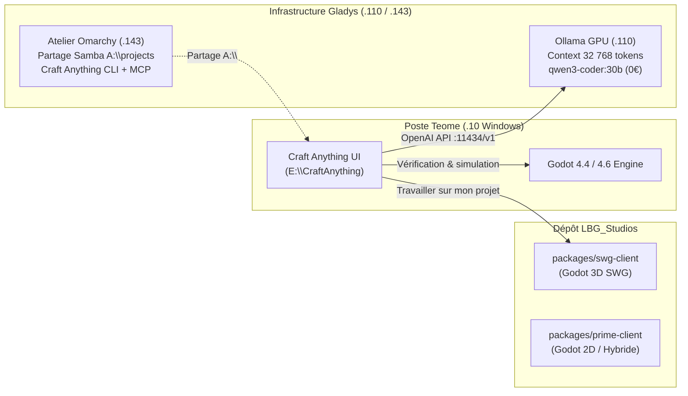

# Craft Anything & Gladys Studio Pipeline

**Date** : 2026-11-27  
**Statut** : Document opérationnel d'intégration (O1 / O2)  
**Machine de Dev / Atelier** : `.143` (Omarchy Linux)  
**Poste Teome** : `.10` (Windows x64 / `E:\CraftAnything`)  
**Moteur IA Local 0€** : Ollama RTX `.110:11434` (`huihui_ai/qwen3-coder-abliterated:30b`)  

---

## 1. Vue d'Ensemble

**Craft Anything** (`storytold/craft-anything` v0.6.1) est intégré dans l'écosystème **Gladys / LBG Studios** comme outil d'ingénierie inverse, de rétro-conception et d'amélioration modulaire de nos clients Godot 4 (`prime-client`, `swg-client`).

Il combine l'analyse de cibles logicielles existantes (probes d'inspection, extraction de tokens de design, hiérarchie de scènes) et la génération assistée par agent de code (Claude Code local / Ollama 0€) avec boucle de feedback et validation visuelle/fonctionnelle.



---

## 2. Installations & Déploiements

### 2.1. Sur l'Atelier Omarchy (`.143`)
- **Binaires** : `/home/lbg/.local/bin/craft-anything` et `craft-anything-cli`.
- **Outil d'Orchestration Gladys** : `tools/gladys_craft_anything.py` (CLI d'automatisation Gladys avec timeout 1800s et profils Ollama 30b/14b).
- **Intégrations MCP** : Enregistré dans `Claude Code`, `Antigravity`, `Cursor`, `Codex`, `OpenCode`, `VS Code`.
- **Skills** : Installés dans `~/.agents/skills/craft-anything/` et `~/.claude/skills/craft-anything/`.
- **Backends IA configurés (`~/.config/craft-anything/config.toml`)** :
  - `Claude Code` (CLI locale).
  - `Ollama 110 (Gladys)` : `huihui_ai/qwen3-coder-abliterated:30b` avec `timeout_secs = 1800`.
  - `Ollama 110 (Gladys 14b)` : `huihui_ai/qwen2.5-coder-abliterate:14b` avec `timeout_secs = 1800`.

### 2.2. Sur le Poste Windows (`.10`)
- **Répertoire d'installation** : `E:\CraftAnything\` (version portable autonome 64-bit).
- **Raccourci Bureau** : `Craft Anything.lnk` pointant vers `E:\CraftAnything\craft-anything.exe`.
- **Dossier de déploiement réseau** : `\\192.168.0.143\projects\CraftAnything_Windows\`.
- **Script de synchronisation** : `INSTALLER_SUR_E.cmd`.

---

## 3. Réglage Critique : Contexte Ollama (4096 -> 32 768 tokens)

Les tâches de reconstruction de code et de lecture d'arbres de scènes dépassent régulièrement la limite par défaut de 4096 tokens d'Ollama.

### Remédiation appliquée sur `.110` :
Dans `/etc/systemd/system/ollama.service.d/override.conf` :
```ini
[Service]
Environment="OLLAMA_HOST=0.0.0.0:11434"
Environment="OLLAMA_NUM_THREADS=8"
Environment="OLLAMA_MAX_LOADED_MODELS=1"
Environment="OLLAMA_NUM_PARALLEL=1"
Environment="OLLAMA_CONTEXT_LENGTH=32768"
```
Rechargé via `sudo systemctl daemon-reload && sudo systemctl restart ollama`.

---

## 4. Modes d'Utilisation Recommandés

1. **Rétro-conception de sous-systèmes SWG** :
   - Cibles recommandées : menu radial (`swg_radial_menu.gd`), système HAM (`Health / Action / Mind`), barres de statut, inventaire Paperdoll.
2. **Amélioration de notre client existant** :
   - Onglet **« Travailler sur mon projet »** dans l'UI.
   - Sélection du dossier `A:\LBG_Studios\packages\swg-client` ou `J:\swgemu\clients\swg-client`.
   - Cadrage strict des prompts sur des scripts GDScript ciblés.
3. **Contrôle Qualité & Tests CI** :
   - Après chaque itération de Craft Anything, exécuter la suite de tests headless Godot :
     ```bash
     bash tools/ci_godot_headless.sh
     ```
