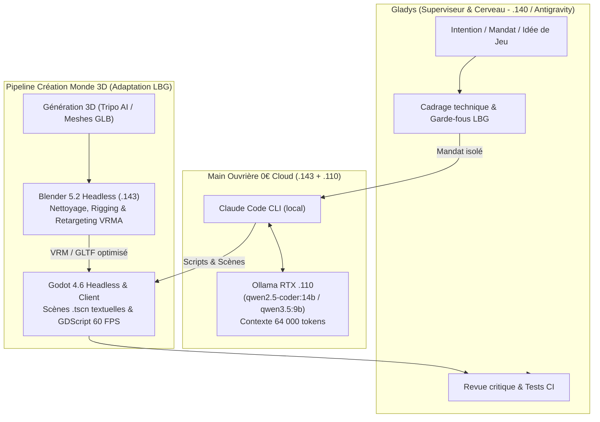

# Gladys Studio Pipeline — Intégration Claude Code Local 0€ & Usine de Jeu 3D

**Date** : 2026-11-14  
**Statut** : Guide Opérationnel & Compétence Gladys (O1/O2)  
**Inspiration** :  
- [Cedric Oden : *Claude Code gratuit et illimité (Ollama local)*](https://www.youtube.com/watch?v=iakl2AAZqWM)  
- [MechaPizzAI : *Créer un jeu Steam avec IA (Claude Code + 3D + Moteur)*](https://www.youtube.com/watch?v=qyfr1hzHiRk)  
**Alignement LBG Studios** : 100% Souverain, 0€ Cloud, Godot 4.6 Headless au lieu d'Unity.

---

## 1. Vue d'Ensemble pour l'Organisme Gladys

Ces deux approches viennent enrichir directement les capacités d'action de **Gladys** (le cerveau global) et de ses effecteurs sur l'Atelier Omarchy (`.143`) :



---

## 2. Pilier 1 : Claude Code Gratuit & Illimité via Ollama (.110)

### 2.1. Le Principe
- **L'outil (la carrosserie)** : La CLI officielle Claude Code (`@anthropic-ai/claude-code`) installée en `/home/lbg/.local/bin/claude`. Elle apporte les outils système de lecture de fichiers, diffs git, recherche regex, bash et gestion de contexte.
- **Le moteur (le cerveau local 0€)** : Le serveur Ollama sur **`192.168.0.110:11434`** avec la carte graphique RTX locale.
- **Le réglage critique (Contexte 64k)** : Pour qu'un agent de code soit efficace sans tronquer les fichiers, la fenêtre de contexte (`num_ctx`) doit être portée à **64 000 tokens** (ou 32 000 minimum selon la VRAM allouée).

### 2.2. Modèles Recommandés sur .110
- `huihui_ai/qwen2.5-coder-abliterate:14b` : Le champion du code local, excellent en GDScript, Python, C++ et JSON.
- `huihui_ai/qwen3.5-abliterated:9b` : Modèle multimodal ultra-rapide avec raisonnement logique.

### 2.3. Lancement Rapide (Wrapper LBG)
Un script de lancement dédié est disponible dans [`tools/launch_claude_local.sh`](../tools/launch_claude_local.sh) :
```bash
bash tools/launch_claude_local.sh "Refactorise le module X en respectant les règles du repo"
```

---

## 3. Pilier 2 : Le Pipeline de Studio Jeu 3D Autonome

Dans sa vidéo, MechaPizzAI utilise Unity + C#.  
Chez **LBG Studios**, nous transposons et surpassons cette méthode grâce à nos forces intrinsèques :

| Composant | Méthode MechaPizzAI (Tuto) | Méthode LBG Studios (Gladys) | Avantage LBG |
|---|---|---|---|
| **Chef d'Orchestre** | Claude Code (Cloud payant) | Claude Code local (.110) ou Antigravity | **0 € de coût récurrent**, sans limites d'utilisation |
| **Générateur 3D** | Tripo AI (Génération GLB) | Tripo AI API / Générateur local | Assets 3D légers et optimisés low-poly |
| **Traitement 3D** | Import manuel Blender | **Blender 5.2 headless scripté (.143)** | Zéro clic manuel : normalisation d'armature automatique |
| **Moteur de Jeu** | Unity (Lourd, binaire fermé) | **Godot 4.6 headless (`prime-hub` :8787)** | Fichiers scènes `.tscn` textuels (parfaits pour les LLM), 400ms de boot, 0 GPU requis |
| **Animation** | Mixamo | **222+ animations VRMA natives** (dont danses Star Wars Galaxies SOE) | Déjà dans le monorepo, 100% compatibles VRM |

---

## 4. Protocole d'Action pour Gladys

Quand Teome demande à Gladys d'ajouter une feature, un mini-jeu ou une nouvelle zone 3D :

1. **Phase 1 : Conception & Architecture (Gladys)** :
   - Définit le cahier des charges, les nœuds Godot 4 requis et les conventions GDScript.
2. **Phase 2 : Exécution du Code (Claude Code Local / Cline 0€)** :
   - Invoqué sur `.143` pour écrire les scripts `.gd`, les contrôleurs ou les shaders.
3. **Phase 3 : Injection des Assets 3D** :
   - Récupération du modèle 3D brut (.glb).
   - Passage dans le pipeline Blender headless pour calibrer l'échelle, les pivots et le format GLTF/VRM.
4. **Phase 4 : Validation Automatisée (CI)** :
   - Exécution immédiate des tests Godot headless : `bash tools/ci_godot_headless.sh`.
   - Rapport clair présenté à Teome par Lia.
