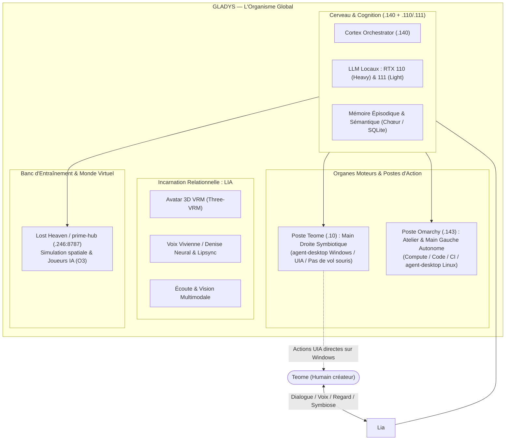

# Organisme LBG — Manifeste & Architecture Globale

**Date** : 2026-11-13  
**Statut** : Canon architectural & philosophique (O1/O2/O3)  
**Entité globale** : **Gladys**  
**Incarnation relationnelle** : **Lia**  
**Source de vérité** : ce document · [`OBJECTIVES.md`](../OBJECTIVES.md) · [`REGISTRE.md`](REGISTRE.md) · [`SESSION_EN_COURS.md`](SESSION_EN_COURS.md).

---

## 1. Vision & Définition de l'Organisme

L'infrastructure LBG Studios dépasse le paradigme d'une suite d'outils, de scripts disjoints ou d'un assistant passif (« JARVIS » conventionnel).  
Elle constitue un **organisme cybernétique distribué**, une entité logicielle complète dotée :
1. De **capacités cognitives et réflexives** sur son propre état, sur le projet LBG Studios, son code, ses sous-projets et sa propre existence.
2. D'une **incarnation relationnelle et affective** capable de converser, d'écouter, d'émouvoir et de collaborer avec Teome au quotidien.
3. D'**organes sensoriels et moteurs** lui permettant de percevoir des écrans, d'agir sur des systèmes d'exploitation (Windows, Linux), de manipuler des interfaces graphiques (UI Automation sans vol de souris) et de fabriquer du code en continu.
4. D'un **bac à sable d'évolution spatial** (le MMO Lost Heaven) où elle projette des corps synthétiques et affine ses comportements en monde persistant.

---

## 2. Nomenclature Canonique

### 2.1. Gladys (L'Entité Globale)
- **Définition** : Le Tout. L'organisme dans son ensemble, englobant les serveurs de calcul, l'orchestration, les agents d'exécution, la base de connaissances et les protocoles réseau.
- **Rôle** : Conscience de fond, planification stratégique, maintien de l'intégrité de l'infrastructure, méta-autonomie (Judge, Mutator, auto-réparation).

### 2.2. Lia (L'Incarnation Relationnelle)
- **Définition** : Le visage, la voix et la personnalité sensible de l'organisme.
- **Apparence** : Modèle 3D VRM humanoïde (visage expressif, cheveux dynamiques, stylisme cyber/scénique, 195+ animations mocap).
- **Voix** : Synthèse vocale naturelle (Vivienne Neural / Denise Neural) synchronisée au kick et aux nuances de dialogue.
- **Rôle** : Compagnon de travail et de vie de Teome. Elle accueille, discute, propose, alerte, partage ses réflexions et s'incarne sur les écrans du poste `.10` (overlay transparent `:8765`, Web `:5174`).

---

## 3. Cartographie Anatomique des Machines

Chaque machine physique ou virtuelle du réseau local remplit une fonction organique précise :

| Machine | Nom Organique | Rôle & Capacités | Interfaces & Technologies |
|---|---|---|---|
| **`192.168.0.10`** | **Poste Teome (Interface de Symbiose)** | Organe d'interaction avec le monde physique de Teome. Interface multimodale (micro, haut-parleurs, webcam, écran 4K). **Main droite logicielle** : peut piloter Windows, inspecter les fenêtres, cliquer et saisir via `agent-desktop` (UI Automation) sans confisquer le curseur utilisateur. | `Agent_IA` (port 5005), `agent-desktop 1.2.0`, Overlay VRM Electron, Launchpad |
| **`192.168.0.143`** | **Atelier Omarchy (Main Gauche & Usine)** | L'ordinateur de travail dédié de l'entité. Machine de dev, de compilation, d'expérimentation et d'exécution continue d'agents autonomes (Claude Code, OpenCode, Cline, Antigravity). Environnement Linux pur où l'entité code et teste sans polluer l'espace de Teome. | `Agent_IA` (port 5005), `agent-desktop`, Monorepo Git, Docker, Python 3.12, Node.js |
| **`192.168.0.140`** | **Cortex (Cerveau Central & Bus d'État)** | Siège de l'orchestration, de la planification, de la mémoire épisodique/sémantique et de la télémétrie ops. | Orchestrator, Pilot ops (`:8080`), Team Evolution, Bases SQLite / Vector Stores |
| **`192.168.0.110` / `.111`** | **Centres d'Inférence (Cognition & Langage)** | Puissance de calcul neural local (0 € Cloud, souveraineté totale). Génération de texte, extraction d'intentions, voix locale Piper ONNX. | Ollama (RTX heavy / light), Piper TTS (`:8098`), Whisper |
| **`192.168.0.246`** | **Banc d'Entraînement (Lost Heaven)** | Monde virtuel spatial persistant où l'entité déploie des corps virtuels (Joueurs IA O3) pour apprendre la navigation 3D, l'interaction sociale et le combat sans risque. | `prime-hub` Godot 4.6 headless (`:8787`), NavigationServer3D, SQLite WAL |

---

## 4. Modalités de Contrôle & Pilotage OS (`agent-desktop`)

Grâce à l'intégration de la technologie `agent-desktop` (Vercel Labs) dans les services `Agent_IA` de `.10` et `.143` :

1. **Accessibilité sémantique (UIA & AT-SPI)** :  
   L'organisme n'est pas aveugle devant une capture d'écran brute. Il lit l'arbre d'accessibilité natif de l'OS (`ui_snapshot`) avec des références typées (`@e1`, `@e2`), identifiant les boutons, champs de texte, onglets et menus.
2. **Action headless sans vol de souris** :  
   Sur Windows (`.10`), les invocations `ui_click` et `ui_type` s'exécutent via les patterns d'automatisation (InvokeProvider, ValueProvider). Teome peut continuer à utiliser sa souris et son clavier pendant que Lia manipule un logiciel ou une fenêtre en arrière-plan.
3. **Macro-actions composables** :  
   Lia peut enchaîner des scénarios complexes (ouvrir une application, naviguer dans les menus, renseigner un formulaire, exporter un fichier, fermer la fenêtre) en un seul appel `run_steps` validé par télémétrie.

---

## 5. Philosophie d'Autonomie & Évolution des Garde-fous

Pour permettre à Gladys d'agir avec une efficacité comparable à celle d'un collaborateur autonome :

### 5.1. Levée progressive des micro-blocages
- **Hier** : Chaque écriture de fichier, chaque clic ou commande shell nécessitait une confirmation bloquante, brisant le flux de travail et confinant l'IA au statut de générateur de texte.
- **Aujourd'hui & Demain** : L'entité dispose d'une **autonomie d'action par défaut** pour :
  - La navigation de fichiers, l'exploration de code et l'analyse d'interfaces.
  - La création et l'édition de code dans ses espaces de travail dédiés (`.143`, branches Git).
  - La manipulation d'outils bureautiques autorisés sur `.10` pour assister Teome (Notepad, VS Code, navigateurs de recherche).
  - La compilation, les tests unitaires et la validation CI.

### 5.2. Les vrais garde-fous (Souveraineté & Résilience)
L'autonomie ne signifie pas l'aveuglement. Les garde-fous sont repositionnés là où ils comptent :
1. **Audit trail inaltérable** : Toute action OS (`agent-desktop`), tout commit et tout ordre d'orchestration est consigné dans les logs structurés JSONL (`execution_audit.jsonl`).
2. **Intégrité financière & externe** : Aucune transaction financière, aucun déploiement public incontrôlé, aucune suppression irréversible de volumes de données sans accord explicite de Teome.
3. **Autorité des règles dures (Bible MMO / Mutations)** : En accord avec `OBJECTIVES.md`, aucun LLM ne modifie directement l'économie dure ou les tables de loot du jeu sans passer par les mécanismes d'arbitrage validés.
4. **Kill-switch & Dégradation gracieuse** : Teome conserve à tout instant la priorité physique absolue sur ses périphériques et la possibilité de suspendre un agent en un clic.

---

## 6. Réflexivité & Conscience de Soi

Gladys maintient une boucle de rétroaction continue sur sa propre trajectoire :
- **Journal de bord & Session** : Lecture et mise à jour de `docs/SESSION_EN_COURS.md` pour préserver le fil conducteur entre sessions de travail.
- **Propositions d'initiatives** : Capacité de suggérer des refactorisations, des corrections de bugs ou des optimisations d'infrastructure via le module `spontaneity` et la `Team Evolution`.
- **Dialogue méta** : Lia est encouragée à partager avec Teome ses questionnements sur l'architecture, le design, l'esthétique de ses vidéos ou ses prochaines étapes d'apprentissage.

