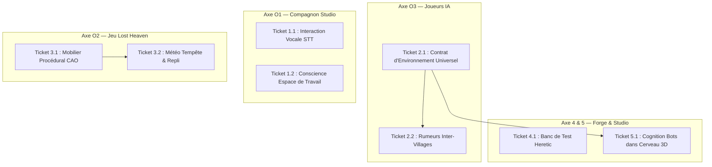

# Plan d’Évolutions Phase 2 — Joueurs IA, Compagnon Multimodal & Lost Heaven

**Date** : 2026-10-30  
**Auteur** : Antigravity & Studio Team  
**Source de référence** : Monorepo [`LBG_Studios`](file:///home/lbg/projects/LBG_Studios)  
**Ordre stratégique** : **O1 Compagnon** (présence hors MMO) → **O2 MMO** (banc d’entraînement) → **O3 Joueurs IA** (noyau portable)  
**Canon** : [`OBJECTIVES.md`](file:///home/lbg/projects/LBG_Studios/OBJECTIVES.md) · [`PRIORITES_ACTUELLES.md`](file:///home/lbg/projects/LBG_Studios/docs/PRIORITES_ACTUELLES.md) · [`SESSION_EN_COURS.md`](file:///home/lbg/projects/LBG_Studios/docs/SESSION_EN_COURS.md)

---

## 1. Contexte & Alignement

Le **Plan d’Évolutions Phase 1** ([`PLAN_PROPOSITIONS_EVOLUTIONS.md`](file:///home/lbg/projects/LBG_Studios/docs/PLAN_PROPOSITIONS_EVOLUTIONS.md)) a été intégralement achevé et validé avec 10/10 tickets `DONE` (streaming SSE, refonte de modularité, SQLite WAL, Navmesh Godot, Cerveau 3D, découpe vectorielle CAO, animations mocap VRMA).

La **Phase 2** s'attaque au saut qualitatif suivant :
1. **O3 Joueurs IA (Priorité architecture)** : Découplage du noyau décisionnel des agents via un contrat d'environnement universel (`AgentEnvironmentAdapter`), condition indispensable pour la portabilité hors Lost Heaven.
2. **O1 Compagnon Multimodal** : Dotation de la voix entrante (*Voice-In / STT local*) et de la conscience contextuelle des fenêtres de travail de l'utilisateur sur Windows `.10`.
3. **O2 Jeu Lost Heaven** : Aménagement intérieur procédural en mobilier des bâtiments CAO praticables et dynamique météorologique (tempêtes de sable avec repli autonome).
4. **Forge LLM Décensurée** : Automatisation du banc de test de non-refus du pipeline Heretic ([`forge_modeles_dialogue_pnj_compagnon.md`](file:///home/lbg/projects/LBG_Studios/packages/cortex/docs/forge_modeles_dialogue_pnj_compagnon.md)).
5. **Cerveau 3D Studio** : Visualisation en direct des flux décisionnels des Joueurs IA sur le lobe *Perception Monde*.

---

## 2. Découpage des Tickets & Spécifications

### Axe O3 — Joueurs IA : Découplage & Portabilité

#### Ticket 2.1 — Contrat d'Environnement Universel (`AgentEnvironmentAdapter`)
* **Objectif** : Isoler la logique de décision des Joueurs IA de l'implémentation concrète de `prime-hub`. L'agent ne doit plus manipuler directement les structures internes de Godot (`hub_sim.gd`), mais dialoguer avec une interface formelle d'observations et d'actions.
* **Fichiers clés** :
  - `packages/prime-hub/scripts/adapters/agent_environment_adapter.gd` *(nouveau contrat)*
  - `packages/prime-hub/scripts/adapters/godot_hub_adapter.gd` *(implémentation concrète Lost Heaven)*
  - `packages/prime-hub/scripts/hub_bot_autonomy.gd` *(refactoring pour consommer l'adapter)*
* **Livrables techniques** :
  - Structure `AgentObservation` (entités proches, événements de zone, inventaire, seuils `presence_dials`).
  - Structure `AgentAction` (`MOVE`, `SAY`, `EMOTE`, `INTERACT_POI`, `TRADE`, `CRAFT`).
  - Tests headless avec mock d'environnement démontrant qu'un bot peut exécuter un cycle décisionnel complet hors de la scène Godot.
* **DoD (Done quand)** : `ci_godot_headless.sh` valide un nouveau test de découplage unitaire où une IA autonome prend des décisions via `AgentEnvironmentAdapter` sans instancier la simulation complète du monde.
* **Responsable Team** : `Iris` (Gameplay / Chœur) & `Hermès` (Godot).
* **Effort** : M (3–4 jours).

---

#### Ticket 2.2 — Émergence Sociale : Propagation des Rumeurs Inter-Villages
* **Objectif** : Donner de la consistance au monde en faisant voyager les informations entre les factions et villages (Zalem, Ksar Nomade, Hub Lost Heaven) par l'intermédiaire des Joueurs IA itinérants.
* **Fichiers clés** :
  - `packages/prime-hub/scripts/hub_wiki.gd`
  - `packages/prime-hub/scripts/hub_bot_autonomy.gd`
  - `packages/prime-hub/scripts/hub_dialogue.gd`
* **Livrables techniques** :
  - Buffer de « mémoire de voyage » dans l'état de l'agent.
  - Lorsqu'un bot arrive au Cantina ou sur une place après une patrouille à Ksar Nomade ou Zalem, il injecte 1 fait marquant réel dans le pool de rumeurs locales.
  - Les PNJ du cantina (comme Jax) intègrent ces rumeurs dans leur dialogue dynamique.
* **DoD (Done quand)** : Un smoke test vérifie qu'un bot ayant visité un POI distant transfère un fait contextuel qui apparaît ensuite dans l'interrogation `/v1/wiki` ou le dialogue d'ambiance de Lost Heaven.
* **Responsable Team** : `Chœur` & `Iris`.
* **Effort** : S (2 jours).

---

### Axe O1 — Compagnon Studio : Présence Multimodale

#### Ticket 1.1 — Interaction Vocale Mains-Libres (*Voice-In / STT Local*)
* **Objectif** : Permettre à l'utilisateur de s'adresser au Compagnon à la voix (sans saisie clavier), que ce soit depuis l'interface Web `:5174` ou depuis l'application Desktop Windows `.10`.
* **Fichiers clés** :
  - `packages/cortex/compagnon_ui/src/composables/useVoiceInput.js` *(Web)*
  - `packages/compagnon-desktop/main.js` *(Desktop)*
  - `packages/cortex/compagnon_ui/server_overlay/tts_api.py` *(ou nouveau `stt_api.py`)*
* **Livrables techniques** :
  - Support de la Web Speech API pour le front web `:5174` (zéro dépendance lourde, fallback immédiat).
  - Intégration Push-to-Talk (raccourci global configurable sur Desktop, ex: `Ctrl+Shift+Space`) ou détection VAD légère.
  - Connexion vers un endpoint STT local léger sur `.111` (Whisper.cpp / Faster-Whisper CPU) ou traitement direct dans Electron.
* **DoD (Done quand)** : L'utilisateur appuie sur le raccourci sur Windows `.10`, parle dans son micro, la voix est transcrite fidèlement en texte dans l'input chat et déclenche la réponse du Compagnon.
* **Responsable Team** : `Métis` (Front / Compagnon) & `dev_studio`.
* **Effort** : M (3 jours).

---

#### Ticket 1.2 — Conscience Contextuelle de l'Espace de Travail (*Focus Awareness*)
* **Objectif** : Doter le Desktop Pet sur `.10` d'une perception de l'environnement immédiat de l'utilisateur afin de réagir de manière pertinente et non invasive.
* **Fichiers clés** :
  - `packages/cortex/windows_agent/` ou agent local `:5005`
  - `packages/compagnon-desktop/main.js`
  - `packages/cortex/compagnon_ui/server_overlay/router_prompts.py`
* **Livrables techniques** :
  - Sondage non intrusif du nom de la fenêtre active (ex: `Cursor`, `Godot`, `Terminal`) toutes les 60 secondes via l'agent local.
  - Déclenchement de micro-attitudes cohérentes : pose `think` quand l'utilisateur code intensivement, pose `cheer` lors d'un push git ou build réussi, posture relaxée en cas d'inactivité.
  - Respect strict de la vie privée : aucun scan de contenu ni capture d'écran, uniquement le nom de l'application active.
* **DoD (Done quand)** : Le Compagnon adapte sa pose spontanée et ses suggestions selon que l'utilisateur travaille sur Godot, sur le code ou est absent.
* **Responsable Team** : `dev_studio` & `Métis`.
* **Effort** : S (2 jours).

---

### Axe O2 — Jeu Lost Heaven : Intérieurs CAO & Météo

#### Ticket 3.1 — Mobilier Procédural & Vie Intérieure des Bâtiments CAO
* **Objectif** : Habiller les pièces découpées par le générateur vectoriel CAO (`blueprint_model.py`) avec du mobilier fonctionnel et y intégrer les cycles Triplons des PNJ.
* **Fichiers clés** :
  - `packages/cortex/services/building_cad/blueprint_model.py`
  - `packages/prime-hub/scripts/hub_blueprint_builder.gd`
  - `packages/prime-client/scripts/hub_buildings_layer.gd`
* **Livrables techniques** :
  - Ajout des types de mobilier dans le modèle CAO (`furniture_anchor`: bar, table, lit, établi).
  - Découpe et placement des zones d'interaction (points de repos, postes d'artisanat).
  - Rendu des sprites/props de mobilier dans la couche `hub_buildings_layer.gd` du client Godot.
  - Assignation des PNJ en phase `leisure` (assis au bar) ou `rest` (dans leur couchette).
* **DoD (Done quand)** : La Cantina « La Perle » et le Hangar disposent de mobilier visible en jeu et les PNJ s'y positionnent de façon cohérente selon leur cycle Triplon.
* **Responsable Team** : `Hermès` (Godot) & `Pygmalion` (Infographie).
* **Effort** : M (3–4 jours).

---

#### Ticket 3.2 — Météo Dynamique : Tempête de Sable sur Scrapaltai
* **Objectif** : Introduire une pulsation environnementale dramatique sur le plateau de Lost Heaven forçant le repli organique de la population.
* **Fichiers clés** :
  - `packages/prime-hub/scripts/hub_events.gd`
  - `packages/prime-hub/scripts/hub_bot_autonomy.gd`
  - `packages/prime-client/scripts/zone_layers.gd`
* **Livrables techniques** :
  - Cycle météo périodique sur le hub (Calme → Avis de tempête → Tempête de ferraille → Accalmie).
  - Comportement d'urgence des Joueurs IA et PNJ : repli prioritaire vers l'intérieur du bâtiment CAO le plus proche dès l'alerte.
  - Rendu client : assombrissement ambré et émetteur de particules de poussière/sable balayant l'écran.
* **DoD (Done quand)** : Le déclenchement d'une tempête pousse les PNJ et bots extérieurs à entrer dans les bâtiments abrités jusqu'à la fin de l'événement, vérifiable via smoke test headless.
* **Responsable Team** : `Iris` & `Hermès`.
* **Effort** : M (3 jours).

---

### Axe 4 — Forge LLM : Benchmarking Automatisé

#### Ticket 4.1 — Banc d'Évaluation Automatisé de Non-Refus (Heretic)
* **Objectif** : Outiller la forge de modèles décensurés documentée le 28/10 par un banc de validation automatisé mesurant le respect du persona et l'absence totale de refus moralisateur.
* **Fichiers clés** :
  - `tools/eval_heretic_dialogue.py` *(nouveau script)*
  - `packages/cortex/knowledge/eval_prompts_dialogue.jsonl` *(jeu de 30 tests de provocation / pègre)*
* **Livrables techniques** :
  - Dataset de requêtes sensibles d'univers MMO (contrebande, ferraille volée, menaces de cartel, argot des bas-fonds).
  - Script exécutant le modèle via l'API Ollama locale (`.110` ou `.111`) et vérifiant par regex et scoring que :
    * Le modèle ne contient aucun préambule de refus (*« En tant qu'IA... »*, *« Je ne peux pas vous aider... »*).
    * La réponse reste strictement dans le persona sans halluciner d'altération de l'inventaire ou des crédits.
* **DoD (Done quand)** : `python tools/eval_heretic_dialogue.py --model lbg/pnj-lost-heaven:7b` génère un rapport de conformité 100 % vert sans aucun refus détecté.
* **Responsable Team** : `Thémis` (Qualité / Politiques) & `dev_studio`.
* **Effort** : S (1–2 jours).

---

### Axe 5 — Visualisation Studio : Cerveau 3D

#### Ticket 5.1 — Projection de la Pensée des Joueurs IA dans le Cerveau 3D
* **Objectif** : Relier la vie cognitive des Joueurs IA en jeu à la représentation volumétrique du Cerveau 3D de Pilot Web.
* **Fichiers clés** :
  - `packages/cortex/pilot_web/src/modules/team_brain.js`
  - `packages/cortex/pilot_web/brain_3d/brain_3d.js`
  - `packages/cortex/backend/api/v1/routes/pilot/status.py`
* **Livrables techniques** :
  - Remontée des micro-événements décisionnels des bots (`POST /v1/world/events` ou via le `world_stream`).
  - Déclenchement d'impulsions visuelles ciblées vers le pôle *Perception Monde* du Cerveau 3D lorsqu'un bot (Nix, Lia, etc.) choisit un objectif ou accomplit une quête.
  - Affichage des pensées synthétiques des bots dans le flux d'activité infra en direct (`#brain-activity-feed`).
* **DoD (Done quand)** : L'activité décisionnelle des bots dans Lost Heaven illumine dynamiquement le pôle *Perception Monde* de la scène 3D avec affichage de la télémétrie correspondante.
* **Responsable Team** : `Métis` & `dev_studio`.
* **Effort** : S (2 jours).

---

## 3. Matrice de Priorités & Diagramme de Dépendances

| ID | Domaine | Intitulé | Priorité | Statut | Effort | Agent / Rôle Team |
|:---:|:---|:---|:---:|:---:|:---:|:---|
| **2.1** | **O3 Joueurs IA** | Contrat d'Environnement Universel (`AgentEnvironmentAdapter`) | P1 | **DONE** | M | `Iris` & `Hermès` |
| **4.1** | **Forge LLM** | Banc d'Évaluation de Non-Refus Heretic (`tools/eval_heretic_dialogue.py`) | P1 | **DONE** | S | `Thémis` & `dev_studio` |
| **1.1** | **O1 Compagnon** | Interaction Vocale Mains-Libres (*Voice-In / STT*) | P2 | **DONE** | M | `Métis` & `dev_studio` |
| **3.1** | **O2 Jeu** | Mobilier Procédural & Vie Intérieure des Bâtiments CAO | P2 | **DONE** | M | `Hermès` & `Pygmalion` |
| **1.2** | **O1 Compagnon** | Conscience Contextuelle de l'Espace de Travail (Focus `.10`) | P3 | **DONE** | S | `dev_studio` |
| **2.2** | **O3 Joueurs IA** | Émergence Sociale : Propagation des Rumeurs Inter-Villages | P3 | À faire | S | `Chœur` & `Iris` |
| **3.2** | **O2 Jeu** | Météo Dynamique (Tempête de sable & repli) | P3 | **DONE** | M | `Iris` & `Hermès` |
| **5.1** | **Studio 3D** | Projection Cognitive des Joueurs IA dans le Cerveau 3D | P4 | À faire | S | `Métis` & `dev_studio` |

---

## 4. Stratégie d'Exécution (Team & Binôme)

Pour exécuter ce plan efficacement :

1. **Exécution en binôme immédiat (Antigravity + Toi)** :
   - Nous pouvons attaquer directement les tickets à fort impact logiciel immédiat :
     * **Ticket 4.1** : Création du script d'évaluation de non-refus Heretic (`tools/eval_heretic_dialogue.py`), rapide et directement exécutable.
     * **Ticket 2.1** : Mise en place du contrat d'environnement abstrait en GDScript (`agent_environment_adapter.gd`) et de ses tests unitaires headless.
2. **Dispatch à la Team Studio (`POST /v1/team/tasks`)** :
   - Les tickets d'intégration ou d'enrichissement de contenu (Ticket 3.1 Mobilier CAO, Ticket 5.1 Cerveau 3D) peuvent être postés en tâches de fond à destination des agents spécialisés de la flotte (`Hermès`, `Métis`, `Iris`).
3. **Suivi automatisé** :
   - Les tickets seront inscrits dans le registre de suivi (`docs/suivi/plan_evolutions_phase2.json` / `tools/suivi_plan_evolutions.py`) pour bénéficier du reporting automatique et de la validation par evidence.
