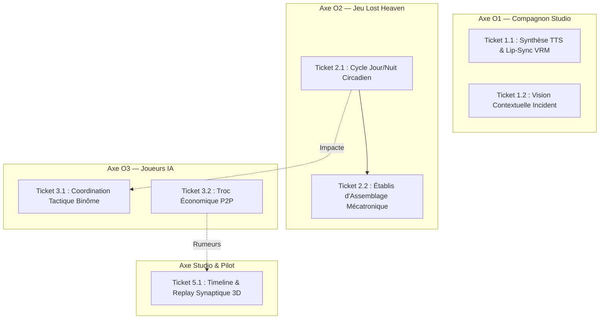

# Plan d’Évolutions Phase 3 — Synthèse Vocale & Lip-Sync, Cycles Vivants MMO & Coopération Tactique IA

**Date** : 2026-10-31  
**Auteur** : Antigravity & Studio Team  
**Source de référence** : Monorepo [`LBG_Studios`](file:///home/lbg/projects/LBG_Studios)  
**Ordre stratégique** : **O1 Compagnon** (présence hors MMO) → **O2 MMO** (banc d’entraînement) → **O3 Joueurs IA** (noyau portable)  
**Canon** : [`OBJECTIVES.md`](file:///home/lbg/projects/LBG_Studios/OBJECTIVES.md) · [`PRIORITES_ACTUELLES.md`](file:///home/lbg/projects/LBG_Studios/docs/PRIORITES_ACTUELLES.md) · [`SESSION_EN_COURS.md`](file:///home/lbg/projects/LBG_Studios/docs/SESSION_EN_COURS.md)

---

## 1. Contexte & Bilan des Phases Précédentes

- **Phase 1** ([`PLAN_PROPOSITIONS_EVOLUTIONS.md`](file:///home/lbg/projects/LBG_Studios/docs/PLAN_PROPOSITIONS_EVOLUTIONS.md)) : **10/10 tickets DONE** (streaming SSE, refonte de modularité, persistance SQLite WAL, Navmesh Godot 3D, Cerveau 3D volumétrique, CAO vectorielle des bâtiments, danses mocap VRMA).
- **Phase 2** ([`PLAN_EVOLUTIONS_PHASE2.md`](file:///home/lbg/projects/LBG_Studios/docs/PLAN_EVOLUTIONS_PHASE2.md)) : **8/8 tickets DONE** (Contrat universel `AgentEnvironmentAdapter`, banc d'évaluation Heretic non-refus, mobilier procédural & vie intérieure CAO, saisie vocale STT, focus awareness fenêtres actives, météo dynamique tempête de sable, propagation des rumeurs inter-villages, projection cognitive des Joueurs IA dans le Cerveau 3D).

La **Phase 3** capitalise sur ces fondations solides pour franchir un nouveau cap d'immersion, de réalisme comportemental et d'autonomie bienveillante :
1. **O1 Compagnon Studio** : Passage au dialogue vocal bilatéral complet avec **synthèse vocale TTS locale expressive** et **synchronisation labiale dynamique (visèmes morph targets VRM)**, complété par la **vision contextuelle ponctuelle** (OCR/VLM local sur incident).
2. **O2 Jeu Lost Heaven** : Transition vers un monde véritablement circadien avec un **cycle jour/nuit dynamique & éclairage des lanternes**, et mise en service des **établis d'assemblage mécatronique** pour le métier de Récupérateur.
3. **O3 Joueurs IA** : Émergence collective via la **coordination tactique en binôme (escorte & couverture mutuelle)** et le **troc économique P2P entre bots** (échange de ferraille contre eau/rations).
4. **Visualisation Studio** : Introduction d'une **timeline chronologique et d'un replay synaptique 3D** dans Pilot Web.

---

## 2. Découpage des Tickets & Spécifications Détaillées

### Axe O1 — Compagnon Studio : Présence Multimodale Complète

#### Ticket 1.1 — Synthèse Vocale TTS Locale & Synchronisation des Lèvres (*Voice-Out & Lip-Sync Visèmes VRM*)
* **Priorité** : P1
* **Objectif** : Après avoir doté le Compagnon de l'écoute vocale (STT au Ticket 1.1 Phase 2), lui donner la parole audible tout en animant les lèvres de son avatar 3D VRM 1.0 en synchronisation parfaite avec les syllabes prononcées.
* **Fichiers clés** :
  - `packages/cortex/backend/services/tts_service.py` *(nouveau service TTS unifié)*
  - `packages/cortex/backend/api/v1/routes/tts.py` *(routes `/v1/tts/synthesize` et `/v1/tts/voices`)*
  - `packages/cortex/compagnon_ui/src/lib/vrm_pet.js` *(analyse audio WebAudio / visèmes morph targets)*
  - `packages/compagnon-desktop/main.js` / `preload.js` *(relais audio Electron)*
* **Livrables techniques** :
  - Moteur TTS résilient : synthèse locale Piper / Kokoro ou fallback Web Speech API du navigateur / client sans latence excessive.
  - Découpage phonèmes → visèmes : mapping des durées et amplitudes sur les 5 formes de bouche canoniques VRM (`aa`, `ih`, `ou`, `ee`, `oh`).
  - Lissage temporel : interpolation douce (lerp) des morph targets à 60 FPS pour éviter tout effet de claquement ou mâchoire saccadée.
  - Contrôle utilisateur : toggle muet / voix dans le menu HUD du compagnon.
* **DoD (Done quand)** : Lorsque le Compagnon répond textuellement dans le chat, un flux audio est joué et l'avatar VRM ouvre et ferme la bouche de manière synchrone et naturelle sur le Web et le bureau Desktop `.10`.
* **Responsable Team** : `Métis` (Front / Compagnon) & `dev_studio`.
* **Effort** : M (3 jours).

---

#### Ticket 1.2 — Vision Contextuelle Ponctuelle sur Demande ou Incident (*OCR & Mini-VLM Local*)
* **Priorité** : P2
* **Objectif** : Étendre le Focus Awareness (Ticket 1.2 Phase 2) en permettant au Compagnon d'analyser visuellement ce que l'utilisateur voit à l'écran lorsqu'il demande explicitement de l'aide (*« Regarde cette erreur »*, *« Inspecte ce bug »*) ou lors d'un crash détecté.
* **Fichiers clés** :
  - `packages/cortex/windows_agent/Agent_IA/executor.py` *(action `capture_active_window_snippet`)*
  - `packages/cortex/backend/services/vision_service.py` *(service d'analyse visuelle locale)*
  - `packages/cortex/compagnon_ui/server_overlay/router_prompts.py` *(injection du contexte visuel)*
* **Livrables techniques** :
  - Capture ciblée sécurisée : capture exclusive de la fenêtre d'édition active ou de la boîte de dialogue d'erreur (jamais l'écran complet non consenti).
  - Analyse locale 0 € : extraction textuelle via OCR rapide ou inférence locale par mini-VLM léger (ex. `moondream2` ou `gemma-4:E4b-qat` vision).
  - Règle de confidentialité : pas de stockage persistant d'images, purge immédiate après analyse en mémoire tampon.
* **DoD (Done quand)** : Une commande vocale ou textuelle demandant « regarde mon écran » transmet un extrait visuel de la fenêtre active, analyse le message d'erreur ou le fragment de code, et guide l'utilisateur sur la cause du problème.
* **Responsable Team** : `dev_studio` & `Métis`.
* **Effort** : S (2 jours).

---

### Axe O2 — Jeu Lost Heaven : Écosystème & Monde Circadien

#### Ticket 2.1 — Cycle Jour / Nuit Circadien & Éclairage Nocturne des Bâtiments CAO
* **Priorité** : P1
* **Objectif** : Remplacer l'éclairage statique actuel par un cycle jour/nuit dynamique (Aube, Zénith, Crépuscule, Nuit) géré par le serveur Godot headless `prime-hub` et répercuté fidèlement sur les clients, modifiant l'ambiance et la faune.
* **Fichiers clés** :
  - `packages/prime-hub/scripts/hub_world_clock.gd` *(nouveau gestionnaire d'horloge circadienne)*
  - `packages/prime-hub/scripts/hub_events.gd` *(intégration avec la météo de Phase 2)*
  - `packages/prime-hub/scripts/hub_sim_views.gd` *(diffusion de `world_time` et `day_phase`)*
  - `packages/prime-client/scripts/zone_layers.gd` & `hub_buildings_layer.gd` *(teinte globale et lueurs des lanternes)*
  - `packages/prime-hub/tools/day_night_selftest.gd` *(test unitaire headless Godot)*
* **Livrables techniques** :
  - Cycle paramétrable (ex: 24 minutes réelles = 24 heures en jeu, ratio 1:60).
  - Éclairage nocturne des bâtiments CAO : les lanternes de La Perle (Cantina) et du Dépôt s'allument à la tombée de la nuit (`night_lanterns_active = true`).
  - Faune et bêtes sauvages : seuil d'agressivité et rayon de détection accrus pour les bêtes du désert la nuit, incitant les bots et joueurs à rester groupés ou sous abri.
* **DoD (Done quand)** : `bash tools/ci_godot_headless.sh` exécute avec succès `day_night_selftest.gd` démontrant la progression de l'horloge, l'allumage automatique des éclairages de nuit et la modulation des alertes de bêtes.
* **Responsable Team** : `Hermès` (Godot) & `Iris` (Gameplay).
* **Effort** : M (3 jours).

---

#### Ticket 2.2 — Métier de Récupérateur : Établis d'Assemblage Mécatronique & Recettes de Terrain
* **Priorité** : P2
* **Objectif** : Rendre interactifs les établis de travail identifiés dans les bâtiments CAO lors du Ticket 3.1 Phase 2 (notamment au Hangar Dépôt Nord) pour permettre la fabrication d'équipements de survie à partir de la ferraille collectée.
* **Fichiers clés** :
  - `packages/prime-hub/scripts/hub_crafting.gd` *(moteur de validation des recettes)*
  - `packages/prime-hub/data/craft/schematics_scrap.json` *(catalogue canonique de recettes de récupération)*
  - `packages/prime-hub/scripts/hub_collision.gd` *(validation de proximité d'ancrage `craft`)*
  - `packages/prime-hub/tools/crafting_schematics_selftest.gd` *(test unitaire headless Godot)*
* **Livrables techniques** :
  - 4 nouvelles recettes canoniques : *Kit de réparation mécatronique*, *Filtre à condensat d'oasis*, *Batterie régulée de ferraille*, *Torche de prospection nocturne*.
  - Respect strict des mutations dures : vérification absolue côté serveur des ingrédients d'inventaire et du temps d'assemblage (0 mutation libre LLM).
  - Animation et posture Triplon : snap du bot ou joueur sur l'établi en posture d'artisanat (`craft`) pendant l'opération.
* **DoD (Done quand)** : Un bot ou joueur à proximité de l'établi du Hangar peut consommer 3 morceaux de ferraille et 1 condensateur usé pour fabriquer un kit de réparation, vérifié par test headless Godot.
* **Responsable Team** : `Hermès` & `Chœur`.
* **Effort** : S (2 jours).

---

### Axe O3 — Joueurs IA : Coopération Tactique & Émergence Sociale

#### Ticket 3.1 — Coordination Tactique en Binôme & Escorte Coopérative (`AgentEnvironmentAdapter`)
* **Priorité** : P1
* **Objectif** : Exploiter le contrat universel `AgentEnvironmentAdapter` mis en place en Phase 2 (Ticket 2.1) pour permettre à deux Joueurs IA de former une escorte tactique (binôme de patrouille ou garde du corps d'un marchand nomade).
* **Fichiers clés** :
  - `packages/prime-hub/scripts/adapters/agent_environment_adapter.gd` *(actions de groupe `FORMATION_FOLLOW`, `COVER_TARGET`)*
  - `packages/prime-hub/scripts/hub_bot_autonomy.gd` *(logique de rôle leader / suiveur & couverture)*
  - `packages/prime-hub/scripts/adapters/godot_hub_adapter.gd` *(résolution spatiale de la formation)*
  - `packages/prime-hub/tools/tactical_escort_selftest.gd` *(test unitaire headless Godot)*
* **Livrables techniques** :
  - Maintien d'une distance de formation dynamique (3 à 6 mètres avec tolérance de terrain).
  - Partage de menace : si le leader est pris pour cible par une hyène du désert, le partenaire bascule immédiatement en posture de diversion ou de défense.
  - Repli synchronisé : en cas de tempête de sable (Ticket 3.2 Phase 2) ou de nuit noire, le binôme se replie ensemble vers le même abri sans dispersion.
* **DoD (Done quand)** : Le test headless `tactical_escort_selftest.gd` prouve qu'un bot suiveur maintient sa position d'escorte derrière un leader et réagit de manière coordonnée face à une menace simulée.
* **Responsable Team** : `Iris` (Gameplay) & `Hermès` (Godot).
* **Effort** : M (3 jours).

---

#### Ticket 3.2 — Économie de Troc P2P & Négociations d'Échanges entre Joueurs IA
* **Priorité** : P2
* **Objectif** : Permettre aux Joueurs IA d'échanger des ressources élémentaires entre eux lorsqu'ils se rencontrent au Cantina « La Perle » ou sur la place centrale, répondant à leurs manques réciproques sans passer par un marchand PNJ.
* **Fichiers clés** :
  - `packages/prime-hub/scripts/hub_trade.gd` *(moteur de troc direct joueur-à-joueur)*
  - `packages/prime-hub/scripts/hub_bot_autonomy.gd` *(estimation des surplus et manques d'inventaire)*
  - `packages/prime-hub/scripts/hub_wiki.gd` *(génération de rumeurs sur les cours du troc)*
  - `packages/prime-hub/tools/barter_trade_selftest.gd` *(test unitaire headless Godot)*
* **Livrables techniques** :
  - Matrice de valeur relative bornée (ex: 2 ferrailles légères = 1 ration d'eau).
  - Protocole d'offre et acceptation : émission de l'offre d'échange, vérification bilatérale de l'inventaire, échange atomique sécurisé sous autorité Godot Hub (zéro duplication, zéro mutation sauvage).
  - Intégration rumeur : après un troc notable, une rumeur est automatiquement consignée dans `HubWiki` (*« Nix a troqué de la ferraille contre des filtres avec Lia au Cantina »*).
* **DoD (Done quand)** : Un bot ayant un excédent de ferraille et un déficit en eau réalise un échange avec un bot partenaire et la transaction est loguée avec intégrité d'inventaire dans `HubDb`.
* **Responsable Team** : `Chœur` (Économie) & `Iris`.
* **Effort** : S (2 jours).

---

### Axe Studio & Pilot : Observabilité Avancée

#### Ticket 5.1 — Replay Chronologique & Timeline Synaptique dans Pilot Web
* **Priorité** : P3
* **Objectif** : Permettre dans le Cerveau 3D (`team_brain.js`) de remonter le temps grâce à une réglette temporelle (Scrubber) pour revoir les impulsions synaptiques, les micro-décisions des Joueurs IA et les alertes environnementales passées.
* **Fichiers clés** :
  - `packages/cortex/pilot_web/src/modules/team_brain.js` *(contrôleur de scrubber et rejeu)*
  - `packages/cortex/pilot_web/brain_3d/brain_3d.js` *(moteur de rejeu d'impulsions 3D)*
  - `packages/cortex/backend/api/v1/routes/pilot/status.py` *(buffer circulaire d'historique temporel)*
  - `packages/cortex/backend/tests/test_pilot_brain_timeline.py` *(test unitaire backend)*
* **Livrables techniques** :
  - Buffer circulaire en mémoire vive (dernières 1000 impulsions / ~15 minutes).
  - Contrôles HUD : bouton *Pause*, bouton *Direct*, barre de défilement temporelle `-15 min ... 0s`.
  - Reconstitution visuelle : lorsqu'on déplace le curseur, le cerveau se recolore dans l'état exact où il se trouvait (charge cognitive, pôle illuminé, message de flux).
* **DoD (Done quand)** : L'utilisateur peut mettre en pause le Cerveau 3D, reculer de 5 minutes et revoir l'onde synaptique correspondant à un événement de tempête ou à une décision de bot.
* **Responsable Team** : `Métis` & `dev_studio`.
* **Effort** : S (2 jours).

---

## 3. Matrice de Priorités & Dépendances de Phase 3

| ID | Domaine | Intitulé | Priorité | Statut | Effort | Responsable Team |
|:---:|:---|:---|:---:|:---:|:---:|:---|
| **1.1** | **O1 Compagnon** | Synthèse Vocale TTS Locale & Lip-Sync Visèmes VRM | P1 | **DONE** | M | `Métis` & `dev_studio` |
| **2.1** | **O2 Jeu** | Cycle Jour / Nuit Circadien & Éclairage Bâtiments CAO | P1 | **DONE** | M | `Hermès` & `Iris` |
| **3.1** | **O3 Joueurs IA** | Coordination Tactique en Binôme (`AgentEnvironmentAdapter`) | P1 | **DONE** | M | `Iris` & `Hermès` |
| **2.2** | **O2 Jeu** | Métier Récupérateur : Établis d'Assemblage Mécatronique | P2 | **DONE** | S | `Hermès` & `Chœur` |
| **3.2** | **O3 Joueurs IA** | Économie de Troc P2P & Négociations d'Échanges | P2 | **DONE** | S | `Chœur` & `Iris` |
| **1.2** | **O1 Compagnon** | Vision Contextuelle Ponctuelle sur Demande (OCR / VLM) | P2 | **DONE** | S | `dev_studio` & `Métis` |
| **5.1** | **Studio 3D** | Replay Chronologique & Timeline Synaptique Pilot Web | P3 | **DONE** | S | `Métis` & `dev_studio` |

---

## 4. Recommandation d'Amorçage Immédiat

Pour lancer cette **Phase 3** dans les meilleures conditions :
- **Binôme Prioritaire P1 (Majeur)** :
  1. **Ticket 2.1 (O2 Jeu — Cycle Jour/Nuit Circadien)** : Fondation temporelle vitale pour le monde et la survie. Directement testable en CI Godot headless (`day_night_selftest.gd`).
  2. **Ticket 1.1 (O1 Compagnon — TTS Local & Lip-Sync VRM)** : Complétion naturelle du dialogue mains-libres amorcé en Phase 2.
- **Ouverture de l'Axe O3 P1** :
  3. **Ticket 3.1 (O3 Joueurs IA — Coordination Tactique en Binôme)** : Validation poussée du contrat universel `AgentEnvironmentAdapter`.
