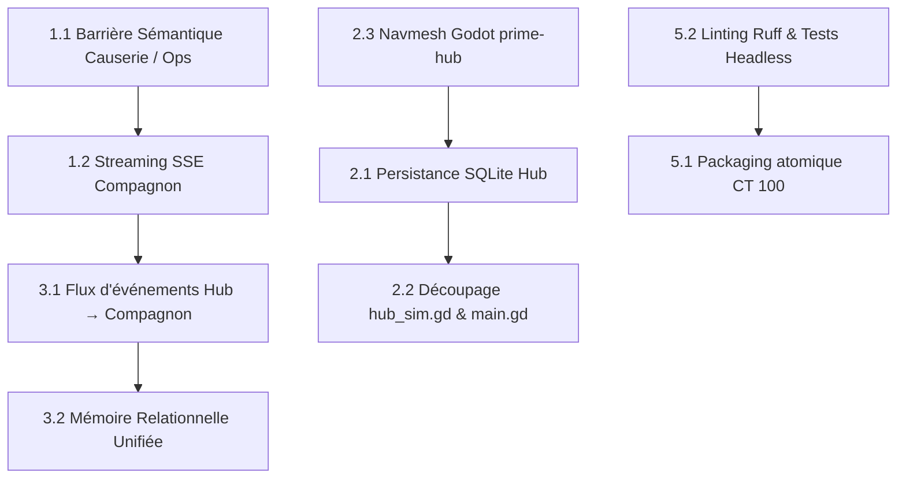

# Plan d’Évolutions — Studio (Cortex) & Jeu (Lost Heaven)

**Date** : 2026-10-08  
**Auteur** : Antigravity (Analyse & Propositions)  
**Source** : Monorepo [`LBG_Studios`](file:///home/lbg/projects/LBG_Studios)  
**Ordre stratégique** : **O1 Studio d’abord, O2 Jeu ensuite** — [`OBJECTIVES.md`](file:///home/lbg/projects/LBG_Studios/OBJECTIVES.md) · [`PRIORITES_ACTUELLES.md`](file:///home/lbg/projects/LBG_Studios/docs/PRIORITES_ACTUELLES.md)  
**Étoile du nord** : IA incarnée sur PC/infra (Rang 1) → persona au cœur du MMO (Rang 2) → évolution contrôlée du monde et du code (Rang 3) — [`RESTAURATION_PRODUIT.md`](file:///home/lbg/projects/LBG_Studios/docs/RESTAURATION_PRODUIT.md).  
**Mains code `.143` (ADR 0025)** : OpenCode LIVE Métis ; Claude CLI = dry-run OK (expérimental) ; **Cline CLI installé** sur `.143` — détail [`packages/cortex/docs/cline/CLI_SECOND_AVIS.md`](../packages/cortex/docs/cline/CLI_SECOND_AVIS.md) · smoke live E4b-qat encore ouvert ([`SUJETS_OUVERTS.md`](SUJETS_OUVERTS.md) O-IDE-1).  
**Délégation Team** : mission Campus `f11fa428-6aef-4a61-83e5-5b32fe6feee0` — suivi Pilot [`#/team`](http://192.168.0.140:8080/pilot/#/team).

---

## 1. Contexte & Diagnostic

Ce document formalise les pistes d'évolution issues de l'audit architectural réalisé le 2026-10-08.
Le projet a franchi des étapes clés :
- **O1 Studio** : Jalons D0–D6 validés sur le Compagnon [`:5174`](http://192.168.0.100:5174/) ; levée récente des blocages d'ouverture et d'émission de plans (D6.5 / A1–A4b).
- **O2 Jeu** : Architecture Godot-first unifiée (ADR 0026 / G5) sur [`:8787`](file:///home/lbg/projects/LBG_Studios/docs/RUNTIME_GODOT.md) via [`packages/prime-hub`](file:///home/lbg/projects/LBG_Studios/packages/prime-hub) (peel HTTP+WS, Triplons PNJ, autonomie bots, combat/boss telegraph vert).
- **Pont Studio ↔ Jeu** : Spécification des `presence_dials` (Phase B) et briefs de mission (Phase C) amorcée ([`PLAN_PRESENCE_ZONE_ENTRAINEMENT.md`](file:///home/lbg/projects/LBG_Studios/docs/PLAN_PRESENCE_ZONE_ENTRAINEMENT.md)).

Les propositions ci-dessous visent à consolider la robustesse, fluidifier l'expérience utilisateur et concrétiser le lien vivant entre le Studio et le MMO.

---

## 2. Phase 1 — O1 Studio & Compagnon (Priorité Haute)

### 1.1 Barrière sémantique « Causerie collègue » vs « Tool Loop Ops »
- **Statut** : **OK live** 2026-10-08 — barrière design + deploy CT100 ; fix bypass `presence_brief` (T5 probe `src=llm` causerie). Métis OpenCode relancé pour smoke rejeu + 1.2 SSE.
- **Problème** : Lors du rejeu humain D6 ([`smoke_rejeu_d6_2026-10-08b.md`](file:///home/lbg/projects/LBG_Studios/docs/smoke_rejeu_d6_2026-10-08b.md), tour 5), une discussion sur le game design (« zone d'entraînement ») a armé la boucle d'outils ops (`tool_loop`), provoquant des fuites techniques et bloquant temporairement `/api/ask`.
- **Solution** :
  1. Modifier la détection d'intentions dans [`packages/cortex/compagnon_ui/server_overlay/router_prompts.py`](file:///home/lbg/projects/LBG_Studios/packages/cortex/compagnon_ui/server_overlay/router_prompts.py) et [`chat_intent.py`](file:///home/lbg/projects/LBG_Studios/packages/cortex/compagnon_ui/server_overlay/chat_intent.py).
  2. Isoler formellement le contexte `brainstorming_design` : si l'humain parle de concept, de lore ou de gameplay sans verbe impératif d'action opérationnelle (*« déploie »*, *« vérifie l'IP »*, *« exécute »*), interdire l'armement d'outils d'infrastructure.
  3. Répondre avec un point de vue de collègue créatif (critère C2 strict) sans invoquer l'écosystème technique.
- **Done quand** : Le test de causerie sur la « zone d'entraînement » ou le lore produit une réponse textuelle collègue en moins de 3 secondes avec zéro appel d'outil système.

### 1.2 Streaming de tokens temps réel (SSE) pour le Compagnon
- **Statut** : **OK live** (déployé CT100 `:5174`) — route `POST /ask/stream` (start immédiat, ping heartbeat, delta progressif, done), `proxy_buffering off` dans nginx, décodeur `askStream.js`, indicateur réflexion dès 300 ms et curseur de streaming dans `ChatFlow.vue`. Tests unitaires validés (`test_sse_ask.py` + `askStream.test.js`).
- **Problème** : Les requêtes au Compagnon passent par un appel HTTP classique (`POST /ask`). Lorsqu'un LLM local sur `.110` ou `.111` prend du temps à générer, l'interface subit un blanc visuel qui dégrade le ressenti des « 30 premières secondes ».
- **Solution** :
  1. Ajouter un endpoint SSE (`POST /api/ask/stream`) dans [`packages/cortex/compagnon_ui/server_overlay/core.py`](file:///home/lbg/projects/LBG_Studios/packages/cortex/compagnon_ui/server_overlay/core.py) via `sse_ask.py`.
  2. Adapter [`ChatFlow.vue`](file:///home/lbg/projects/LBG_Studios/packages/cortex/compagnon_ui/src/components/ChatFlow.vue) et [`useChat.js`](file:///home/lbg/projects/LBG_Studios/packages/cortex/compagnon_ui/src/composables/) pour consommer le flux et afficher les tokens en temps réel.
  3. Afficher un indicateur discret de réflexion progressive dès 300 ms.
- **Done quand** : Le premier token s'affiche sous 1 seconde en modèle light, supprimant la latence perçue.

### 1.3 Modularisation et allègement de Pilot Web ([`pilot_web`](file:///home/lbg/projects/LBG_Studios/packages/cortex/pilot_web))
- **Statut** : **OK validé & packagé** — ancien monolithe `pilot.js` (~8 500 L) supprimé au profit de 17 modules ES modulaires < 1 000 L à la racine de `pilot_web/` (`pilot_actions.js`, `pilot_assistant.js`, `pilot_cards.js`, `pilot_chat.js`, `pilot_core.js`, `pilot_desktop.js`, `pilot_init.js`, `pilot_jobs.js`, `pilot_lyra.js`, `pilot_metrics.js`, `pilot_office.js`, `pilot_orch.js`, `pilot_pm.js`, `pilot_router.js`, `pilot_state.js`, `pilot_team.js`, `pilot_views.js`). Chunks ESM dérivés (`tools/gen_chunks.mjs --check` 17 chunks alignés), build de production Vite (`npm run build` OK en < 1 s), suite `test_pilot_static.py` 100 % passante.
- **Problème** : [`pilot.js`](file:///home/lbg/projects/LBG_Studios/packages/cortex/pilot_web/pilot.js) atteint plus de 8 400 lignes et [`index.html`](file:///home/lbg/projects/LBG_Studios/packages/cortex/pilot_web/index.html) pèse 99 KB en JavaScript vanilla monolithique avec manipulation directe du DOM, alors que `compagnon_ui` est en Vue 3 / Vite.
- **Solution** :
  1. Découper `pilot.js` en modules ES fonctionnels indépendants (`pilot_views.js`, `pilot_metrics.js`, `pilot_cards.js`).
  2. Extraire les tokens de design et composants d'approbation L2 (`ActionCard`, jauges de tension/curiosité) pour assurer la cohérence visuelle sans cloner les rôles (Pilot = cockpit ops, Compagnon = présence).
- **Done quand** : `pilot.js` est segmenté en sous-modules de moins de 1 000 lignes, maintenables et testables.

---

## 3. Phase 2 — O2 Jeu : Hub Headless Godot & Client Prime

### 2.1 Persistance transactionnelle SQLite pour [`prime-hub`](file:///home/lbg/projects/LBG_Studios/packages/prime-hub)
- **Statut** : **OK validé** — couche SQLite threadée non-bloquante [`hub_db.gd`](file:///home/lbg/projects/LBG_Studios/packages/prime-hub/scripts/hub_db.gd) (mode WAL, queue asynchrone `BEGIN IMMEDIATE … COMMIT`, sans blocage du tick frame) ; couche d'abstraction [`hub_player_store.gd`](file:///home/lbg/projects/LBG_Studios/packages/prime-hub/scripts/hub_player_store.gd) avec table `player_positions`, auto-migration depuis JSON et export miroir périodique ; résilience validée par selftest ([`db_selftest.gd`](file:///home/lbg/projects/LBG_Studios/packages/prime-hub/tools/db_selftest.gd)) et smoke crash-safety `kill -9` sans corruption ([`smoke_sqlite_prime_hub.sh`](file:///home/lbg/projects/LBG_Studios/tools/smoke_sqlite_prime_hub.sh)).
- **Problème** : Toutes les données d'état du monde, des comptes, des positions et des relations sont enregistrées dans des fichiers JSON plats ([`accounts.json`](file:///home/lbg/projects/LBG_Studios/packages/prime-hub/data/accounts.json), `players_state.json`, `player_positions.json`, `world_suggestions.jsonl`). Risque d'I/O blocking lors de la réécriture totale et de corruption lors d'un crash ou arrêt non propre.
- **Solution** :
  1. Intégrer SQLite dans `prime-hub` pour stocker les comptes, l'inventaire, les quêtes et la chronique de manière transactionnelle.
  2. Créer une couche d'abstraction dans [`packages/prime-hub/scripts/hub_player_store.gd`](file:///home/lbg/projects/LBG_Studios/packages/prime-hub/scripts/hub_player_store.gd).
  3. Conserver un export périodique JSON / JSONL pour l'auditabilité et les scripts de smoke existants.
- **Done quand** : Une coupure forcée du processus `prime-hub` ne corrompt aucune donnée joueur et les temps d'écriture n'impactent plus le tick de frame.

### 2.2 Découpage modulaire des méga-scripts GDScript
- **Statut (OK validé & clôturé)** : Découpage intégral achevé, aucun script GDScript ne dépasse 800 lignes :
  - **Serveur prime-hub** : `hub_sim.gd` (1 669 L initialement) scindé en 5 modules spécialisés :
    - [`hub_sim.gd`](file:///home/lbg/projects/LBG_Studios/packages/prime-hub/scripts/hub_sim.gd) (**771 L**) : boucle de simulation, gestion entités et délégations publiques transparentes.
    - [`hub_combat.gd`](file:///home/lbg/projects/LBG_Studios/packages/prime-hub/scripts/hub_combat.gd) (**447 L**) : combat open-world, bêtes, boss, windup telegraph, agro, leash et loots.
    - [`hub_presence.gd`](file:///home/lbg/projects/LBG_Studios/packages/prime-hub/scripts/hub_presence.gd) (**185 L**) : dials de présence (`presence_dials.json`), proximité et salutations.
    - [`hub_sim_ambient.gd`](file:///home/lbg/projects/LBG_Studios/packages/prime-hub/scripts/hub_sim_ambient.gd) (**196 L**) : chat ambiant, Nix escorte, ambiances périodiques.
    - [`hub_sim_views.gd`](file:///home/lbg/projects/LBG_Studios/packages/prime-hub/scripts/hub_sim_views.gd) (**142 L**) : formatage et serialization (`zone_state_payload`, `enter_world_payload`, `bots_payload`).
    - [`hub_sim_defs.gd`](file:///home/lbg/projects/LBG_Studios/packages/prime-hub/scripts/hub_sim_defs.gd) (**103 L**) : constantes de topologie, POIs, fallback PNJ et bots.
    - Selftest serveur : [`sim_selftest.gd`](file:///home/lbg/projects/LBG_Studios/packages/prime-hub/tools/sim_selftest.gd) (`SIM_SELFTEST_OK: entities=35 bots=10 beasts=7 ticks=60`).
  - **Client prime-client** : `main.gd` (2 406 L initialement) scindé en 4 modules spécialisés :
    - [`main.gd`](file:///home/lbg/projects/LBG_Studios/packages/prime-client/scripts/main.gd) (**707 L**) : boucle racine, caméra, clics mondes, possession joueur et délégations.
    - [`client_gameplay_ops.gd`](file:///home/lbg/projects/LBG_Studios/packages/prime-client/scripts/client_gameplay_ops.gd) (**529 L**) : salvage ferraille, chasse meute, densité combat, négo trade Jax, panel wiki.
    - [`client_quest_ops.gd`](file:///home/lbg/projects/LBG_Studios/packages/prime-client/scripts/client_quest_ops.gd) (**281 L**) : craft M10, mission board, roster Echo Hammat, quête d'initiation.
    - [`client_net_world.gd`](file:///home/lbg/projects/LBG_Studios/packages/prime-client/scripts/client_net_world.gd) (**675 L**) : WebSocket, handoff, ingestion zone_state, synchronisation entités, focus Lost Heaven.
    - [`client_ui_dialogue.gd`](file:///home/lbg/projects/LBG_Studios/packages/prime-client/scripts/client_ui_dialogue.gd) (**506 L**) : raccourcis clavier, hotbar, modales UI, chat hub, pont dialogue PNJ.
    - Selftest client : [`client_modular_selftest.gd`](file:///home/lbg/projects/LBG_Studios/packages/prime-client/tools/client_modular_selftest.gd) (`CLIENT_MODULAR_SELFTEST_OK: 4 modules initialisés avec succès sur main`).
- **Problème** :
  - [`hub_sim.gd`](file:///home/lbg/projects/LBG_Studios/packages/prime-hub/scripts/hub_sim.gd) (serveur) : 1 600 lignes concentrant les déplacements, les ticks, les POIs, la simulation économique et les dialogues.
  - [`main.gd`](file:///home/lbg/projects/LBG_Studios/packages/prime-client/scripts/main.gd) (client) : 2 400 lignes interconnectant les entrées, la caméra, 15 fenêtres modales et les communications réseau.
- **Solution** :
  1. Côté serveur : scinder `hub_sim.gd` en nœuds et modules de simulation spécialisés (`HubCombat`, `HubPresence`, `HubSimAmbient`, `HubSimViews`, `HubSimDefs`).
  2. Côté client : scinder `main.gd` en 4 modules autonomes (`GameplayOps`, `QuestOps`, `NetWorld`, `UiDialogue`) pilotés par délégations transparentes.
- **Done quand** : Aucun script GDScript ne dépasse 800 lignes et les responsabilités sont isolées par modules Godot dédiés.

### 2.3 Navigation : Intégration du `NavigationServer3D` (Navmesh)
- **Problème** : La grille A* AABB actuelle oblige à un bridage artificiel (`PATH_BUDGET_PER_TICK=2`) pour ne pas faire saccader la frame headless.
- **Solution** :
  1. Pré-calculer un maillage de navigation (*baked navmesh*) pour Lost Heaven (Scrapaltai).
  2. Utiliser le `NavigationServer3D` natif de Godot 4.6 pour les calculs de chemins des PNJ et des monstres.
- **Done quand** : Plus de 30 entités peuvent recalculer leur trajectoire simultanément sans budget de bridage et sans chute du tick rate serveur.

---

## 4. Phase 3 — Pont Vivant Studio ↔ MMO (Étoile du Nord)

### 3.1 Flux d'événements direct Hub → Compagnon (*Live World Stream*)
- **Problème** : Le Compagnon n'est informé des événements du jeu que par des interrogations manuelles ou des sondes programmées ([`presence_report.py`](file:///home/lbg/projects/LBG_Studios/packages/cortex/compagnon_ui/server_overlay/presence_report.py)).
- **Solution** :
  1. Ajouter un émetteur d'événements légers dans `prime-hub` vers une queue d'événements sur Cortex (ex. *« Le boss de la cour a été vaincu »*, *« Nix a escorté un voyageur »*, *« Scrap fall détecté »*).
  2. Enrichir le prompt de salutation du Compagnon avec le dernier événement marquant du monde.
  3. Exemple d'ouverture naturelle :  
     *« Salut Teome ! La cour de Lost Heaven a été agitée tout à l'heure, la meute a été dispersée. Tu voulais qu'on avance sur quoi aujourd'hui ? »*
- **Done quand** : Une action marquante en jeu est naturellement mentionnée par le Compagnon lors de la première prise de contact au bureau.
- **Statut** : **OK validé & clôturé (2026-10-12)** :
  - Émetteur Godot [`hub_world_stream.gd`](file:///home/lbg/projects/LBG_Studios/packages/prime-hub/scripts/hub_world_stream.gd) actif sur `prime-hub` (ring buffer 64 events exposé via `GET /v1/world/stream` sur `:8787`).
  - Module Cortex [`world_stream.py`](file:///home/lbg/projects/LBG_Studios/packages/cortex/compagnon_ui/server_overlay/world_stream.py) connecté au hub avec cache mémoire et timeout 1.5 s sans blocage.
  - Salutations sociales ([`router_prompts.py`](file:///home/lbg/projects/LBG_Studios/packages/cortex/compagnon_ui/server_overlay/router_prompts.py) / `short_social_reply`) et prompt système ([`character_layer.py`](file:///home/lbg/projects/LBG_Studios/packages/cortex/compagnon_ui/server_overlay/character_layer.py)) enrichis avec le dernier fait marquant de Lost Heaven.
  - Route proxy/cache `GET /world/stream` dans [`core.py`](file:///home/lbg/projects/LBG_Studios/packages/cortex/compagnon_ui/server_overlay/core.py) et méthode `fetchWorldStream` dans [`useApi.js`](file:///home/lbg/projects/LBG_Studios/packages/cortex/compagnon_ui/src/composables/useApi.js).
  - Suite de tests unitaires dédiée [`test_world_stream.py`](file:///home/lbg/projects/LBG_Studios/packages/cortex/compagnon_ui/server_overlay/tests/test_world_stream.py) 100 % passante (7 tests).
  - Empreinte validée dans le packaging atomique CT 100 (`overlay.map` + `pyproject.toml`).

### 3.2 Convergence de la mémoire relationnelle
- **Problème** : `relation_memory` (jeu) et `conversation_memory` (bureau) restent cloisonnées.
- **Solution** :
  1. Établir une passerelle de synchronisation bilatérale des traits relationnels pour l'avatar Teome.
  2. Si Nix ou Jax interagissent avec Teome dans le jeu (boisson, quête, combat), le Compagnon au bureau sur `.10` intègre ce contexte dans ses références.
- **Done quand** : Les interactions in-game nourrissent la familiarité et le ton du Compagnon Studio.
- **Statut** : **OK validé & clôturé (2026-10-12)** :
  - Module [`relation_memory.py`](file:///home/lbg/projects/LBG_Studios/packages/cortex/compagnon_ui/server_overlay/relation_memory.py) connecté à `prime-hub` (`/v1/relation-memory` et `/v1/relation-memory/append` sur `:8787`).
  - Prompt système Compagnon ([`character_layer.py`](file:///home/lbg/projects/LBG_Studios/packages/cortex/compagnon_ui/server_overlay/character_layer.py)) enrichi avec le bloc `[Mémoire relationnelle in-game (Lost Heaven)]`.
  - Intention `wants_relation_memory` branchée dans [`llm_chat_phase.py`](file:///home/lbg/projects/LBG_Studios/packages/cortex/compagnon_ui/server_overlay/llm_chat_phase.py).
  - Endpoints proxy/append dans [`core.py`](file:///home/lbg/projects/LBG_Studios/packages/cortex/compagnon_ui/server_overlay/core.py) et méthodes `fetchRelationMemory`/`appendRelationMemory` dans [`useApi.js`](file:///home/lbg/projects/LBG_Studios/packages/cortex/compagnon_ui/src/composables/useApi.js).
  - Suite de tests [`test_relation_memory.py`](file:///home/lbg/projects/LBG_Studios/packages/cortex/compagnon_ui/server_overlay/tests/test_relation_memory.py) 100 % passante (6 tests) ; packaging CT 100 vérifié (36 fichiers).

---

## 5. Phase 4 — Qualité, Infrastructure & Industrialisation

### 5.1 Packaging propre du `server_overlay` (CT 100)
- **Problème** : [`deploy_compagnon_100.sh`](file:///home/lbg/projects/LBG_Studios/packages/cortex/infra/scripts/deploy_compagnon_100.sh) synchronise 29 fichiers Python individuels via rsync pour surcharger `/opt/orchestrateur/`. Le versioning et les retours arrière sont complexes.
- **Solution** :
  1. Formaliser `server_overlay` comme un sous-package Python autonome avec son propre `pyproject.toml` ou conteneur dédié sur `.100`.
  2. Mettre en place un script de build et de déploiement atomique (avec backup / rollback automatisé en cas d'erreur de smoke).
- **Done quand** : Le déploiement sur CT 100 s'effectue en une commande atomique vérifiable par checksum de version.

### 5.2 Outillage de Linting (Ruff) & Tests Headless Godot (CI)
- **Problème** : Pas de linter standardisé configuré dans le monorepo (`AGENTS.md`). Les tests Godot reposent tous sur des scripts bash curl sur machines physiques.
- **Solution** :
  1. Configurer **Ruff** à la racine pour le formatage et le linting Python sans friction.
  2. Intégrer un runner de tests headless Godot (`godot --headless -s test_runner.gd`) pour tester la logique de `prime-hub` (calculs de craft, économie, quêtes) en local ou en intégration continue, sans dépendre du réseau LAN.
- **Done quand** : `ruff check` passe à 100 % et les tests économiques et mécaniques de `prime-hub` s'exécutent en moins de 10 secondes en ligne de commande.
- **Statut** : **OK validé & clôturé (2026-10-12)** :
  - Configuration Ruff standardisée via [`ruff.toml`](../ruff.toml) et [`pyproject.toml`](../pyproject.toml) racine ; `ruff check .` passe à 100 % vert.
  - Runner headless Godot [`tools/ci_godot_headless.sh`](../tools/ci_godot_headless.sh) intégré : exécute simulation, navigation NavigationServer3D et persistance SQLite/économie (18/18 checks) en 3 secondes (< 10 s DoD) sans dépendance réseau.
  - Alignement canon documenté dans [`AGENTS.md`](../AGENTS.md).

---

## 5bis. Suivi opérationnel (bloquants / relance / réalisés)

| Surface | URL / commande |
|---------|----------------|
| **Compte rendu** | [`docs/suivi/PLAN_EVOLUTIONS_STATUS.md`](suivi/PLAN_EVOLUTIONS_STATUS.md) |
| **Tickets JSON** | [`docs/suivi/plan_evolutions.json`](suivi/plan_evolutions.json) |
| **Rafraîchir** | `python3 tools/suivi_plan_evolutions.py --refresh` |
| **Marquer done** | `python3 tools/suivi_plan_evolutions.py --mark 1.2 done --evidence "…" --refresh` |
| **Compagnon** | « où en est le plan ? » / « suivi plan » / « tickets bloqués » → source `plan_suivi` |
| **Pilot** | [\#/team](http://192.168.0.140:8080/pilot/#/team) (tâches live croisées par le script) |

Statuts : `todo` · `in_progress` · `blocked` (prérequis/L2) · `relaunch` (échec Team) · `done` · `cancelled`.  
**Plan entièrement réalisé** = tous les tickets `done` ou `cancelled` (flag dans le CR).

---

## 6. Matrice de Priorités et Ordre d'Exécution

| Horizon | Périmètre | Ticket / Action | Effort | Risque | Gain attendu |
|:---|:---|:---|:---:|:---:|:---|
| **Immédiat (1–2 j)** | O1 Compagnon | **1.1 Fix fuite ops causerie** ([`router_prompts.py`](file:///home/lbg/projects/LBG_Studios/packages/cortex/compagnon_ui/server_overlay/router_prompts.py)) | S | Faible | Clôture nette du critère C2 (collègue fiable sans tool-loop parasite). |
| **Sprint 1** | O1 Compagnon | **1.2 Streaming SSE `/ask`** ([`ChatFlow.vue`](file:///home/lbg/projects/LBG_Studios/packages/cortex/compagnon_ui/src/components/ChatFlow.vue)) | M | Faible | Fluidité instantanée, suppression du blanc visuel sur LLM local. |
| **Sprint 1** | O2 Hub | **2.3 Navigation Navmesh** ([`prime-hub`](file:///home/lbg/projects/LBG_Studios/packages/prime-hub)) | M | Moyen | Suppression du budget `PATH_BUDGET_PER_TICK=2`, zéro saccade. |
| **Sprint 2** | Pont Studio/Jeu | **3.1 Flux événements Hub → Compagnon** | M | Faible | Matérialisation de l'Étoile du Nord : le Compagnon vit au rythme du MMO. |
| **Sprint 2** | O2 Hub | **2.1 Persistance SQLite** ([`hub_player_store.gd`](file:///home/lbg/projects/LBG_Studios/packages/prime-hub/scripts/hub_player_store.gd)) | L | Moyen | Données joueurs protégées contre la corruption et zéro I/O blocking. |
| **Sprint 3** | Studio & Jeu | **2.2 Découpage des méga-scripts** & **1.3 Pilot Web** | L | Moyen | Dette technique réduite, maintenabilité accrue des clients. |
| **Sprint 3** | DevOps | **5.1 Packaging CT 100** & **5.2 Ruff / CI tests Godot** | M | Faible | Déploiements reproductibles et qualité de code garantie. |

---

## 7. Références

- Objectifs généraux : [`OBJECTIVES.md`](file:///home/lbg/projects/LBG_Studios/OBJECTIVES.md)
- Priorités opérationnelles : [`docs/PRIORITES_ACTUELLES.md`](file:///home/lbg/projects/LBG_Studios/docs/PRIORITES_ACTUELLES.md)
- Runtime Godot Lost Heaven : [`docs/RUNTIME_GODOT.md`](file:///home/lbg/projects/LBG_Studios/docs/RUNTIME_GODOT.md)
- Restauration produit (Étoile du nord) : [`docs/RESTAURATION_PRODUIT.md`](file:///home/lbg/projects/LBG_Studios/docs/RESTAURATION_PRODUIT.md)
- Focus Compagnon D6 : [`docs/FOCUS_COMPAGNON.md`](file:///home/lbg/projects/LBG_Studios/docs/FOCUS_COMPAGNON.md)
- Plan présence zone d'entraînement : [`docs/PLAN_PRESENCE_ZONE_ENTRAINEMENT.md`](file:///home/lbg/projects/LBG_Studios/docs/PLAN_PRESENCE_ZONE_ENTRAINEMENT.md)
