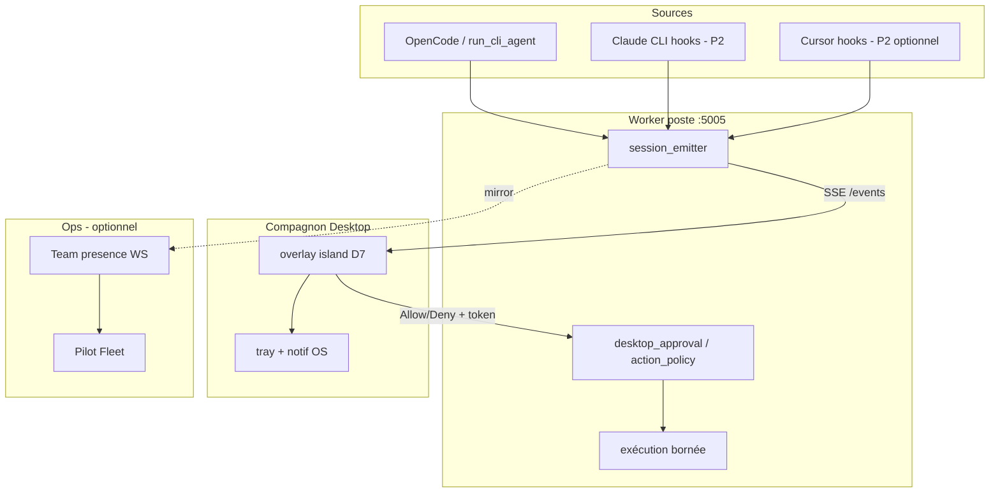

# Plan Team — D7 Session Island (Compagnon Desktop)

**Date** : 2026-10-08 · **MAJ** 2026-10-09 (ADR + spawn + clarifs Compagnon)  
**Statut** : **clôturé conception + code monorepo** (2026-10-11) — deploy `.143` / Electron opt-in encore ouverts  
**Priorité** : O1 Studio — suite Compagnon après D0–D6  
**Auteur proposition** : analyse Coucou + greffe LBG  
**Clôture** : [`LECON_PRESENCE_AGENTS_D7_2026-10-09.md`](LECON_PRESENCE_AGENTS_D7_2026-10-09.md)

Complète :

- [`FOCUS_COMPAGNON.md`](FOCUS_COMPAGNON.md) (D0–D6 OK → suite desktop)
- [`PRIORITES_ACTUELLES.md`](PRIORITES_ACTUELLES.md)
- ADR **[`0027`](../packages/cortex/docs/adr/0027-session-island-d7.md)** (proposé)
- Clarifs Compagnon : [`SESSION_ISLAND_D7_COMPAGNON_CLARIFS.md`](SESSION_ISLAND_D7_COMPAGNON_CLARIFS.md)
- Décisions machine : [`SESSION_ISLAND_D7_DECISIONS.json`](SESSION_ISLAND_D7_DECISIONS.json)
- Spawn : `python -m lbg_agents.spawn_team_session_island_d7_job`
- [`packages/cortex/docs/plan_combler_gaps_agentiques.md`](../packages/cortex/docs/plan_combler_gaps_agentiques.md) — **G5 HITL UX**
- ADR [`0025`](../packages/cortex/docs/adr/0025-mains-code-143-run-cli-agent.md) (`run_cli_agent`)
- ADR [`0023`](../packages/cortex/docs/adr/0023-catalogue-outils-ide-second-avis.md) (IDE = outils, pas personas)
- [`packages/cortex/docs/ecosystem_dev_143.md`](../packages/cortex/docs/ecosystem_dev_143.md)
- Inspiration externe (MIT, idées seulement) : [Louis-CFM/coucou](https://github.com/Louis-CFM/coucou)

---

## 0. Pitch (30 secondes)

On greffe chez nous l’idée Coucou : une **island / overlay desktop** qui montre en live les sessions d’agents de code (OpenCode / Claude CLI / futurs hooks) et permet **Allow / Deny** sans quitter le focus — **sans** forker Coucou, **sans** second cerveau, **sans** toucher au runtime jeu O2.

Chez LBG, ça devient **D7** du rail Compagnon : extension de `compagnon-desktop` + events depuis les workers `:5005` + même policy L2 (`action_policy` / `desktop_approval`).

---

## 1. Problème

| Aujourd’hui | Douleur |
|-------------|---------|
| HITL L2 = tokens + Pilot + Slack | UX lente ; pas d’approbation *au moment* de l’outil |
| `run_cli_agent` (ADR 0025) | Boîte noire pendant l’exécution (stdout à la fin) |
| Overlay Electron D2/D3 | Avatar + initiatives, **pas** ticker session / Allow-Deny |
| G5 « comblé » côté Slack/Pilot | Critère ops OK ; **UX poste** encore faible |

**Objectif produit** : quand Métis / Iris / un CLI agent tourne, le Compagnon Desktop **voit**, **annonce**, et si besoin **demande** — sans dashboard, sans auto-exec.

---

## 2. Non-objectifs (explicites)

| Non-objectif | Pourquoi |
|--------------|----------|
| Fork / clone Coucou (Mochi, Tauri, iPhone, Spotify…) | Hors focus ; marque tierce ; stack déjà Electron |
| Remplacer Pilot / Slack HITL | Island = **complément poste** ; Pilot = cockpit ops |
| Nouveau OS type CrewAI | Règle monorepo inchangée |
| Godot / `prime-hub` / persona MMO | O2 hors scope D7 |
| Computer-use UI libre | ADR 0023 |
| Auto-Allow silencieux | Contre-pouvoir Compagnon inchangé |

---

## 3. Décisions d’architecture (à valider)

### D1 — Greffe, pas produit parallèle

```text
Sources d’événements
  → Bus session local (worker)
  → Fan-out (poste + optionnel Orch presence)
  → Compagnon Desktop overlay (island UX)
  → Décision Allow/Deny → worker (même garde-fous L2)
```

**Surfaces** :

| Rôle | Où | Change |
|------|-----|--------|
| Présence island | `packages/compagnon-desktop` | **Oui** — D7 |
| Worker events | `linux_agent` `.143` (+ `windows_agent` `.10` phase 2) | **Oui** |
| Policy L2 | `action_policy` + jetons `desktop_approval` | Réutiliser / étendre contrat |
| Miroir ops | Pilot Fleet / presence (optionnel) | Lecture seule phase 1 |
| Chat Compagnon | `:5174` | Pas de dashboard ; lien « session en cours » optionnel |

### D2 — Contrat d’événements (canon LBG)

Inspiré Coucou, **renommé** pour le monorepo (éviter collision de marque) :

```json
{
  "v": 1,
  "event": "session.tool_pre",
  "session_id": "cli-opencode-20261008-…",
  "agent": "opencode",
  "persona": "metis",
  "ts": "2026-10-08T19:00:00Z",
  "summary": "Edit packages/cortex/…",
  "detail": { "tool": "write", "path": "…", "+": 12, "-": 3 },
  "approval_id": null
}
```

| Event | Effet island | Callback |
|-------|--------------|----------|
| `session.start` | Pill apparaît, état idle→thinking | — |
| `session.prompt` | Ticker prompt court | — |
| `session.tool_pre` | Ticker outil / fichier | — |
| `session.tool_post` | Ticker résultat court | — |
| `session.approval_needed` | Carte **Allow / Deny / Always (session)** | Obligatoire |
| `session.stop` | Finished 5 s puis idle / dismiss | — |
| `session.error` | État erreur | — |

**Règle fail-open** (comme Coucou) : si l’island ne répond pas à temps, le worker **ne bloque pas** indéfiniment — timeout → fallback terminal / policy existante / deny-safe selon kind.

### D3 — Bus local (choix technique proposé)

| Environnement | Bus proposé | Pourquoi |
|---------------|-------------|----------|
| Omarchy `.143` (Linux) | Unix socket `$XDG_RUNTIME_DIR/lbg-session.sock` **ou** HTTP local `127.0.0.1:5006/events` | Simple à tester ; worker déjà HTTP `:5005` |
| Windows `.10` | Named pipe `\\.\pipe\lbg-session` **ou** même HTTP local | Parité Coucou ; Electron déjà sur `.10` |

**Recommandation Phase 0** : **HTTP local events** sur le worker (`POST /session/events`, `GET /session/stream` SSE) pour aller vite sans IPC OS-spécifique. Socket/pipe = Phase 2 si latence / perf le demandent.

### D4 — Qui approuve quoi

| Kind / situation | Island D7 | Invariant |
|------------------|-----------|-----------|
| Soft-confirm LAB déjà OK | Pas de carte (ou toast informatif) | Inchangé |
| `run_cli_agent` réel (token) | Carte Allow/Deny **peut** porter le jeton UI | Même secret `desktop_approval` |
| Permission outil IDE (hooks Claude) | Phase 2 — Allow/Deny → relay | Fail-open |
| Jobs Team `waiting_approval` | **Reste Pilot + Slack** | Pas déplacé sur island en V1 |

---

## 4. Architecture cible



---

## 5. Phases & livrables

### Phase 0 — Cadre & contrat (0,5–1 j) — **gate GO**

| ID | Livrable | Done when |
|----|----------|-----------|
| P0.1 | Ce plan reviewé Team (GO / amendements) | Décision écrite dans ce doc §9 |
| P0.2 | ADR **0027** draft « Session Island D7 » | Accepté ou reporté |
| P0.3 | Schéma JSON events + OpenAPI fragment worker | Fichier versionné + 3 exemples |
| P0.4 | Maquette UX 1 écran (ticker + carte Allow/Deny) | Validée produit (pas de dashboard) |

**Personas** : Thémis (cadrage) · Métis (contrat technique) · humain L2 produit.

### Phase 1 — MVP Omarchy (1–2 semaines) — **valeur Studio**

But : pendant un `run_cli_agent` OpenCode sur `.143`, l’overlay (ou un client SSE de secours) montre la session ; Allow/Deny pour le **démarrage réel** si approval requis.

| ID | Livrable | Zones | Done when |
|----|----------|-------|-----------|
| P1.1 | `session_emitter` dans `linux_agent` | `linux_agent/Agent_IA/` | Events `start/prompt/tool_*/stop` émis en JSONL + HTTP |
| P1.2 | Endpoints `GET /session/stream` (SSE) + `POST /session/decision` | `linux_agent` main | Curl smoke vert |
| P1.3 | Instrumentation `run_cli_agent` | `core.run_cli_agent` | Au moins start / heartbeat / stop / error |
| P1.4 | Overlay D7 minimal dans Electron | `compagnon-desktop/overlay/` | Pill + ticker + Allow/Deny |
| P1.5 | Config `sessionIsland.*` | `config.json` | Opt-in, off par défaut |
| P1.6 | Tests unitaires emitter + parse events | `linux_agent` tests / tiny JS | CI locale verte |
| P1.7 | Smoke LAN doc | `SMOKE_LAN.md` ou runbook D7 | Checklist 5 étapes PASS |

**Critère MVP** : un humain sur `.10` (Electron pointant worker `.143`) **voit** une session OpenCode et peut **refuser** un réel qui demandait approval — sans ouvrir Pilot.

### Phase 2 — Parité Windows + hooks IDE (1–2 semaines)

| ID | Livrable | Done when |
|----|----------|-----------|
| P2.1 | Emitter + stream sur `windows_agent` `.10` | Même contrat v1 |
| P2.2 | Relay hooks Claude Code (opt-in install) | PermissionRequest → carte island |
| P2.3 | Mapping OpenCode plugin events (si dispo) | tool_pre/post plus riches |
| P2.4 | Miroir `presence` Orch (lecture) | Fleet voit « session active » |
| P2.5 | Timeout / fail-open documenté + testé | Pas de hang CLI |

### Phase 3 — Polish produit (optionnel, après GO P1)

| ID | Livrable |
|----|----------|
| P3.1 | Diffs +N/−M dans ticker (si tool le fournit) |
| P3.2 | Raccourci clavier ouvrir island |
| P3.3 | Lien Compagnon `:5174` « session en cours » |
| P3.4 | Sons / pulse overlay (réutiliser D3, quota) |
| P3.5 | Always-allow scoped session (jamais global silencieux) |

---

## 6. RACI Team

| Rôle | Persona / humain | Responsabilité |
|------|------------------|----------------|
| Sponsor produit | Humain L2 | GO phases, UX « pas un dashboard » |
| Cadrage | Thémis | ADR 0027, critères done, anti-dérive |
| Impl worker + events | Métis (`dev_studio`) | Emitter, SSE, `run_cli_agent` |
| Impl desktop | Métis (+ aide Iris si UI) | Overlay Electron D7 |
| Policy / sécurité | Argus + Thémis | Fail-open, tokens, audit JSONL |
| Smoke | Argus | Runbook D7 sur LAN |
| Ops miroir | Héphaïstos | Flags systemd / env workers |
| Hors scope | Iris/Dédale jeu | Pas de tickets Godot D7 |

**Spawn suggéré** (après GO P0) : mission Lyra `session_island_d7_phase1` — max 4 tasks L1 (Métis×2, Argus smoke, Thémis ADR).

---

## 7. Risques & garde-fous

| Risque | Mitigation |
|--------|------------|
| Scope creep « clone Coucou » | Non-objectifs §2 ; phases ; review Thémis |
| Fuite secrets dans ticker | Truncate paths ; jamais clés / tokens dans events |
| Hang agent si island down | Timeout + fail-open (§3 D2) |
| Double HITL (Slack + island) | Jobs Team restent Slack/Pilot ; island = poste CLI/desktop |
| Electron `.10` vs worker `.143` | Config URL stream explicite ; lab d’abord localhost puis LAN |
| Charge SSE | Heartbeat ≤ 1/2 s pendant tool ; idle = silence |
| Confusion personas Campus vs IDE | ADR 0023 : pills = **outils** (`opencode`, `claude`), pas Iris/Métis comme mascottes |

---

## 8. Estimations & dépendances

| Phase | Effort indicatif | Dépendances |
|-------|------------------|-------------|
| P0 | 0,5–1 j | Review Team |
| P1 | 5–8 j Métis + 1 j Argus | Electron `.10`, worker `.143`, flags ADR 0025 |
| P2 | 5–8 j | Hooks Claude installables ; Windows agent |
| P3 | 2–4 j | P1 stable |

**Flags proposés** :

```text
LBG_SESSION_ISLAND_ENABLED=0|1          # worker
LBG_SESSION_ISLAND_FAIL_OPEN=1          # défaut
compagnon-desktop config:
  sessionIsland.enabled
  sessionIsland.streamUrl   # ex. http://192.168.0.143:5005/session/stream
```

**Dépendance produit** : D6 Compagnon reste gate feeling — D7 ne doit **pas** casser `:5174` ni Agir dry-run.

---

## 9. Décision Team (à remplir)

**Chemin recommandé** : dialogue Compagnon
([`SESSION_ISLAND_D7_COMPAGNON_CLARIFS.md`](SESSION_ISLAND_D7_COMPAGNON_CLARIFS.md))
→ remplir [`SESSION_ISLAND_D7_DECISIONS.json`](SESSION_ISLAND_D7_DECISIONS.json)
→ recopier ici.

| Question | Réponse | Clé JSON |
|----------|---------|----------|
| GO Phase 0–1 ? | **GO** | `go` |
| Bus V1 | **SSE + IPC** (socket `.143` / pipe `.10`) | `bus_v1` = `http_sse_and_ipc` |
| Island cibles | **Electron `.10` + client minimal `.143`** | `island_targets` |
| Miroir Pilot en P1 ? | **Best-effort** (sinon P2) | `pilot_mirror_p1` = true |
| Nom produit interne | **Présence Agents** | `product_name` |

**Date review** : 2026-10-09  
**Participants** : humain L2 + Compagnon (clarifs chat)  
**Amendements** : bus dual ; dual UI ; Pilot best-effort ; nom Présence Agents  
**ADR 0027** : ☑ **accepté** (2026-10-09) · contrat [`session_island_events_v1.md`](../packages/cortex/docs/session_island_events_v1.md)

---

## 10. Critères d’acceptation globaux (fin P1)

1. Opt-in : flags off → zéro comportement nouveau.  
2. Session OpenCode réelle émet ≥ `start` + `stop` (ou `error`).  
3. Overlay affiche agent + état + dernière action (≤ 80 caractères).  
4. Carte Allow/Deny fonctionne pour un réel `run_cli_agent` soumis à approval.  
5. Deny ou timeout fail-open : pas de process zombie ; audit JSONL.  
6. Aucune régression smoke Compagnon D6 / Agir.  
7. Doc runbook + lien depuis `FOCUS_COMPAGNON.md` (jalon D7).

---

## 11. Annexes

### A. Mapping inspiration Coucou → LBG

| Coucou | LBG D7 |
|--------|--------|
| Mochi / notch | Overlay avatar existant + bandeau session |
| `coucou-hook` + pipe | Emitter worker + SSE (P1) / hooks (P2) |
| Allow/Deny/Always | Allow/Deny/Always-session → `desktop_approval` |
| Pills multi-agents | Pills outils (`opencode`, `claude`, …) |
| Chat multi-LLM dans island | **Non** — chat = `:5174` |
| iPhone / iCloud | **Non** |
| Integrations Stripe/Spotify | **Non** |

### B. Fichiers touchés (prévision P1)

```text
packages/compagnon-desktop/
  main.js
  overlay/overlay.js
  overlay/index.html
  config.json
  README.md

packages/cortex/linux_agent/Agent_IA/
  main.py
  core.py                    # run_cli_agent instrumentation
  session_emitter.py         # NEW

packages/cortex/docs/
  adr/0027-session-island-d7.md   # NEW (P0)
  runbook_session_island_d7.md    # NEW (P1)

docs/
  PLAN_SESSION_ISLAND_D7.md       # ce fichier
  FOCUS_COMPAGNON.md              # + jalon D7 (après GO)
```

### C. Smoke minimal (brouillon)

```bash
# Sur .143 — flags on
curl -sN http://127.0.0.1:5005/session/stream &
# Déclencher dry-run puis réel run_cli_agent via Team/Compagnon
# Vérifier events start/stop ; carte Deny sur réel sans token
```

### D. Spawn Team (script)

```bash
# 1) Clarifs Compagnon → remplir SESSION_ISLAND_D7_DECISIONS.json
# 2) Dry-run P0
cd packages/cortex
LBG_ORCHESTRATOR_URL=http://192.168.0.140:8010 \
  LBG_TEAM_SESSION_ISLAND_WAVE=P0 \
  LBG_TEAM_SESSION_ISLAND_DRY_RUN=1 \
  python -m lbg_agents.spawn_team_session_island_d7_job

# 3) Spawn P0 réel (Thémis ADR + Métis schéma)
LBG_TEAM_SESSION_ISLAND_WAVE=P0 LBG_TEAM_SESSION_ISLAND_DRY_RUN=0 \
  python -m lbg_agents.spawn_team_session_island_d7_job

# 4) Après P0 OK → P1 (Métis×2 + Argus)
LBG_TEAM_SESSION_ISLAND_WAVE=P1 LBG_TEAM_SESSION_ISLAND_DRY_RUN=0 \
  python -m lbg_agents.spawn_team_session_island_d7_job
```

Gate : sans `go` dans `DECISIONS.json` → exit 2 `gate_blocked`.  
Bypass lab only : `LBG_TEAM_SESSION_ISLAND_BYPASS_GATE=1`.

---

## 12. Recommandation

1. **Coller le prompt** de [`SESSION_ISLAND_D7_COMPAGNON_CLARIFS.md`](SESSION_ISLAND_D7_COMPAGNON_CLARIFS.md) dans `:5174`.  
2. Remplir [`SESSION_ISLAND_D7_DECISIONS.json`](SESSION_ISLAND_D7_DECISIONS.json).  
3. Si GO → dry-run puis spawn **P0** ; ADR 0027 → accepté.  
4. Puis spawn **P1**.

ROI : comble le trou UX **G5 côté poste**, rend les mains code ADR 0025 **observables**, renforce le Compagnon « sur le PC » sans diluer O2 ni Pilot.
