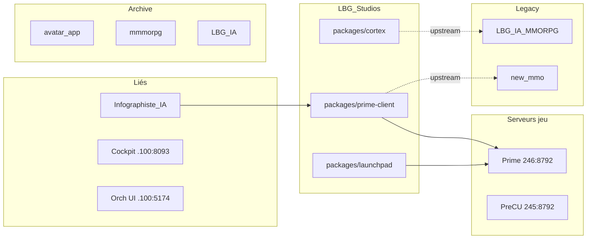

# Registre LBG Studios

**Date** : 2026-07-31 (surfaces LAN + smoke)  
**Source de vérité** : ce fichier.

**Objectif** : recentrer sur **Studio (Cortex)** puis **Jeu (Prime/Godot)** dans `LBG_Studios`,  
sans perdre l’étoile du nord — [`RESTAURATION_PRODUIT.md`](RESTAURATION_PRODUIT.md).  
**Smoke** : [`SMOKE_LAN.md`](SMOKE_LAN.md).

**Règle** : dépôt **legacy / archive / étagère** = pas de nouvelle feature produit ; correctifs OK.

---

## Actif — monorepo `LBG_Studios`

| Package | Rôle | Point d’entrée |
|---------|------|----------------|
| **`packages/cortex`** | Studio : orchestrateur, Team, Pilot, agents | `http://192.168.0.140:8080/` |
| **`packages/prime-client`** | Jeu : client Godot Prime | Launchpad / Godot → 246 |
| **`packages/launchpad`** | Lanceur Electron (sources) | build Windows → `J:\swgemu\dist\` |

Serveurs jeu (runtime, hors Git) :

| Hôte | Rôle | Accès |
|------|------|-------|
| **`192.168.0.246:8792`** | **Prime** — état serveur + comptes Core3 | http://192.168.0.246:8792/ |
| **`192.168.0.245:8792`** | **PreCU / ops** — état + comptes | http://192.168.0.245:8792/ |
| **`192.168.0.246:8080`** | Patches Prime | http://192.168.0.246:8080/patches/prime/manifest.json |

## Actif — remotes liés (hors Git monorepo)

| Chemin local | Rôle |
|--------------|------|
| `../Infographiste_IA` | Pipeline assets / LoRA |
| **Cockpit P03** (runtime) | Ops infra LAN — http://192.168.0.100:8093/pilot/#/cockpit (sources `_shelf/LBG_Project_03`) |
| **Orchestrateur UI** (runtime) | SPA Vue — http://192.168.0.100:5174/ · `/lyra` · `/agents/map` (sources `_archive/LBG_IA`, API `:3000`) |

## Étagère

| Dépôt | Motif |
|-------|--------|
| `_shelf/LBG_Project_03` | Sources Cockpit / LangGraph — runtime actif sur `.100:8093` ; pas de nouvelles features majeures ici (lien depuis Pilot Ops) |

## Archive / legacy upstream

| Dépôt | Motif |
|-------|--------|
| `_archive/avatar_app` | Bac avatars web Three.js — gelé |
| `_archive/mmmorpg` | Pivot Core3 / sandbox WS gelée |
| `_archive/LBG_IA` | Sources SPA Orchestrateur Vue — **runtime actif** sur `.100:5174` (pas à jeter) |
| `../LBG_IA_MMORPG` | **Upstream legacy** Cortex (avant extraction) |
| `../new_mmo` | **Upstream legacy** jeu (Core3 + historiques) |

### Composants gelés (ne pas réimporter)

`mmo_server`, `mmmorpg_server`, `web_client`, `pilot_web/mmo`, `lbg_client_godot` 3D phase 0, `avatar_app`.

---

## Matrice

