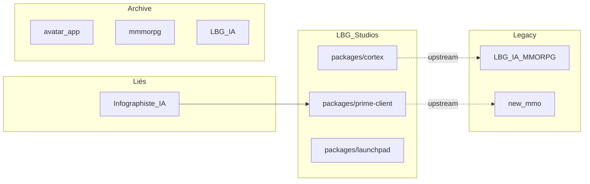

# Registre LBG Studios

**Date** : 2026-07-31 (rectif : `avatar_app` → archive)  
**Source de vérité** : ce fichier.

**Objectif** : recentrer sur **Studio (Cortex)** puis **Jeu (Prime/Godot)** dans `LBG_Studios`.

**Règle** : dépôt **legacy / archive / étagère** = pas de nouvelle feature produit ; correctifs OK.

---

## Actif — monorepo `LBG_Studios`

| Package | Rôle | Point d’entrée |
|---------|------|----------------|
| **`packages/cortex`** | Studio : orchestrateur, Team, Pilot, agents | `http://192.168.0.140:8080/` |
| **`packages/prime-client`** | Jeu : client Godot Prime | Launchpad / Godot → 246 |
| **`packages/launchpad`** | Lanceur Electron (sources) | build Windows → `J:\swgemu\dist\` |

## Actif — remotes liés (hors Git monorepo)

| Chemin local | Rôle |
|--------------|------|
| `../Infographiste_IA` | Pipeline assets / LoRA |
| **Cockpit P03** (runtime) | Ops infra LAN — http://192.168.0.100:8093/pilot/#/cockpit (sources `_shelf/LBG_Project_03`) |

## Étagère

| Dépôt | Motif |
|-------|--------|
| `_shelf/LBG_Project_03` | Sources Cockpit / LangGraph — runtime actif sur `.100:8093` ; pas de nouvelles features majeures ici (lien depuis Pilot Ops) |

## Archive / legacy upstream

| Dépôt | Motif |
|-------|--------|
| `_archive/avatar_app` | Bac avatars web Three.js — gelé |
| `_archive/mmmorpg` | Pivot Core3 / sandbox WS gelée |
| `_archive/LBG_IA` | Orchestrateur Vue historique |
| `../LBG_IA_MMORPG` | **Upstream legacy** Cortex (avant extraction) |
| `../new_mmo` | **Upstream legacy** jeu (Core3 + historiques) |

### Composants gelés (ne pas réimporter)

`mmo_server`, `mmmorpg_server`, `web_client`, `pilot_web/mmo`, `lbg_client_godot` 3D phase 0, `avatar_app`.

---

## Matrice

