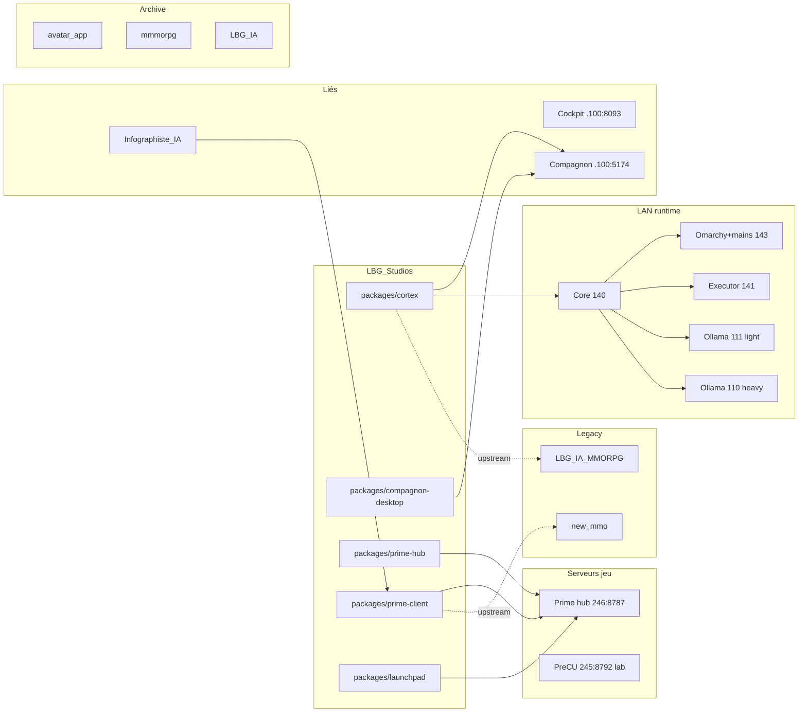

# Registre LBG Studios

**Date** : 2026-10-14 (piliers O1/O2/O3 · G5+ `:8787`)  
**Source de vérité** : ce fichier · runtime joueur : [`RUNTIME_GODOT.md`](RUNTIME_GODOT.md).

**Objectif** : trois piliers — **O1 Compagnon** · **O2 MMO (banc d’essai)** · **O3 Joueurs IA** —  
[`OBJECTIVES.md`](../OBJECTIVES.md) · restauration : [`RESTAURATION_PRODUIT.md`](RESTAURATION_PRODUIT.md).  
**Organisme & Architecture globale** : [`ORGANISME_LBG.md`](ORGANISME_LBG.md) (Entité globale **Lyra**, incarnation **Lia**, organes d'action multimodaux `.10`/`.143`/`.140`/`.110`/`.246`).  
**Priorités actuelles** : [`PRIORITES_ACTUELLES.md`](PRIORITES_ACTUELLES.md) (snapshot O1/O2/O3).  
**Focus compagnon** : [`FOCUS_COMPAGNON.md`](FOCUS_COMPAGNON.md) (O1 · D8 avatar bridge).  
**Session en cours (Cursor ↔ Antigravity)** : [`SESSION_EN_COURS.md`](SESSION_EN_COURS.md).  
**Règles Antigravity** : `../.agents/rules/` (+ global `~/.gemini/GEMINI.md`).  
**Handoff sonde AD (Antigravity)** : [`handoff_antigravity_sonde_ad.md`](handoff_antigravity_sonde_ad.md).  
**Handoff visuel Compagnon (Antigravity)** : [`handoff_antigravity_visuel_compagnon.md`](handoff_antigravity_visuel_compagnon.md).  
**Focus wahou (jeu, archivé)** : [`FOCUS_WAHOU.md`](FOCUS_WAHOU.md).  
**Smoke** : [`SMOKE_LAN.md`](SMOKE_LAN.md).  
**Adressage Freebox** : [`LAN_ADRESSAGE_FREEBOX.md`](LAN_ADRESSAGE_FREEBOX.md).  
**NAS Synology `.51`** : [`NAS_SYNOLOGY_51.md`](NAS_SYNOLOGY_51.md).  
**LLM local** : [`packages/cortex/docs/local_llm_route_matrix.md`](../packages/cortex/docs/local_llm_route_matrix.md) · règle Cursor `local-llm-route-matrix.mdc`.  
**Forge modèles décensurés (PNJ / Compagnon)** : [`packages/cortex/docs/forge_modeles_dialogue_pnj_compagnon.md`](../packages/cortex/docs/forge_modeles_dialogue_pnj_compagnon.md) — pipeline Heretic, Optuna KL, GGUF, Ollama `.110`/`.111`.  
**Compagnon LLM / morale LAB** : [`packages/cortex/docs/compagnon_llm_moral_policy.md`](../packages/cortex/docs/compagnon_llm_moral_policy.md).  
**Spontanéité / évolution initiatives** : [`packages/cortex/docs/spontaneity.md`](../packages/cortex/docs/spontaneity.md).  
**Voix TTS (`voice_local`)** : [`packages/cortex/docs/voice_local.md`](../packages/cortex/docs/voice_local.md) — **Edge** `fr-FR-DeniseNeural` (défaut) + fallback Piper `.111:8098`.  
**System One Laya** (routage intent typé, optionnel) : [`packages/cortex/docs/laya_system_one.md`](../packages/cortex/docs/laya_system_one.md).  
**GPU éphémère Colab** : [`packages/cortex/docs/reason_ephemeral_colab.md`](../packages/cortex/docs/reason_ephemeral_colab.md) · notebooks `packages/cortex/tools/colab/`.  
**LLM secours free** : [`packages/cortex/docs/reason_cloud_free_fallback.md`](../packages/cortex/docs/reason_cloud_free_fallback.md) · comparatif [`llm_cloud_free_vs_local.md`](../packages/cortex/docs/llm_cloud_free_vs_local.md).  
**Canal ops** : Slack + Element backup — [`packages/cortex/docs/ops_notify_slack.md`](../packages/cortex/docs/ops_notify_slack.md) · ADR 0021.  
**Sprint évolution 7j** (Team, L1 auto / L2 Pilot) : [`packages/cortex/docs/team_evolution_sprint.md`](../packages/cortex/docs/team_evolution_sprint.md).  
**Pont Cloud↔LAN** : [`packages/cortex/docs/pont_cloud_local.md`](../packages/cortex/docs/pont_cloud_local.md).  
**NotebookLM (POC poste)** : [`packages/cortex/docs/notebooklm_poste.md`](../packages/cortex/docs/notebooklm_poste.md) · seed `packages/cortex/tools/notebooklm/seed_lbg_docs.sh`.  
**Lore / âme jeu** : [`world/BIBLE_MMO.md`](world/BIBLE_MMO.md) · [`world/INVENTAIRE_PNJ.md`](world/INVENTAIRE_PNJ.md) · [`world/ARBRES_TALENTS_PRECU.md`](world/ARBRES_TALENTS_PRECU.md) · [`world/BOITE_IDEES_GAMEPLAY.md`](world/BOITE_IDEES_GAMEPLAY.md) · maturité A/B/C ([`maturity_content.md`](../packages/cortex/docs/maturity_content.md), V60–V65) · garant runtime **Chœur du monde**.  
**Doctrine technologique / anti-recodage** : [`packages/cortex/docs/adr/0029-doctrine-anti-recodage-rust-pragmatisme.md`](../packages/cortex/docs/adr/0029-doctrine-anti-recodage-rust-pragmatisme.md) — ADR 0029 (Python IA, Godot spatiale, Rust scalpel ciblé sur benchmark).

**Règle** : dépôt **legacy / archive / étagère** = pas de nouvelle feature produit ; correctifs OK.

---

## Chemins et remotes

| Quoi | Chemin / URL |
|------|----------------|
| Monorepo (source de vérité) | GitHub `Teome0245/LBG_Studios` — clones : WSL `/home/sdesh/projects/LBG_Studios` · **éditeur `.143`** `/home/lbg/projects/LBG_Studios` (SMB `A:` depuis `.10`) · sync miroir `packages/cortex/infra/scripts/sync_projects_143.sh` · lab/prod via **git + `deploy_*`** (pas rsync massif) |
| Workspace Cursor | `LBG_Studios.code-workspace` |
| Deploy runtime Cortex | `.140` → **`/opt/LBG_IA_MMO`** (rsync, pas de `git clone`) |
| Env prod | `.140` `/etc/lbg-ia-mmo.env` (depuis `packages/cortex/infra/secrets/lbg.env`) |
| Client Windows | Launchpad ≥2.1.4 (Prime only) → `J:\…` ; hub joueur `.246:8787` ; Godot `J:\swgemu\clients\prime-client` |

### Client Godot (chemins)

| Rôle | Chemin |
|------|--------|
| **Source Git** (dev, ce repo) | `packages/prime-client` |
| **Runtime 140** (`LBG_PRIME_CLIENT_ROOT`, canon **2026-10-14**) | `/opt/LBG_Studios/packages/prime-client` |
| Miroir legacy (sync optionnel) | `/opt/new_mmo/prime-client` — forcer via `LBG_PRIME_ALLOW_LEGACY_NEW_MMO=1` |
| Joueur Windows | `J:\swgemu\clients\prime-client` (sync depuis le package) |

Nouvelles features client → **Git Studios**. Deploy / sondes VM → `LBG_PRIME_CLIENT_ROOT` Studios ; `bash packages/cortex/infra/scripts/sync_prime_client_assets_vm.sh`.

---

## Actif — monorepo `LBG_Studios`

| Package | Rôle | Point d’entrée |
|---------|------|----------------|
| **`packages/cortex`** | Studio : orchestrateur, Team, Pilot, agents | Pilot ops `http://192.168.0.140:8080/` · Compagnon présence `.100:5174` |
| **`packages/compagnon-desktop`** | Tray Electron + overlay VRM/FaceRig + bridge avatar `:8765` (poste `.10`) | `packages/compagnon-desktop` · D8 |
| **`packages/prime-hub`** | **Autorité monde** Godot headless G5+ (HTTP+WS) | `http://192.168.0.246:8787/healthz` |
| **`packages/prime-client`** | Jeu : client Godot Prime | Launchpad / Godot → hub `:8787` |
| **`packages/launchpad`** | Lanceur Electron (sources) ≥ 2.1.4 Prime-only | build Windows → `J:\swgemu\dist\` |

Serveurs jeu (runtime) :

| Hôte | Rôle | Accès |
|------|------|-------|
| **`192.168.0.246:8787`** | **Autorité joueur** — `prime-hub` G5+ (HTTP+WS unifiés) | http://192.168.0.246:8787/healthz · [`RUNTIME_GODOT.md`](RUNTIME_GODOT.md) |
| **`192.168.0.246:8080`** | Patches / releases Prime + Launchpad | http://192.168.0.246:8080/patches/prime/manifest.json |
| **`192.168.0.246:8792`** | Core3 comptes **lab** (hors chemin joueur · OFF par ADR 0026) | optionnel `--keep-account-admin` |
| **`192.168.0.245:8792`** | **PreCU** — référence SWG Pre-CU (lecture seule ; souvent éteint) | http://192.168.0.245:8792/ |

**Règle chemin joueur** : features LBG = monorepo + **`.246:8787`** (`prime-hub`). Core3 / PreCU `:8792` = lab / référence, pas le runtime joueur.  
**Règle 245** : modèle le plus proche de l’original Pre-CU pour consulter arbres / craft / datatables. Voir Bible **V4**.

## LAN — hôtes (Atlas / ops)

| IP | Rôle | Notes |
|----|------|-------|
| **`.10`** | Poste Teome | Cursor, ComfyUI, pilotage humain — plus l’executor LAN |
| **`.100`** | Cockpit / Compagnon / API | `:8093` Cockpit · `:3000` API · `:5174` Compagnon présence · `:3080` Open WebUI lab |
| **`.110`** | Ollama **heavy** | `:11434` **CPU only** — `gemma-4-abliterated:12b` + `e2b` (+ `qwen3.5-abliterated:9b` disque) ; pas de 27B routé |
| **`.111`** | Ollama **light** | `:11434` — `qwen3.5-abliterated:2B` / `0.8B` + `gemma-4-abliterated:e2b` (causerie Compagnon) · **Piper TTS** `:8098` (`voice_local`) |
| **`.140`** | Core Studio | Pilot `:8080`, backend `:8000`, orchestrateur `:8010` |
| **`.141`** | CT `lbg-executor` | poll `/v1/team/wsl/*` — `lbg-lan-executor.service` |
| **`.142`** | — | **IP libérée** (CT `lbg-hands` détruit 2026-10-02) — rôles absorbés par `.143` ; [`migration_hands_142_to_143.md`](migration_hands_142_to_143.md) |
| **`.143`** | VM `lbg-omarchy` | **R720 `.201`** — éditeur + **mains** `linux_agent` `:5005` + Présence Agents D7 ; [`omarchy_vm_143.md`](../packages/cortex/docs/omarchy_vm_143.md) · [`ecosystem_dev_143.md`](../packages/cortex/docs/ecosystem_dev_143.md) |
| **`.200` / `.201`** | Proxmox | `.200` = NUC (hôte CT 111) · `.201` = R720 (CT 100 / 110 / 141 · VM 140 / **143** / 245 / 246) |
| **`.51`** | NAS Synology | `N:` = raccourci SMB ; **pas** OneDrive ; uptime irrégulier (~6 mois) |
| **`.245`** | PreCU | lecture seule `:8792` — souvent éteint ; Pilot bureau annote Lab SWG **Éteinte** |
| **`.246`** | Prime | **autorité joueur** `prime-hub` **`:8787`** · patches `:8080` · Core3 `:8792` lab OFF |

LLM : `think: false` (Qwen). `.110` = 24 Go RAM **sans GPU** — interactif → 2B/9b ; 12b = batch ; PoC GPU → Colab (`reason_ephemeral_colab.md`).

### Plan d’adressage Freebox (`.254`) — 2026-09-27

Passerelle DHCP : Freebox **`192.168.0.254`** → *Paramètres → Réseau local / DHCP → Baux statiques*.  
Source de vérité MAC/IP projet = **cette table** (sondage ARP + `qm`/`pct config` Proxmox). Checklist UI : [`LAN_ADRESSAGE_FREEBOX.md`](LAN_ADRESSAGE_FREEBOX.md).  
**Contrôle API 2026-10-05** : smoke Freebox — **13/13** hôtes lab OK (sans `.142`) · `settings: true`. Token app `fr.lbg.cortex.freebox` dans secrets locaux.

| IP | Hostname / rôle | MAC (réelle) | IP comment | Freebox bail | Notes |
|----|-----------------|--------------|------------|--------------|-------|
| `.10` | `PC-SDESHAROHES` | `04:7C:16:CD:98:A5` | manuel / bail | **OK** | Poste Teome — agent Windows `:5005` (défaut) |
| `.40` | `PORTABLE-SDS` (Wi-Fi) | `48:E7:DA:34:33:B3` | bail statique | **OK** | AzureWave Wi-Fi — agent `:5005` aussi (orch préfère `.77`) |
| `.77` | `PORTABLE-SDS` (Ethernet) | `00:50:B6:B1:C6:80` | bail statique | **OK** | Ethernet **préféré** ; `desktop_target=portable` |
| `.14` | Freebox Player POP | `DC:00:B0:63:62:7F` | bail | OK (hors projet) | |
| `.22` | `my-Cam` | `D8:EB:97:D7:8D:A4` | bail | OK (hors projet) | |
| `.51` | `NAS_LBG` | `00:11:32:40:BE:2F` | bail | **OK** | Synology |
| `.100` | `lbg-web-100` (CT 100 @ `.201`) | `BC:24:11:88:E2:DD` | **statique Proxmox** | **OK** | Nom Freebox `LBG-Web-100` |
| `.110` | `ollama-110` (CT 110 @ `.201`) | `BC:24:11:6B:B8:54` | **statique Proxmox** | **OK** | Heavy LLM |
| `.111` | `ollama-light` / NUC Ollama 111 (CT 111 @ `.200`) | `BC:24:11:BF:8E:CA` | **statique Proxmox** | **OK** | Light LLM |
| `.140` | `lbg-backend` / VM-Backend (VM 140 @ `.201`) | `BC:24:11:20:7F:81` | guest `.140/24` | **OK** | Core Studio |
| `.141` | `lbg-executor` (CT 141 @ `.201`) | `BC:24:11:59:34:21` | **statique Proxmox** | **OK** | Freebox `lbg-Executor (141)` |
| `.142` | — (ex `lbg-hands`) | `BC:24:11:16:BE:5E` | — | **libéré** | CT détruit — Freebox nettoyé (2026-10-05) |
| `.143` | `lbg-omarchy` (VM 143 @ `.201`) | `BC:24:11:43:00:01` | **NM manuel** `.143/24` | **OK** | Freebox `lbg-omarchy (143)` — mains + éditeur |
| `.200` | `NUC PROXMOX` | `F4:4D:30:67:3F:07` | bail | **OK** | Hôte CT 111 |
| `.201` | `PowerEdge R720 - LAN1` | `C8:1F:66:BD:E4:3D` | bail | **OK** | ARP = `…:3D` (LAN1) |
| `.245` | `lbg-mmo-precu` / VM-MMORPG_PreCU (VM 245) | `00:0C:29:AC:34:C8` | guest `.245/24` | **OK** | PreCU lecture seule — souvent off ; badge bureau **Éteinte** |
| `.246` | `lbg-mmo-prime` / VM-MMORPG_Prime (VM 246) | `BC:24:11:E9:CF:8C` | guest `.246/24` | **OK** | Prime produit |
| `.251` | `TL-SG108E-SW` | `AC:15:A2:02:D0:1D` | bail | **OK** | Switch Garage |

**Plages / convention**

| Plage | Usage |
|-------|--------|
| `.1–.49` | Poste / IoT / Freebox (hors lab sauf `.10`) |
| `.50–.99` | Stockage / lab divers (`.51` NAS) |
| `.100–.149` | **Lab LBG** (front, LLM, core, agents, Omarchy) |
| `.150–.199` | Réserve / essais |
| `.200–.209` | Hyperviseurs Proxmox |
| `.210–.249` | Serveurs jeu / legacy VMware (`.245` PreCU · `.246` Prime) |
| `.250–.254` | Infra réseau (switch, Freebox) |

**Baux Freebox orphelins** encore listés : `.217` (VMWare Port2) — hors lab ; les anciens `.40` `.90` etc. semblent déjà retirés.

## Actif — remotes liés (hors Git monorepo)

| Chemin local | Rôle |
|--------------|------|
| `../Infographiste_IA` | Pipeline assets / LoRA |
| **Cockpit P03** (runtime) | Ops infra LAN — http://192.168.0.100:8093/pilot/#/cockpit (sources `_shelf/LBG_Project_03`) |
| **Orchestrateur UI / Compagnon** | SPA Vue chat produit — http://192.168.0.100:5174/ ; sources **`packages/cortex/compagnon_ui`** ; deploy `packages/cortex/infra/scripts/deploy_compagnon_100.sh` ; API `:3000` |
| **Compagnon Desktop** | Electron tray + avatar — `packages/compagnon-desktop` (poste `.10`) |

## Étagère

| Dépôt | Motif |
|-------|--------|
| `_shelf/LBG_Project_03` | Sources Cockpit / LangGraph — runtime actif sur `.100:8093` ; pas de nouvelles features majeures ici (lien depuis Pilot Ops) |

## Archive / legacy upstream

| Dépôt | Motif |
|-------|--------|
| `_archive/avatar_app` | Bac avatars web Three.js — gelé |
| `_archive/mmmorpg` | Pivot Core3 / sandbox WS gelée |
| `_archive/LBG_IA` | Sources SPA Orchestrateur Vue — runtime `:5174` en **redirect Pilot** (P3) ; API `:3000` active |
| `../LBG_IA_MMORPG` | **Upstream legacy** Cortex (avant extraction) |
| `../new_mmo` | **Upstream legacy** jeu (Core3 + historiques) |

### Composants gelés (ne pas réimporter)

`mmo_server`, `mmmorpg_server`, `web_client`, `pilot_web/mmo`, `lbg_client_godot` 3D phase 0, `avatar_app`.

---

## Matrice

| **`tools/studio_content_engine`** | Générateur autonome de vidéos courtes 9:16 (TikTok, YouTube Shorts, Reels) 100% local (Ollama + Piper TTS + Blender headless + FFmpeg) | `tools/studio_content_engine/README.md` |

---

## Jalons récents (O1 / O2 / O3)

| Date | Jalon | Où |
|------|--------|-----|
| 2026-11-10 | **Studio Content Engine (0€)** : Pipeline autonome vidéo courte verticale 9:16, lip-sync audio RMS, poses Blender 3D, sous-titres ASS, connecteurs TikTok / YouTube | `tools/studio_content_engine/` · [`SESSION_EN_COURS.md`](SESSION_EN_COURS.md) |
| 2026-10-14 | Canon **O1 Compagnon / O2 MMO banc / O3 Joueurs IA** + règle mutations dures | [`OBJECTIVES.md`](../OBJECTIVES.md) · [`PRIORITES_ACTUELLES.md`](PRIORITES_ACTUELLES.md) |
| 2026-10-14 | **D8** avatar bridge Desktop (SSE `:8765` · VRM overlay · contrat events v1) | [`FOCUS_COMPAGNON.md`](FOCUS_COMPAGNON.md) · [`avatar_presence_events_v1.md`](../packages/cortex/docs/avatar_presence_events_v1.md) |
| 2026-10-13 | Canon docs : autorité joueur `:8787` · packages `prime-hub` / `compagnon-desktop` au registre | ce fichier · [`RESTAURATION_PRODUIT.md`](RESTAURATION_PRODUIT.md) |
| 2026-10-14 | Greffes Mods→Compagnon : Agents live · bus Team · routeur L1/L2 live `:5174` | [`FOCUS_COMPAGNON.md`](FOCUS_COMPAGNON.md) · `compagnon_ui` |
| 2026-10-14 | Unification `LBG_PRIME_CLIENT_ROOT` Studios · toasts HUD · O-DOC-2 clos · plateau polish O2 | [`SESSION_EN_COURS.md`](SESSION_EN_COURS.md) · [`SUJETS_OUVERTS.md`](SUJETS_OUVERTS.md) |
| 2026-10-13 | Clôture backlog nominal (ops/veille/IDE/campus) · smoke LAN 24 OK | [`SESSION_EN_COURS.md`](SESSION_EN_COURS.md) · [`SUJETS_OUVERTS.md`](SUJETS_OUVERTS.md) |
| 2026-10-12 | Plan évolutions 10/10 DONE · World Stream + mémoire relationnelle · feeling Compagnon | [`suivi/PLAN_EVOLUTIONS_STATUS.md`](suivi/PLAN_EVOLUTIONS_STATUS.md) |
| 2026-10-11 | Navmesh `NavigationServer3D` live · L3 smoke LAN `days_ok=3/3` | [`RUNTIME_GODOT.md`](RUNTIME_GODOT.md) |
| 2026-10-07 | **P6 G5+** `prime-hub` live · Core3/spike Python OFF chemin joueur | ADR 0026 · [`RUNTIME_GODOT.md`](RUNTIME_GODOT.md) |
| 2026-08-24 | Recentrage wahou : aboutis archivés, pari 30 s Lost Heaven, mission Team L1 | [`FOCUS_WAHOU.md`](FOCUS_WAHOU.md) |
| 2026-08-18 | Pilot : modules ES + Vite, Three.js npm (`three@0.128`), import map uvicorn | `packages/cortex/pilot_web` |
| 2026-08-18 | Orchestrateur démarrable sans legacy : stub local `hybrid_proactive_agent` | `packages/cortex/orchestrator` |
| 2026-08-18 | Backend : `pydantic-settings`, `response_model` Pilot, `trace_id` E2E | `packages/cortex/backend` |
| 2026-09-20 | LLM secours free (Groq/OpenRouter) + comparatif Colab/Kaggle + smoke notebooks | `packages/cortex/docs/reason_cloud_free_fallback.md` |
| 2026-09-21 | REASON ephemeral câblé sur `.140` + doc PoC Colab/Pinggy | `packages/cortex/docs/reason_ephemeral_colab.md` |
| 2026-09-22 | Laya System One (HTTP) : cascade intent + laya-serve `.111:8097` (LAB) | `packages/cortex/docs/laya_system_one.md` |
