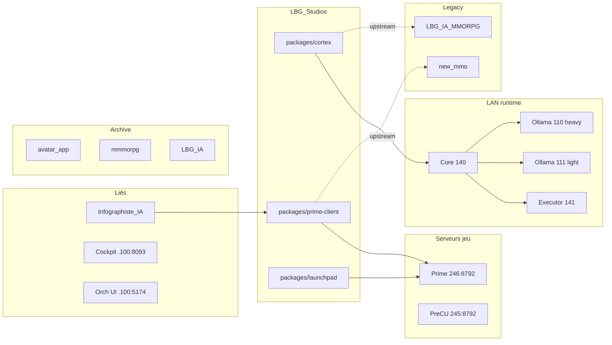

# Registre LBG Studios

**Date** : 2026-08-17 (LAN + LLM Qwen + executor `.141`)  
**Source de vérité** : ce fichier.

**Objectif** : recentrer sur **Studio (Cortex)** puis **Jeu (Prime/Godot)** dans `LBG_Studios`,  
sans perdre l’étoile du nord — [`RESTAURATION_PRODUIT.md`](RESTAURATION_PRODUIT.md).  
**Smoke** : [`SMOKE_LAN.md`](SMOKE_LAN.md).  
**LLM local** : [`packages/cortex/docs/local_llm_route_matrix.md`](../packages/cortex/docs/local_llm_route_matrix.md).  
**Pont Cloud↔LAN** : [`packages/cortex/docs/pont_cloud_local.md`](../packages/cortex/docs/pont_cloud_local.md).  
**Lore / âme jeu** : [`world/BIBLE_MMO.md`](world/BIBLE_MMO.md) · [`world/INVENTAIRE_PNJ.md`](world/INVENTAIRE_PNJ.md) · [`world/ARBRES_TALENTS_PRECU.md`](world/ARBRES_TALENTS_PRECU.md) · [`world/BOITE_IDEES_GAMEPLAY.md`](world/BOITE_IDEES_GAMEPLAY.md) · garant runtime **Chœur du monde**.

**Règle** : dépôt **legacy / archive / étagère** = pas de nouvelle feature produit ; correctifs OK.

---

## Chemins et remotes

| Quoi | Chemin / URL |
|------|----------------|
| Monorepo (source de vérité) | `/home/sdesh/projects/LBG_Studios` — GitHub `Teome0245/LBG_Studios` |
| Workspace Cursor | `LBG_Studios.code-workspace` |
| Deploy runtime Cortex | `.140` → **`/opt/LBG_IA_MMO`** (rsync, pas de `git clone`) |
| Env prod | `.140` `/etc/lbg-ia-mmo.env` (depuis `packages/cortex/infra/secrets/lbg.env`) |
| Client Windows | Launchpad → `J:\swgemu\dist\` ; Godot `J:\swgemu\clients\prime-client` |

### Client Godot (deux chemins — ne pas les confondre)

| Rôle | Chemin |
|------|--------|
| **Source Git** (dev, ce repo) | `packages/prime-client` |
| **Runtime 140** (env actuel) | `/opt/new_mmo/prime-client` (`LBG_PRIME_CLIENT_ROOT`) |
| Copie Studios sur 140 | `/opt/LBG_Studios/packages/prime-client` (pas encore l’env par défaut) |
| Joueur Windows | `J:\swgemu\clients\prime-client` (sync depuis le package) |

Nouvelles features client → **Git Studios**. Deploy / sondes VM → respecter `LBG_PRIME_CLIENT_ROOT` jusqu’à unification.

---

## Actif — monorepo `LBG_Studios`

| Package | Rôle | Point d’entrée |
|---------|------|----------------|
| **`packages/cortex`** | Studio : orchestrateur, Team, Pilot, agents | `http://192.168.0.140:8080/` |
| **`packages/prime-client`** | Jeu : client Godot Prime | Launchpad / Godot → 246 |
| **`packages/launchpad`** | Lanceur Electron (sources) | build Windows → `J:\swgemu\dist\` |

Serveurs jeu (runtime, hors Git) :

| Hôte | Rôle | Accès |
|------|------|-------|
| **`192.168.0.246:8792`** | **Prime** — monde LBG produit (écriture / features) | http://192.168.0.246:8792/ |
| **`192.168.0.245:8792`** | **PreCU** — **référence SWG Pre-CU** (lecture seule ; ne pas modifier) | http://192.168.0.245:8792/ |
| **`192.168.0.246:8080`** | Patches Prime | http://192.168.0.246:8080/patches/prime/manifest.json |

**Règle 245** : modèle le plus proche de l’original Pre-CU pour consulter arbres / craft / datatables. Toute feature LBG = **246** + monorepo. Voir Bible **V4**.

## LAN — hôtes (Atlas / ops)

| IP | Rôle | Notes |
|----|------|-------|
| **`.10`** | Poste Teome | Cursor, ComfyUI, pilotage humain — plus l’executor LAN |
| **`.100`** | Cockpit / Orch UI | `:8093` Cockpit · `:5174` SPA · `:3000` API |
| **`.110`** | Ollama **heavy** | `:11434` CPU — `qwen3.8:27b` (code/PM/dialogue) + `gemma4:e2b` (forge) |
| **`.111`** | Ollama **light** | `:11434` — `qwen2.5:3b` + `llama3.2:3b` |
| **`.140`** | Core Studio | Pilot `:8080`, backend `:8000`, orchestrateur `:8010` |
| **`.141`** | CT `lbg-executor` | poll `/v1/team/wsl/*` — `lbg-lan-executor.service` |
| **`.200` / `.201`** | Proxmox | `.201` = R720 (CT 110 / 141) |
| **`.245`** | PreCU | lecture seule `:8792` |
| **`.246`** | Prime | monde produit `:8792` + sidecar IA |

LLM : `think: false` (Qwen). Ne pas cohabiter deux 18 Go sur `.110` (24 Go RAM).

## Actif — remotes liés (hors Git monorepo)

| Chemin local | Rôle |
|--------------|------|
| `../Infographiste_IA` | Pipeline assets / LoRA |
| **Cockpit P03** (runtime) | Ops infra LAN — http://192.168.0.100:8093/pilot/#/cockpit (sources `_shelf/LBG_Project_03`) |
| **Orchestrateur UI** (runtime) | SPA Vue — http://192.168.0.100:5174/ · `/lyra` · `/agents/map` (sources `_archive/LBG_IA`, API `:3000`) |

## Étagère

| Dépôt | Motif |
|-------|--------|
| `_shelf/LBG_Project_03` | Sources Cockpit / LangGraph — runtime actif sur `.100:8093` ; pas de nouvelles features majeures ici (lien depuis Pilot Ops) |

## Archive / legacy upstream

| Dépôt | Motif |
|-------|--------|
| `_archive/avatar_app` | Bac avatars web Three.js — gelé |
| `_archive/mmmorpg` | Pivot Core3 / sandbox WS gelée |
| `_archive/LBG_IA` | Sources SPA Orchestrateur Vue — **runtime actif** sur `.100:5174` (pas à jeter) |
| `../LBG_IA_MMORPG` | **Upstream legacy** Cortex (avant extraction) |
| `../new_mmo` | **Upstream legacy** jeu (Core3 + historiques) |

### Composants gelés (ne pas réimporter)

`mmo_server`, `mmmorpg_server`, `web_client`, `pilot_web/mmo`, `lbg_client_godot` 3D phase 0, `avatar_app`.

---

## Matrice

