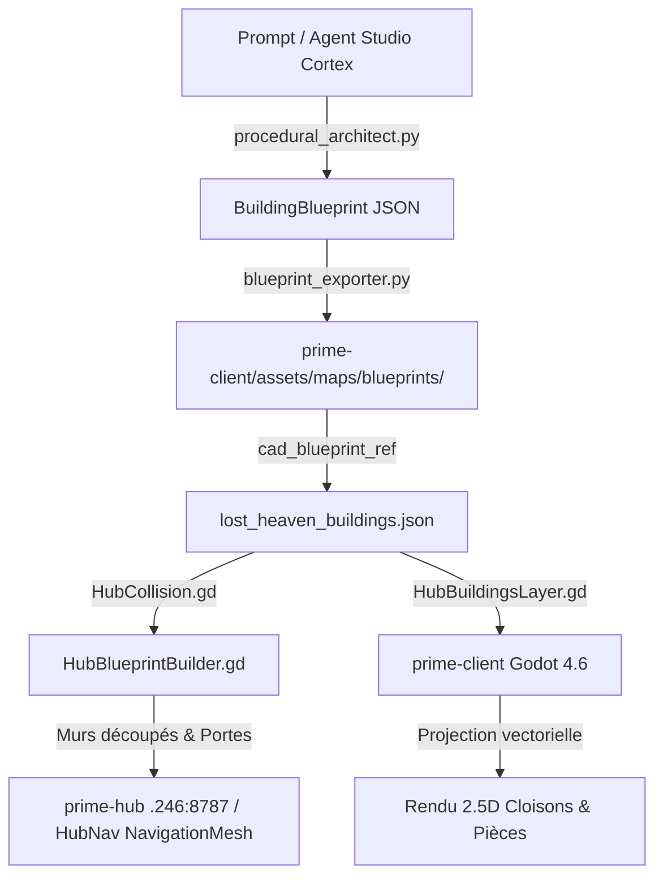

# BUILDING_CAD_GENERATOR.md — Système de Génération et Modélisation CAO de Bâtiments

**Date** : 2026-10-26  
**Inspiration** : CADCraft + Claude (Model Context Protocol / CAO paramétrique)  
**Périmètre** : `packages/cortex/services/building_cad/` (Studio) · `packages/prime-hub/` (Serveur/Collisions) · `packages/prime-client/` (Rendu)

---

## 1. Philosophie & Principes

Contrairement aux générateurs de maillage 3D brut (qui produisent des formes aléatoires sans intérieurs ni cotes exactes), le générateur de bâtiments de Lost Heaven repose sur une **approche CAO déclarative et paramétrique** :

1. **Intérieurs Praticables & Cohérents** :
   - Épaisseur de murs réaliste (0.25 m à 0.4 m).
   - Portes dimensionnées pour les hitboxes des joueurs et PNJ (largeur 1.2 m à 2.8 m, hauteur 2.2 m à 2.6 m).
   - Circulation logique : entrée, sas, hall principal, cloisons, pièces spécifiques (réserve, bureaux, dortoirs).

2. **Découpe Physique des Collisions (Godot Headless & NavMesh)** :
   - Au lieu d'un simple pavé opaque AABB, le compilateur [`HubBlueprintBuilder`](../../packages/prime-hub/scripts/hub_blueprint_builder.gd) décompose les murs en segments individuels et **découpe physiquement les ouvertures de portes**.
   - Le passage de porte est un espace vide sans collision, permettant aux joueurs et PNJ de franchir les portes et d'entrer librement dans les bâtiments.

3. **Boucle Agentic Studio (Cortex / LLM)** :
   - L'agent d'architecture peut générer ou modifier des structures en émettant ou modifiant un blueprint JSON propre, sans manipuler directement des coordonnées de vertex non vérifiables.

---

## 2. Schéma du Blueprint (`BuildingBlueprint`)

Les blueprints sont enregistrés dans `packages/prime-client/assets/maps/blueprints/*.json` :

```json
{
  "id": "poi:lost_heaven_cantina",
  "kind": "cantina",
  "label": "La Perle de Scrapaltai",
  "world_pos": [5028.3, 0.0, -784.1],
  "footprint_width_m": 32.0,
  "footprint_depth_m": 24.0,
  "floors": [
    {
      "floor_index": 0,
      "elevation_m": 0.0,
      "height_m": 3.8,
      "rooms": [
        {
          "id": "room_main_hall",
          "name": "Salle principale",
          "purpose": "cantina_hall",
          "polygon": [[-16.0, -4.5], [16.0, -4.5], [16.0, 12.0], [-16.0, 12.0]],
          "area_m2": 528.0,
          "ambient_audio": "amb_cantina_chatter"
        }
      ],
      "walls": [
        {
          "id": "wall_south",
          "start": [16.0, 12.0],
          "end": [-16.0, 12.0],
          "thickness_m": 0.3,
          "height_m": 3.8,
          "is_exterior": true,
          "doors": [
            { "offset_m": 14.6, "width_m": 2.8, "height_m": 2.6, "is_exterior": true }
          ],
          "windows": [
            { "offset_m": 1.2, "width_m": 1.4, "height_m": 1.5, "sill_height_m": 1.0 }
          ]
        }
      ]
    }
  ],
  "roof_style": "flat"
}
```

---

## 3. Architecture Technique



---

## 4. Validation & CI

1. **Tests unitaires Python (Cortex)** :
   ```bash
   cd packages/cortex && python -m pytest backend/tests/test_building_cad.py
   ```
2. **Tests Headless Godot (Prime-Hub & Collisions)** :
   ```bash
   bash tools/ci_godot_headless.sh
   # Exécute building_cad_selftest.gd : valide la découpe physique des portes et le passage libre
   ```
