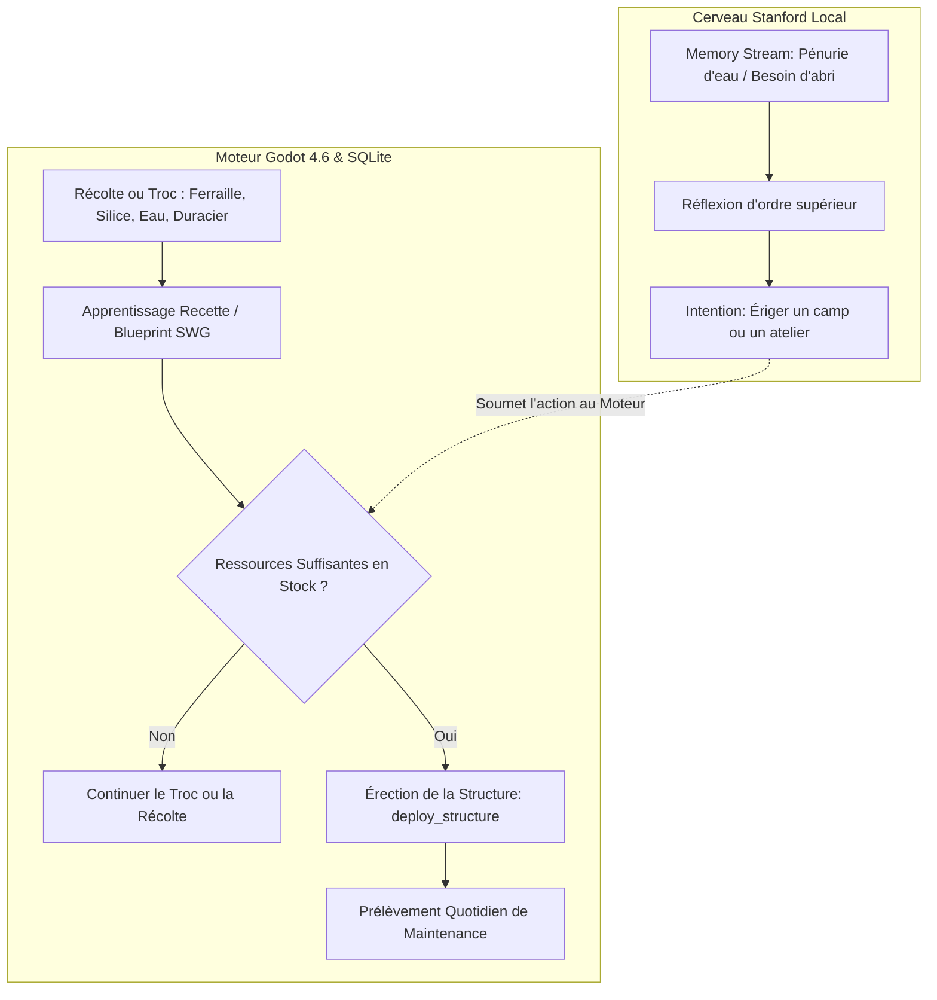

# Démographie Planétaire & Urbanisme Émergent de Scrapaltaï

**Date** : 2026-11-26  
**Auteurs** : Équipe LBG Studios & Antigravity  
**Statut** : Canon O2/O3 — Conception & Feuille de Route  
**Alignement** : Règle d'or LBG (`OBJECTIVES.md`), `METHODOLOGIE_DEV_SOLO_MMO_PRIME.md`.

---

## 1. Distinction Fondamentale : Joueurs IA (O3) vs PNJ Résidents (O2)

Une clarification essentielle régit l'écosystème de simulation :

- **Les 10 Bots Joueurs IA (O3)** :
  - **Ce sont des joueurs** : ils ont un compte, un inventaire joueur, une présence volatile (`login`/`logout`), et des objectifs de session (chasser, progresser dans l'arbre SWG, commercer avec des humains, quitter le jeu).
  - Ils ne sont **pas des résidents fixes** et ne font pas partie du recensement urbain des colonies.
- **Les PNJ Résidents (O2)** :
  - **Ce sont les citoyens permanents de la planète Scrapaltaï**.
  - Ils incarnent le tissu social, commercial, agricole et artisanal des villes, villages et avant-postes.
  - Ils ne déconnectent pas : ils dorment, travaillent, patrouillent, bâtissent, voyagent en caravane et vieillissent dans le monde.

---

## 2. Démographie Cible & Faisabilité Technique (Cap à ~300 PNJ)

### Trajectoire de Croissance (+10 PNJ par semaine)
- **Phase 1 (Actuelle - 2 semaines)** : 10 PNJ pilotes emblématiques de Lost Heaven.
- **Phase 2 (+1 semaine)** : 20 PNJ (ouverture des mines d'Anchor-Ridge et de l'oasis du Ksar Nomade).
- **Phase 3 (+1 semaine)** : 30 PNJ (marchands, artistes et gardes de Mos Eisley et des portes).
- **Phase 4 (Croissance continue, ~27 semaines)** : Expansion méthodique de **+10 PNJ/semaine** jusqu'à l'équilibre démographique planétaire de **~300 PNJ**.

### Pourquoi 300 PNJ tournent à l'aise sur notre serveur (`.246:8787`)
1. **Spatial Hashing & Tick LOD (Level of Detail)** :
   - Un PNJ situé à l'autre bout de la planète (ex: mine d'Anchor-Ridge) sans joueur humain à proximité ne simule pas de physique 3D à 60 Hz.
   - Il tourne sur un **tick basse fréquence** (ex: 1 tick par minute pour mettre à jour son emploi du temps et son stock).
   - Seuls les PNJ dans la sphère d'action immédiate des joueurs sont interpolés en temps réel.
2. **Frugalité Mémoire** :
   - 300 PNJ avec état SQLite représentent environ **15 à 20 Mo de RAM** supplémentaires sur un binaire Godot headless qui n'en consomme que 800 Mo.
   - Coût serveur CPU : quasiment nul hors sollicitation directe.

---

## 3. Urbanisme Émergent : Les PNJ Façonnent le Monde (Règle d'Or 0 € Triche)

Les PNJ ne sont pas de simples statues de dialogue : ils construisent et transforment Scrapaltaï.  
**Règle d'or d'acier : ZÉRO ressource créée par hallucination LLM.**

### Types de Constructions :
1. **Structures Éphémères (Nomades & Éclaireurs)** :
   - Feux de camp, tentes en toile de dune, balises de chemin.
   - *Règle de decay* : disparaissent au bout de 48h à 72h si non entretenues.
2. **Structures Pérennes (Artisans & Colons)** :
   - Dômes d'argile adobe, ateliers d'assemblage mécatronique, échoppes de troc, extracteurs d'humidité (*vaporateurs GX-8*).
   - *Règle de maintenance* : financées par les bénéfices réels du PNJ sur ses ventes aux joueurs et aux bots. Si la caisse est vide, le bâtiment s'érode sous le vent de sable.
3. **Pistes & Routes Procédurales** :
   - Plus les PNJ et caravanes empruntent un tracé entre deux avant-postes (`hub_paths.gd`), plus la densité de passage tasse le sable. Une piste praticable se dessine naturellement dans le paysage.

---

## 4. Cycle de Vie des PNJ (Life Cycle)

1. **Arrivée / Naissance Sociale** :
   - Arrivée par navette au Starport de Lost Heaven ou recrutement par une caravane nomade.
2. **Apprentissage & Rôle** :
   - Progression dans l'arbre de compétences SWG (un apprenti forgeron apprend le travail des alliages).
3. **Activité & Fondation** :
   - Accumulation de crédits et de matériaux, choix d'une zone propice, érection d'un commerce ou d'une maison.
4. **Relève / Transmission** :
   - Retraite ou départ par navette, transmission des outils et de l'échoppe à un apprenti.

---

## 5. Observabilité Live : Suivi sur Pilot Topologie (`http://192.168.0.140:8080/#/topology`)

L'évolution de la population et des bâtisses sera visible directement depuis le panneau **Pilot Topologie** :
- **Compteur Démographique Live** : nombre de résidents actifs par colonie (Lost Heaven, Mos Eisley, Zalem, Ksar, Anchor-Ridge).
- **Cartographie des Chantiers** : nouvelles tentes, ateliers et routes en cours d'érection.
- **Journal des Réflexions Stanford** : les 10 dernières pensées d'ordre supérieur ayant déclenché un projet de construction ou une alliance.
