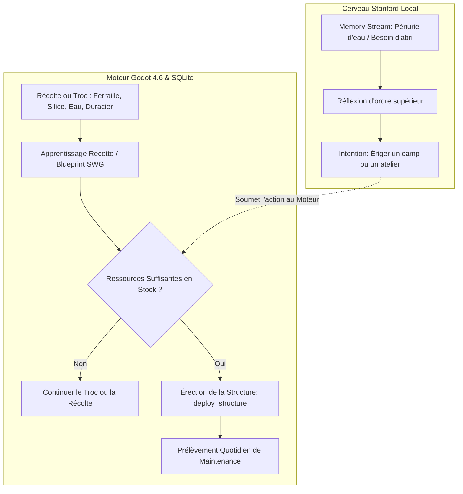

# Démographie Planétaire & Urbanisme Émergent de Scrapaltaï

**Date** : 2026-11-26  
**Auteurs** : Équipe LBG Studios & Antigravity  
**Statut** : Canon O2/O3 — Conception & Feuille de Route  
**Alignement** : Règle d'or LBG (`OBJECTIVES.md`), `METHODOLOGIE_DEV_SOLO_MMO_PRIME.md`.

---

## 1. Distinction Fondamentale : Joueurs IA (O3) vs PNJ Résidents (O2)

Une clarification essentielle régit l'écosystème de simulation :

- **Les 10 Bots Joueurs IA (O3)** :
  - **Ce sont des joueurs** : ils ont un compte, un inventaire joueur, une présence volatile (`login`/`logout`), et des objectifs de session (chasser, progresser dans l'arbre SWG, commercer avec des humains, quitter le jeu).
  - Ils ne sont **pas des résidents fixes** et ne font pas partie du recensement urbain des colonies.
- **Les PNJ Résidents (O2)** :
  - **Ce sont les citoyens permanents de la planète Scrapaltaï**.
  - Ils incarnent le tissu social, commercial, agricole et artisanal des villes, villages et avant-postes.
  - Ils ne déconnectent pas : ils dorment, travaillent, patrouillent, bâtissent, voyagent en caravane et vieillissent dans le monde.

---

## 2. Démographie Cible & Faisabilité Technique (Cap à ~300 PNJ)

### Calendrier en « Temps de Jeu » (Dilatation Circadienne $\times 16$)
Le monde de Scrapaltaï tourne avec une accélération de simulation calibrée :  
$$\mathbf{1\text{ jour en jeu (24h in-game)}} = \mathbf{90\text{ minutes réelles (1h 30 min)}} \quad (\text{soit } 16\text{ jours de jeu par jour IRL})$$

Les étapes de croissance démographique sont indexées sur les **jours de jeu** (`game_day`), permettant une progression organique et dynamique :

| Phase | Période en Jeu | Durée Réelle IRL ($\times 16$) | Population Cible | Périmètre & Colonies |
| :--- | :--- | :--- | :--- | :--- |
| **Phase 1 (Pilote)** | **14 jours de jeu** (2 semaines in-game) | **21 heures réelles** | **10 PNJ** | Les 10 PNJ pilotes de Lost Heaven (La Perle, clinique, atelier, missions). |
| **Phase 2** | **+7 jours de jeu** (1 semaine in-game) | **+10h 30 min réelles** | **20 PNJ** | Expansion vers l'Oasis du Ksar Nomade, les mines d'Anchor-Ridge et fermes d'humidité. |
| **Phase 3** | **+7 jours de jeu** (1 semaine in-game) | **+10h 30 min réelles** | **30 PNJ** | Artisans, artistes de scène, ferrailleurs Jawas et milice de Mos Eisley. |
| **Phase 4 (Continue)** | **+7 jours / palier de 10 PNJ** | **+10h 30 min / palier** | **Jusqu'à 300 PNJ** | Répartition planétaire équilibrée sur tous les biomes, villages et camps nomades. |
| **Jalon Équilibre** | **Jour 189 de jeu** (~27 semaines in-game) | **~11 jours et demi réels** | **300 PNJ** | **Déclenchement du Cycle de Vie Complet (Vieillissement, Morts, Naissances).** |

### Pourquoi 300 PNJ tournent à l'aise sur notre serveur (`.246:8787`)
1. **Spatial Hashing & Tick LOD (Level of Detail)** :
   - Un PNJ situé à l'autre bout de la planète (ex: mine d'Anchor-Ridge) sans joueur humain à proximité ne simule pas de physique 3D à 60 Hz.
   - Il tourne sur un **tick basse fréquence** (ex: 1 tick par minute pour mettre à jour son emploi du temps et son stock).
   - Seuls les PNJ dans la sphère d'action immédiate des joueurs sont interpolés en temps réel.
2. **Frugalité Mémoire** :
   - 300 PNJ avec état SQLite représentent environ **15 à 20 Mo de RAM** supplémentaires sur un binaire Godot headless qui n'en consomme que 800 Mo.
   - Coût serveur CPU : quasiment nul hors sollicitation directe.

---

## 3. Urbanisme Émergent : Les PNJ Façonnent le Monde (Règle d'Or 0 € Triche)

Les PNJ ne sont pas de simples statues de dialogue : ils construisent et transforment Scrapaltaï.  
**Règle d'or d'acier : ZÉRO ressource créée par hallucination LLM.**

### Types de Constructions :
1. **Structures Éphémères (Nomades & Éclaireurs)** :
   - Feux de camp, tentes en toile de dune, balises de chemin.
   - *Règle de decay* : disparaissent au bout de 48h à 72h si non entretenues.
2. **Structures Pérennes (Artisans & Colons)** :
   - Dômes d'argile adobe, ateliers d'assemblage mécatronique, échoppes de troc, extracteurs d'humidité (*vaporateurs GX-8*).
   - *Règle de maintenance* : financées par les bénéfices réels du PNJ sur ses ventes aux joueurs et aux bots. Si la caisse est vide, le bâtiment s'érode sous le vent de sable.
3. **Pistes & Routes Procédurales** :
   - Plus les PNJ et caravanes empruntent un tracé entre deux avant-postes (`hub_paths.gd`), plus la densité de passage tasse le sable. Une piste praticable se dessine naturellement dans le paysage.

---

## 4. Jalon Majeur : Le Cycle de Vie Complet (À ~11,5 Jours Réels / Jour 189 In-Game)

Dès que la population atteint son seuil d'équilibre démographique planétaire (~300 PNJ), le système active le **Cycle de Vie Dynamique** :

1. **Vieillissement Circadien & Stades de Vie** :
   - *Jeunesse & Apprentissage* : Les nouveaux venus apprennent un métier SWG auprès des maîtres formateurs.
   - *Maturité & Maîtrise* : Exploitation active d'ateliers, comptoirs, fermes d'humidité ou patrouilles de garde.
   - *Séniorité & Sagesse Nomade* : Retrait progressif de l'artisanat lourd, fréquentation de La Perle, transmission d'histoires et de rumeurs aux voyageurs.
2. **Mortalité Réelle (Naturelle ou Accidentelle)** :
   - *Mort Naturelle de Vieillesse* : Fin de vie paisible pour les aînés ayant accompli leur cycle.
   - *Morts Liées aux Événements & Fléaux* : Tempêtes de sable cataclysmiques (`sandstorm`), attaques de meutes de chacals/krayts, ou pénurie prolongée d'eau lors de blocus de convois.
3. **Naissances, Dynasties & Nouveaux Colons** :
   - *Arrivées régulières* : Débarquement de navettes de colons au Starport de Lost Heaven ou intégration d'orphelins du désert par les caravanes nomades.
4. **Héritage Déterministe & Préservation de la Mémoire** :
   - *Transmission des biens* : Lorsqu'un artisan disparaît, son atelier, ses stocks de ferraille et sa maison en adobe sont légués à son apprenti ou mis aux enchères de quartier.
   - *Mémoire collective éternelle* : Le flux mémoriel de l'artisan n'est pas perdu : le **Scribe de Lost Heaven** (`npc:scribe`) archive sa biographie dans la **Chronique de Scrapaltaï** (`prime_hub.sqlite3`), et les anciens compagnons continuent de citer son nom au comptoir de Jax.

---

## 5. Observabilité Live : Suivi sur Pilot Topologie (`http://192.168.0.140:8080/#/topology`)

L'évolution de la population et des bâtisses sera visible directement depuis le panneau **Pilot Topologie** :
- **Compteur Démographique Live** : nombre de résidents actifs par colonie (Lost Heaven, Mos Eisley, Zalem, Ksar, Anchor-Ridge).
- **Cartographie des Chantiers** : nouvelles tentes, ateliers et routes en cours d'érection.
- **Journal des Réflexions Stanford** : les 10 dernières pensées d'ordre supérieur ayant déclenché un projet de construction ou une alliance.
