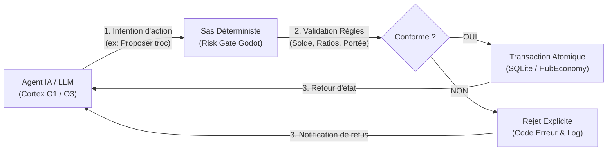

# Protocole de Sécurité & Sas Déterministe ("Risk Gate") — LBG Studios

**Date** : 2026-11-10  
**Statut** : Canon vivant d'architecture  
**Piliers concernés** : O1 Compagnon, O2 MMO, O3 Joueurs IA  
**Inspiration & Référence** : Architecture modulaire à validation dure hors-modèle (Veille Tech TikTok).

---

## 1. Principe Fondamental (Zéro Mutation LLM Libre)

Conformément à [`OBJECTIVES.md`](../../OBJECTIVES.md), **aucun modèle de langage (LLM)** n'a le droit d'écrire directement dans la base de données de jeu, de modifier un solde financier, d'octroyer un objet d'inventaire ou de changer unilatéralement un état de quête ou de réputation.

Les LLMs (Compagnon, PNJ conversationnels, Joueurs IA autonomes) opèrent **exclusivement au niveau de la formulation d'intentions**. Le monde physique et l'état de vérité vivent uniquement dans le serveur **Godot Headless (`packages/prime-hub` sur `.246:8787`)** adossé à SQLite.



---

## 2. Cartographie des Sas Déterministes Actuels

### A. Économie & Troc P2P (`HubTrade` — `hub_trade.gd`)
- **Vérification de fair-play** : La fonction `is_fair_exchange()` vérifie que le ratio de valeur relative des objets échangés reste obligatoirement compris dans une fourchette stricte `[0.5, 2.0]`.
- **Validation bilatérale atomique** : `economy.atomic_barter_swap()` s'assure que le donneur et le receveur possèdent physiquement les items en inventaire avant d'opérer le swap dans une transaction SQLite atomique (commit ou rollback total).

### B. Villes de Joueurs & Politique (`HubPlayerCities` — `hub_player_cities.gd`)
- **Sas électoral** : Un joueur ou agent ne peut voter qu'une seule fois par cycle (`cast_vote`).
- **Plafonds fiscaux** : Les taux de taxation paramétrables par le Maire sont bridés par des bornes absolues déterministes (ex: taxe max 15%).
- **Échelons de croissance** : Le passage de rang d'une ville (Outpost ➔ Village ➔ Township ➔ City ➔ Metropolis) exige le franchissement vérifié de seuils stricts de citoyens résidents et de trésorerie communale.

### C. Combat & Dommages (`HubCombat` & `HubSwgCombat`)
- **Calculs déterministes** : Probabilité de toucher (hit chance), mitigation d'armure, application des dégâts et clamps des points de vie `[0, MaxHP]` sont calculés par le moteur Godot selon les formules mathématiques Pre-CU.
- L'IA ne peut jamais décréter qu'elle a « touché » ou « tué » un ennemi : elle ne fait que requérir l'action d'attaque `/attack <target_id>`.

---

## 3. Matrice de Sécurité pour tout Nouvel Agent

Tout nouvel agent IA (ou module de Compagnon) doit respecter la grille suivante :

| Domaine | Action Agent permise | Validation Sas Déterministe requise |
| :--- | :--- | :--- |
| **Monnaie / Crédits** | Exprimer un souhait d'achat / vente | Vérification du solde effectif dans `HubEconomy` |
| **Inventaire** | Sélectionner un item à équiper / consommer | Vérification de la présence et de la durabilité de l'item |
| **Déplacement** | Indiquer des coordonnées cibles | NavigationServer3D / pathfinding sans téléportation |
| **Quêtes** | Déclarer un objectif atteint | Contrôle des conditions serveur (kills effectifs, items remis) |

---

## 4. Vérification Automatique en Intégration Continue (CI)

L'intégrité du Risk Gate est validée automatiquement sans régression via le script de test headless :
```bash
bash tools/ci_godot_headless.sh
```
Ce script exécute en ~3 secondes toutes les suites de persistance SQLite, de simulation spatiale et d'économie sans dépendance réseau.

