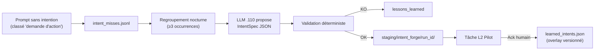
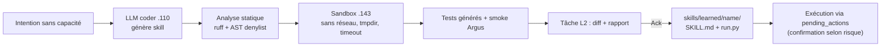

# Handoff — Gladys : apprentissage d'intentions & forge de capacités (sécurisés)

**Date** : 2026-11-24 · **Statut** : proposition (design, pas encore codé) · **Périmètre** : O1 (`packages/cortex`)
**Origine** : ancien orchestrateur Lyra (`.100`) — `intent_learning.py` + `agent_autoupgrade.py`, réintroduits **avec garde-fous**.

---

## 1. Principe directeur

> Le LLM **propose**, la machine **vérifie**, l'humain **adopte**. Rien de généré n'est exécuté ni chargé sans passage L2.

On réutilise les briques existantes plutôt que d'en inventer :

| Brique existante | Rôle dans le nouveau flux |
|---|---|
| `orchestrator/team/agent_mutator.py` | Modèle à copier : staging → évaluation → manifeste → tâche L2 |
| `team_store.create_task(approval_required=True)` | Carte de revue L2 dans Pilot |
| `team/verify_chain.maybe_spawn_argus_smoke` | Smoke après génération |
| `team/prompt_overrides.py` | Modèle « overlay fichier » appliqué seulement à l'ack L2 |
| `server_overlay/pending_actions.py` (`CANONICAL_ACTIONS`, confirmation « oui/go ») | Exécution HITL de toute action apprise |
| `capabilities/spec.py` (`CapabilitySpec.risk_level`) | Déclaration de risque des capacités forgées |
| `lessons_learned` | Mémoire des propositions rejetées (ne pas reproposer) |

---

## 2. Boucle A — Intent Forge (apprentissage d'intentions)

**IntentSpec** (seul format accepté) : `action`, `label`, `keywords[]` (regex), `params_schema`, `target_capability`, `examples_pos[]`, `examples_neg[]`.

**Validations déterministes (aucune n'est LLM)** :
1. JSON strict + schéma pydantic.
2. Regex : compile, longueur ≤ 200, **anti-ReDoS** (pas de quantificateurs imbriqués `(a+)+`, timeout match).
3. Matche **tous** les `examples_pos` (issus des vrais misses).
4. Ne matche **aucun** corpus négatif : salutations/causerie (`chat_intent.py`), prompts des tests existants.
5. **Zéro collision** avec les intentions manuelles existantes (`CANONICAL_ACTIONS`, `infra_lan_intent`, `mission_watch_intent`).
6. `target_capability` **doit déjà exister** → sinon bascule vers boucle B (pas d'invention silencieuse).

**Chargement** : `learned_intents.json` lu **après** les intentions manuelles (jamais prioritaire), kill switch `LBG_LEARNED_INTENTS=0`, chaque entrée porte `run_id` + date d'adoption → révocable.

---

## 3. Boucle B — Capability Forge (auto-upgrade sécurisé)

**Ce qui est généré** : un *skill* au format standard (`SKILL.md` frontmatter + `run.py`), jamais un module importé dans le process orchestrateur → exécution en **sous-processus**, isolée.

**Garde-fous** :
- **AST denylist** : `eval`, `exec`, `compile`, `__import__`, `os.system`, `subprocess(shell=True)`, `socket`, `ctypes`, `shutil.rmtree` hors racine autorisée, écriture hors `allowed_roots`.
- **Allowlist de chemins** déclarée dans le frontmatter (`allowed_roots`) et vérifiée au runtime.
- **Sandbox** : exécution sur `.143` dans un tmpdir jetable, réseau coupé, timeout, pas de secrets dans l'env.
- **`risk_level` imposé par règle, pas par le LLM** : toute écriture/suppression ⇒ `high` ⇒ dry-run obligatoire + confirmation à **chaque** exécution.
- Aucune capacité forgée ne peut toucher économie / combat / craft / quête / réputation O2 (canon `OBJECTIVES.md`).
- **A4 conservé** : jamais d'écriture dans `agents/declarations/*.json`.

**Exemple `delete_file`** (le cas Lyra) : forgé en `high`, `allowed_roots` restreint, mode `--dry-run` qui liste ce qui serait supprimé, déplacement en corbeille plutôt que suppression dure, confirmation « oui » à chaque appel.

---

## 4. Niveaux d'autonomie

| Niveau | Boucle A (intentions) | Boucle B (capacités) |
|---|---|---|
| L1 auto | Journaliser misses, proposer en staging | Générer + tester en sandbox |
| L2 humain | **Adoption** dans `learned_intents.json` | **Adoption** du skill |
| Runtime | Match → action existante (HITL si risque) | Confirmation par appel si `medium/high` |

---

## 5. Plan de livraison

| Phase | Contenu | DoD |
|---|---|---|
| **P1** | Journal `intent_misses.jsonl` + `IntentSpec` + validateurs (regex, ReDoS, collisions) + tests | `pytest` vert, aucun effet runtime |
| **P2** | `team/intent_forge.py` (calqué sur `agent_mutator`) : staging + tâche L2 + ack ⇒ overlay | Cycle complet sur un miss réel, carte L2 visible Pilot |
| **P3** | Chargement `learned_intents.json` dans le routage Compagnon (après manuels, kill switch) | Intention adoptée détectée en chat, révocation testée |
| **P4** | `team/capability_forge.py` : génération skill + AST + sandbox `.143` + L2 | `delete_file` forgé, dry-run OK, exécution uniquement via `pending_actions` |
| **P5** | Nœuds `intent_forge` / `capability_forge` dans `#/topology` + section audit nocturne | Visible Pilot, compteur propositions/adoptions/rejets |

## 6. Décisions d'arbitrage validées (2026-11-24)
- **Validation L2 d'une intention ou skill** : Dans **Pilot (`#/tasks`) ET en chat** (via carte Pending Action L2 avec confirmation « oui / go »).
- **Seuil de récurrence (Boucle A)** : **3 occurrences** du même type de miss avant déclenchement de la proposition d'intention par Gladys.
- **Sandbox d'exécution (Boucle B, Phase 4)** : **Conteneur Podman isolé sur `.143`** (isolation complète process + réseau + filesystem temporaire).

## 7. Statut d'avancement
- **Phase 1 (Fondations Intent Forge & Validations déterministes)** : **TERMINÉE (13/13 tests PASS)**.
  * Code : `packages/cortex/compagnon_ui/server_overlay/intent_forge.py`
  * Tests : `packages/cortex/compagnon_ui/server_overlay/tests/test_intent_forge.py`
- **Phase 2 (Clustering, Staging, Tâche L2 Pilot & Chat PendingAction, Adoption)** : **TERMINÉE (16/16 tests PASS)**.
  * Fonctions clés : `cluster_intent_misses` (seuil de 3 occurrences), `write_intent_manifest`, `maybe_spawn_intent_l2_task`, `create_intent_pending_action`, `adopt_intent_from_manifest`, `run_intent_forge_cycle`.
  * Adoption effective enregistrée dans `learned_intents.json`.
- **Phase 3 (Branchement runtime Compagnon)** : **TERMINÉE (17/17 tests PASS)**.
  * Routage actif dans `core.py` : intercepte les intentions apprises via `match_learned_intent`, propose confirmation PendingAction, enregistre en continu les nouveaux misses avec filtre anti-bruit. Kill-switch `LBG_LEARNED_INTENTS_ENABLED=0`.
- **Phase 4 (Capability Forge & Podman .143)** : Prochaine étape.
