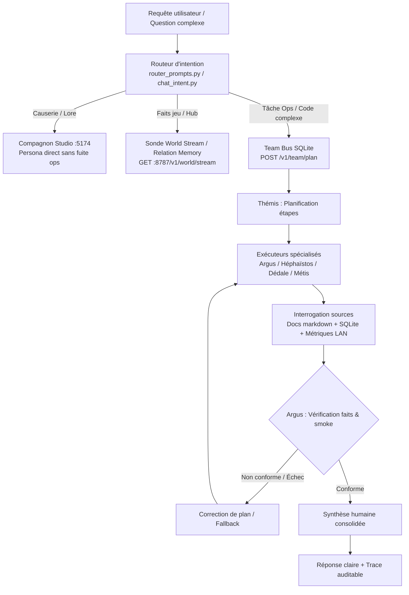

# Mapping Agentic RAG → Bus Team & Mémoire Compagnon

**Statut** : **L1 — Cadrage & Inspiration**  
**Date** : 2026-10-13  
**Référence** : [`lbg_agentic_os.md`](lbg_agentic_os.md), [`architecture_tri_backend_hybride.md`](architecture_tri_backend_hybride.md), ADR 0019, `O-VEIL-3`.  
**Règle d'or** : Inspiration architecturale uniquement — **aucun framework externe** (pas de LangChain, LlamaIndex, Dify ni CrewAI sur le chemin critique).

---

## 1. Contexte : Du RAG naïf à l'Agentic RAG

Dans un RAG traditionnel (naïf), le flux est linéaire et passif :
`Question → Embedding → Recherche vectorielle top-K → Prompt + Contextes → Réponse LLM`.

L'**Agentic RAG** (recherche augmentée par agents) introduit l'agentivité, le raisonnement et l'auto-correction :
1. **Routage et décomposition d'intention** : Déterminer si la question nécessite une recherche documentaire, une sonde système temps réel, ou une simple réponse conversationnelle.
2. **Recherche multi-sauts (*Multi-Hop Querying*)** : Explorer séquentiellement plusieurs sources (fichiers, état de l'infra, base SQLite, hub de jeu) pour croiser les faits.
3. **Auto-évaluation / Critique (*Self-Correction*)** : Vérifier si les documents ou données récupérés répondent réellement à la question posée avant de formuler la réponse finale.
4. **Mémoire contextuelle structurée** : Différencier mémoire de court terme (session/fil), mémoire épisodique (actions passées) et mémoire sémantique (docs de référence).

---

## 2. Correspondance avec l'OS Agentique LBG

LBG Studios dispose déjà de tous les blocs requis, déployés et validés sur le LAN, sans aucune dépendance lourde :

| Concept Agentic RAG | Équivalent standard marché | Implémentation LBG Studios (Cortex / Team / Compagnon) |
|:---|:---|:---|
| **Routeur d'intention** | Agent Query Router / Semantic Router | `chat_intent.py` & `router_prompts.py` (détection `causerie`, `ops`, `lore`, `world`, `code`) |
| **Bus de messages & Traces** | LangGraph / AutoGen State | Bus SQLite Team (`team_tasks`, `team_messages`, `agents.team.trace`) sur `.140:8010` |
| **Mémoire de session (Court terme)** | Scratchpad / Thread Memory | Mémoire FIFO glissante du Compagnon (`compagnon_ui/server_overlay/core.py`) |
| **Mémoire relationnelle / Monde** | Episodic Graph / Vector Store | `relation_memory.py` + `world_stream.py` (pont direct avec `prime-hub` `:8787`) |
| **Recherche multi-sources** | Tool Retriever / Multi-hop RAG | `reason_llm` + sondes d'infrastructure ciblées (`/v1/pilot/status`, `healthz`, `session_status`) |
| **Critique & Validation** | Self-RAG Evaluator / Reflection Loop | Rôle **Argus** (QA / verify) + `failure_followup` dans le workflow Team |
| **Planification séquentielle** | Hierarchical Planner Agent | Rôle **Thémis** (PM / `POST /v1/team/plan`) + **Lyra** (Campus Conductor) |

---

## 3. Architecture du flux Agentic RAG chez LBG

---

## 4. Recommandations de mise en œuvre LBG (L1)

1. **Pas de framework tiers** : Bannir l'installation de bibliothèques tierces de framework d'agents (CrewAI, LangChain, Dify). Nos scripts Python vanilla et l'API FastAPI sont plus rapides, plus fiables et totalement maîtrisés.
2. **Utiliser le bus SQLite Team comme mémoire de travail** : Dès qu'une recherche nécessite plus de 2 étapes, passer par une sous-tâche Team plutôt que d'alourdir le prompt LLM unique.
3. **Enrichissement ciblé de `character_layer.py`** : Continuer d'alimenter le prompt du Compagnon par des blocs contextuels légers et dynamiques injectés à la volée (comme fait avec succès pour le World Stream et la mémoire relationnelle).
