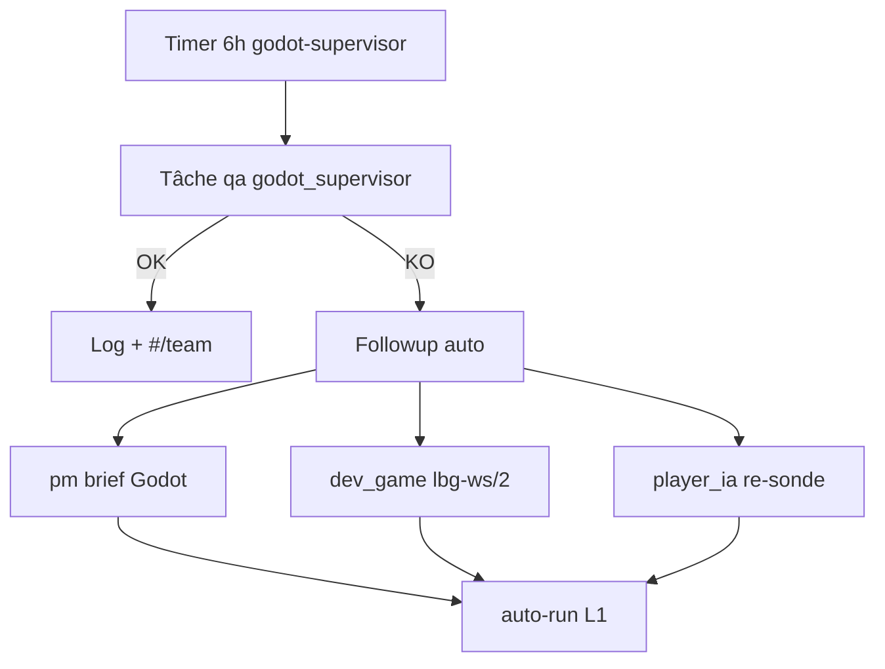

# Équipe virtuelle autonome — Godot + sidecar 246 + lbg-ws/2

**Objectif** : demain matin, la Team pilote les deux pistes client **sans intervention manuelle** (timers + followups auto).

---

## Boucle autonome (VM 140)



| Timer | Actor | Rôle | Période |
|-------|-------|------|---------|
| `lbg-team-godot-supervisor-job` | `system:team_godot_supervisor` | qa (godot_supervisor) | **6 h** |
| `lbg-team-infographiste-job` | `system:team_infographiste` | dev_game (infographiste_ia) | **12 h** |
| `lbg-team-infographiste-lora-job` | `system:team_infographiste_lora` | dev_game (pipeline LoRA) | **2 h** |
| `lbg-team-godot-client-tracks-job` | `system:team_godot_client_tracks` | dev_game M3/M5/ZB-0 | **8 h** |
| `lbg-team-m9-map-job` | `system:team_m9_map` | dev_game M9a/M9b/M9c | **12 h** |
| `lbg-team-godot-dev-job` | `system:team_godot_dev` | **Iris + Hermès** (dev_godot) | **8 h** |
| `lbg-team-player-ia-job` | `system:team_player_ia` | player_ia probe | 12 h |
| `lbg-team-pm-reunification-job` | `system:team_pm_reunification` | pm brief | 24 h |
| `lbg-team-qa-smoke-job` | `system:team_qa_smoke` | qa smoke LAN | 24 h |

Installation :
```bash
bash infra/scripts/install_team_godot_supervisor_job_vm.sh
bash infra/scripts/install_team_infographiste_job_vm.sh
bash infra/scripts/install_team_godot_client_tracks_job_vm.sh
bash infra/scripts/install_team_m9_map_job_vm.sh
bash infra/scripts/install_team_godot_dev_job_vm.sh
```

---

## Variables clés (`/etc/lbg-ia-mmo.env`)

```bash
LBG_TEAM_GODOT_SUPERVISOR_JOB_ENABLED=1
LBG_TEAM_GODOT_FOLLOWUP_ENABLED=1
LBG_TEAM_GODOT_FOLLOWUP_AUTO_RUN=1          # pm + dev_game + player_ia auto
LBG_CORE3_SIDECAR_URL=http://192.168.0.246:8791
LBG_TEAM_GODOT_GATEWAY_SMOKE=1              # gateway M11/M12 sur Prime 246 (:8765 + :50000)
LBG_TEAM_GODOT_GATEWAY_HOST=192.168.0.246
LBG_GATEWAY_WS2_PREVIEW=1                   # négociation lbg-ws/2 sur gateway
LBG_TEAM_GODOT_SOE_M3=0                     # 0 = non-bloquant (pivot Godot-only M11/M12) ; 1 = sonde SOE
LBG_TEAM_GODOT_SOE_M5=0                     # 1 seulement si M3 SOE encore utilisé
LBG_CLIENT_PRIME_LBG_DIR=/home/sdesh/projects/new_mmo/client-prime-lbg
LBG_NEW_MMO_ROOT=/home/sdesh/projects/new_mmo
```

**2026-07-21** : `LBG_TEAM_GODOT_SOE_M3=0` appliqué sur VM **140** — LoginServer `:44553` injoignable / chemin produit = **lbg-ws/2** (pas `soe_handshake`). Les followups « SOE KO » ne doivent plus spammer Element.

**2026-08-05** : garde-fous anti-bruit followups (`team/followup_guard.py`) — cooldown signature, profondeur max, pas de cascade depuis tâches `_godot_followup` / `_m9_followup`, auto-run **PM seulement** par défaut (dev opt-in).

```bash
LBG_TEAM_FOLLOWUP_COOLDOWN_S=3600      # même signature → 1 vague / h
LBG_TEAM_FOLLOWUP_MAX_DEPTH=2          # pas de chaîne parent > 2
LBG_TEAM_GODOT_FOLLOWUP_AUTO_RUN_PM=1  # Thémis L1 auto (défaut)
LBG_TEAM_GODOT_FOLLOWUP_AUTO_RUN_DEV=0 # Dédale/player_ia en file, pas auto-run (défaut)
LBG_TEAM_M9_FOLLOWUP_AUTO_RUN_PM=1
LBG_TEAM_M9_FOLLOWUP_AUTO_RUN_DEV=0
```

**Diagnostic Argus (superviseur Godot)** — gaps sidecar / miroir / lbg-ws/2 :

```bash
# Sur VM 140 (orchestrateur + env LAN)
bash infra/scripts/diag_godot_supervisor.sh

# JSON pour lbg_bot / scripts
bash infra/scripts/diag_godot_supervisor.sh --json

# Via API orchestrateur 140 depuis poste dev
LBG_ORCHESTRATOR_URL=http://192.168.0.140:8010 bash infra/scripts/diag_godot_supervisor.sh --remote
```

Pistes **bloquantes** par défaut (`LBG_TEAM_GODOT_SUPERVISOR_BLOCKING`) : `sidecar_m1`, `godot_mirror_m1`, `lbg_ws2_readiness`.  
ZB-0 et Infographiste = **advisory** (visible dans `human_summary`, ne déclenchent plus followup Dédale seuls).

**2026-07-22** : gateway Godot M11/M12 **migré sur Prime `192.168.0.246`** (HTTP `:8765` + WS `:50000`). Ancien hôte **245** = PreCU / sandbox uniquement — ne plus pointer `LbgAuthClient` / smokes vers 245.
---

## Pilot `#/team` — raccourcis

| Bouton | Effet |
|--------|--------|
| **Supervise Godot** | qa godot_supervisor full → Lancer |
| **Audit lbg-ws/2** | dev_game piste gateway → Lancer |
| **Infographiste IA** | dev_game Pygmalion — manifest GLB → Lancer |
| **SOE M3** / **SOE M5** / **Audit ZB-0** / **Client live** | dev_game pistes M3/M5/ZB-0 |
| **Brief réunification** | pm sous-projets |
| **Sonde joueurs IA** | player_ia probe |

Plan NL exemple : *« supervise godot et lbg-ws/2 sur Prime »* → propose qa + dev_game.

---

## Pistes parallèles

### M1 — Prime 2D (`new_mmo/prime-client`)
- Miroir : `client-prime-lbg/run_sidecar_mirror.sh`
- Smoke : `infra/scripts/smoke_godot_sidecar_mirror_lan.sh`

### lbg-ws/2 — Gateway preview (`services/lbg_gateway/`)
- Client WS `proto: "lbg-ws/2"` → messages `zone_state` v2 (lecture snapshots)
- Audit équipe : tâche dev_game `godot_track: lbg_ws2`
- Spec C++ : `docs/core3_zone_bridge_spec.md` (ZB-0 à venir)

---

## Demain matin (checklist ops)

1. `systemctl list-timers 'lbg-team-*'` sur **140** — tous **active**
2. `#/team` filtrer `system:team_godot_supervisor` — dernière tâche **done**
3. Si **failed** : followups pm/dev_game/player_ia déjà **done** (auto-run)
4. Godot visuel (poste dev) : `run_sidecar_mirror.sh` + `godot4 --path prime-client`

---

## Références

- [`jalon_client_godot_sidecar_246.md`](jalon_client_godot_sidecar_246.md)
- [`runbook_promotion_prototype_core3.md`](runbook_promotion_prototype_core3.md)
- [`core3_zone_bridge_spec.md`](core3_zone_bridge_spec.md)
- [`jalon_infographiste_ia.md`](jalon_infographiste_ia.md)
- [`jalon_godot_client_live_team.md`](jalon_godot_client_live_team.md)
- [`jalon_m9_scrapaltai_map_minimap.md`](jalon_m9_scrapaltai_map_minimap.md)
