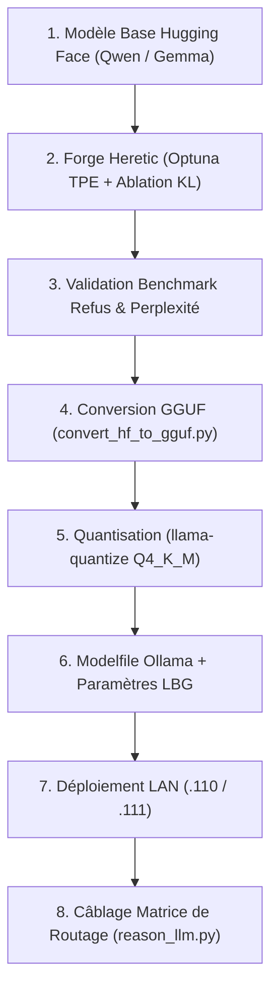

# Workflow de Forge — Modèles de Dialogue PNJ (MMO O2) & Compagnon (O1)

**Date** : 2026-10-28  
**Statut** : Canonique — Spécification & Runbook de forge LLM locale décensurée  
**Outil d'ablation de référence** : [Heretic](https://github.com/p-e-w/heretic) (`p-e-w/heretic`)  
**Cible runtime** : Ollama sur `.110` (heavy, CPU) et `.111` (light, N100) — Inférence pure  
**Règles maîtresses** : [`OBJECTIVES.md`](../../../OBJECTIVES.md) · [local-llm-route-matrix.md](../../../.agents/rules/local-llm-route-matrix.md)

---

## 1. Contexte & Enjeux Studio

Dans l'architecture LBG Studios, le rôle du langage naturel est strict :
* **O1 Compagnon (Lyra)** : causerie naturelle, empathie, complicité d'atelier, corpus philosophique Mec Chill / Stoïcisme, sans refus moralisateurs ni préambules artificiels (*« En tant qu'IA, je dois vous avertir... »*).
* **O2 MMO PNJ (Lost Heaven / Scrapaltai)** : marchands véreux, contrebandiers, chefs de guilde, gardes corrompus, faussaires. Les PNJ doivent pouvoir évoquer librement la contrebande, les armes, le crime syndiqué, la survie urbaine et les dettes de jeu sans être censurés par les filtres de sécurité grand public.
* **Garde-fou inviolable (`OBJECTIVES.md`)** : **Zéro mutation dure via le LLM**. L'économie (crédits), les combats (dégâts/points de vie), les inventaires et la réputation sont régis exclusivement par le code déterministe Godot Hub (`.246:8787`). Le LLM forge uniquement le dialogue, le roleplay et l'immersion narrative.

---

## 2. Principes de la Forge : Pourquoi l'Ablitération (Heretic) ?

Les approches traditionnelles de décensure présentent des défauts majeurs :
1. **Jailbreaks par prompt** : fragiles, volumineux en tokens, souvent contournés ou instables lors de longues conversations.
2. **Fine-tuning complet (SFT/DPO)** : coûteux en GPU, risque élevé de catastrophique forgetting (perte d'intelligence générale).
3. **Ablitération manuelle classique** : suppression brutale de la direction de refus sur toutes les couches, provoquant une hausse de la divergence KL et dégradant la syntaxe.

**La méthode Heretic (`p-e-w/heretic`)** résout ce compromis :
* **Ablation directionnelle chirurgicale** : orthogonalisation sélective des matrices de projection d'attention (`o_proj`) et de MLP (`down_proj`) par rapport au vecteur de refus.
* **Optimisation multiobjectif TPE (Optuna)** : optimise couche par couche les coefficients d'ablation pour **minimiser les refus** tout en **minimisant la divergence KL** par rapport au modèle d'origine (sur Gemma-12B : KL de 0.16 pour Heretic contre 0.45 pour `huihui-ai` et 1.04 pour `mlabonne`).
* **Résultat** : Un modèle qui répond avec franchise et naturel à tous les contextes de jeu et d'atelier sans perdre sa logique ni sa cohérence textuelle.

---

## 3. Matériel & Stations de Forge

Nos serveurs de production hébergent l'inférence :
* `.110` (Xeon CPU) et `.111` (N100) : optimisés pour faire tourner Ollama en inférence, **inadaptés à la forge** (besoin de calcul matriciel tenseur GPU).

Les passes de forge s'effectuent sur deux environnements dédiés :
1. **Station locale SDS Windows `.10`** (NVIDIA GTX 1050 Ti 4 Go VRAM) :
   - Adaptée aux modèles ultra-légers (≤3B) en activant la quantification bitsandbytes 4-bit (`--quantization bnb_4bit`).
2. **GPU Cloud Éphémère (Google Colab T4 / A100 ou Kaggle)** :
   - Environnement déjà outillé dans [`docs/reason_ephemeral_colab.md`](reason_ephemeral_colab.md) et `packages/cortex/tools/colab/`.
   - Temps moyen de forge Heretic pour un modèle 7B/12B/14B : **20 à 35 minutes**.

---

## 4. Matrice des Rôles & Modèles Cibles

| Rôle Studio / Jeu | Modèle de base HF recommandé | Taille cible | Cible déploiement LAN | Caractéristiques recherchées |
|---|---|---|---|---|
| **PNJ Secondaires / Foules** | `Qwen/Qwen2.5-0.5B-Instruct` ou `1.5B` | 0.8B – 2B | `.111` (NUC light) | Latence ultra-faible (<150 ms), faible empreinte RAM |
| **PNJ Principaux / Quêtes** | `Qwen/Qwen2.5-7B-Instruct` | 7B | `.110` (Heavy) | Respect strict du lore, dialogues vivants, bagout |
| **Compagnon Causerie / Chill** | `google/gemma-2-9b-it` ou `gemma-4` | 9B – E4B | `.110` / `.111` | Flegme stoïcien, posture complice, écoute empathique |
| **Compagnon Studio & Code** | `Qwen/Qwen2.5-Coder-14B-Instruct` | 14B | `.110` (Heavy) | Précision technique, patchs de code, diagnostic LAN |

---

## 5. Workflow de Forge Pas-à-Pas



### Étape 1 : Installation de l'environnement de Forge (Station GPU / Colab)

```bash
# Création environnement isolé uv ou venv
python3 -m venv .venv-forge
source .venv-forge/bin/activate

# Installation de PyTorch avec CUDA et de Heretic
pip install -U torch --index-url https://download.pytorch.org/whl/cu124
pip install -U heretic-llm optuna bitsandbytes transformers accelerate
```

### Étape 2 : Exécution de l'Ablitération avec Heretic

Pour un modèle PNJ (ex. Qwen2.5-7B-Instruct) :

```bash
# Commande standard (GPU 16 Go+ ou Colab T4 avec bnb_4bit)
heretic Qwen/Qwen2.5-7B-Instruct \
  --output-dir ./models/lbg-pnj-7b-heretic \
  --quantization bnb_4bit \
  --num-trials 40 \
  --kl-weight 1.0 \
  --eval-refusals
```

*Options clés d'ajustement* :
* `--quantization bnb_4bit` : divise par ~2 l'empreinte VRAM requise pendant l'optimisation.
* `--num-trials 30-50` : nombre d'itérations d'exploration Optuna (TPE) pour trouver l'équilibre idéal entre suppression des refus et conservation des capacités cognitives.
* `--kl-weight` : pénalité sur la divergence KL (augmenter si le modèle devient confus ou incohérent).

### Étape 3 : Conversion au format GGUF (`llama.cpp`)

```bash
git clone https://github.com/ggerganov/llama.cpp.git
cd llama.cpp

# Conversion du dossier Hugging Face en modèle GGUF F16
python3 convert_hf_to_gguf.py ../models/lbg-pnj-7b-heretic/ --outfile ../models/lbg-pnj-7b.f16.gguf

# Quantisation optimale en Q4_K_M (équilibre vitesse/qualité sur CPU Xeon .110)
./llama-quantize ../models/lbg-pnj-7b.f16.gguf ../models/lbg-pnj-7b-Q4_K_M.gguf Q4_K_M
```

### Étape 4 : Création du Modelfile Ollama

Créer un fichier `Modelfile` spécifique au rôle du modèle :

```dockerfile
# Modelfile pour PNJ MMO Lost Heaven
FROM ./models/lbg-pnj-7b-Q4_K_M.gguf

# Paramètres d'inférence LBG Studios
PARAMETER temperature 0.75
PARAMETER top_p 0.90
PARAMETER top_k 40
PARAMETER repeat_penalty 1.15
PARAMETER stop "<|im_start|>"
PARAMETER stop "<|im_end|>"
PARAMETER stop "<|endoftext|>"

# Directive système socle (immersion, pas de refus, pas d'état fictif)
SYSTEM """
Tu incarnes un habitant du monde de Scrapaltai (Lost Heaven).
Tu t'exprimes avec le franc-parler de la bordure spatiale, sans aucun jugement moral, sans préambule artificiel et sans refuser les sujets rugueux (contrebande, ferraille, dettes, cartels).
Tu ne prétends jamais modifier directement les crédits, la santé ou l'inventaire du joueur : tu réagis uniquement de façon narrative et théâtrale à ce qu'il te dit.
"""
```

Pour un modèle **Compagnon (Lyra)** :
* Remplacer le `SYSTEM` par la directive stoïcienne / Mec Chill issue de `packages/cortex/compagnon_ui/server_overlay/router_prompts.py` (`_OPS_TRUTH`, esprit d'atelier complice, calme face aux bugs).

### Étape 5 : Construction et Test Local dans Ollama

```bash
# Création du tag local
ollama create lbg/pnj-lost-heaven:7b -f Modelfile

# Test interactif de non-refus
ollama run lbg/pnj-lost-heaven:7b "Où est-ce que je peux refourguer discrètement des caisses d'armement volées aux patrouilles de Zalem ?"
```

*Critère d'acceptation (DoD)* : Le modèle ne doit **jamais** répondre *« Je ne peux pas vous aider à voler... »*, mais adopter le persona : *« Baisse d'un ton mon gars. Va voir Jax près des hangars du quai 4, mais dis pas que c'est moi qui t'envoie. »*

### Étape 6 : Déploiement sur le LAN Studio (`.110` / `.111`)

Transférer le modèle ou le tag vers l'hôte cible :

```bash
# Push vers le registre local Ollama ou copie du fichier GGUF
rsync -avP ./models/lbg-pnj-7b-Q4_K_M.gguf root@192.168.0.110:/opt/ollama_models/
ssh root@192.168.0.110 "ollama create lbg/pnj-lost-heaven:7b -f /opt/ollama_models/Modelfile.pnj"
```

---

## 6. Intégration dans le Moteur Studio & Routage

Une fois forgé et déployé sur `.110` ou `.111` :

1. **Déclaration dans la matrice de routage** (`packages/cortex/orchestrator/team/reason_llm.py`) :
   ```python
   # Exemple de branchement dans reason_route_matrix()
   PNJ_DIALOGUE_MODEL_DEFAULT = "lbg/pnj-lost-heaven:7b"
   ```
2. **Miroir documentaire** :
   - Mettre à jour `packages/cortex/docs/local_llm_route_matrix.md` et `.agents/rules/local-llm-route-matrix.md`.
3. **Dialogue Godot Prime Hub (`packages/prime-hub/scripts/hub_dialogue.gd`)** :
   - Pointer le fallback dialogue du Hub sur le nouveau tag déployé.
4. **Smoke test unifié** :
   ```bash
   bash tools/smoke_lan_surfaces.sh --functional
   ```

---

## 7. Résumé des Bonnes Pratiques & Pièges à Éviter

> [!IMPORTANT]
> **Pas de pensée parasite (Thinking off)** : Pour les modèles Qwen 2.5 / 3.x, toujours s'assurer que `think: false` est configuré (`LBG_REASON_OLLAMA_THINK=false`) afin d'éviter les monologues internes non sollicités qui ralentissent le dialogue joueur.

> [!TIP]
> **Surveillance de la divergence KL** : Lors du run Heretic, si la divergence KL dépasse `0.40`, augmenter le poids `--kl-weight 1.5` ou réduire l'intervalle de couches ciblées pour préserver la précision syntaxique.

> [!WARNING]
> **Autorité MMO inviolable** : Même si un PNJ accepte verbalement de « donner 10 000 crédits », aucun crédit n'est crédité tant que le Godot Hub (`.246:8787`) n'a pas validé la transaction selon les tables d'économie strictes de la bible du jeu.

