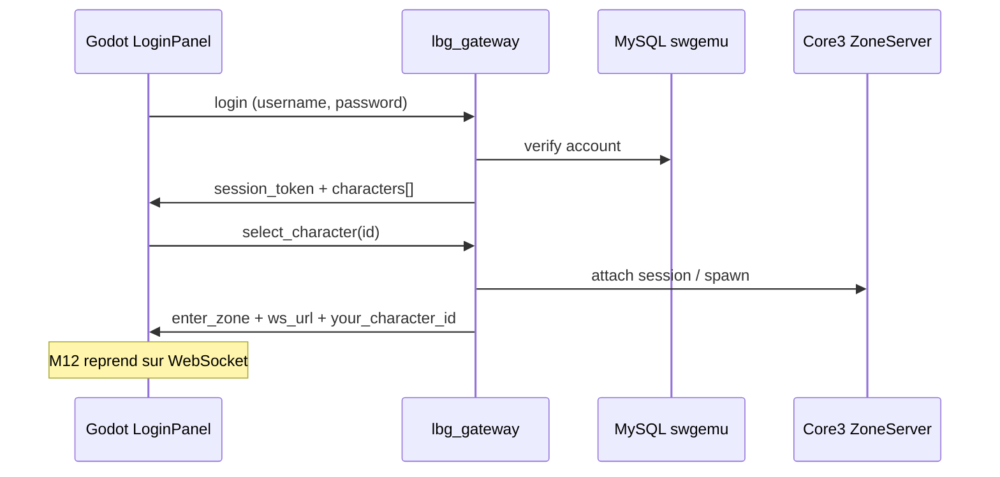

# Jalon M11 — Login compte LBG dans Godot (sans retail)

**Statut** : **en cours** (contrat M11↔M12 rédigé · code LoginPanel / LbgAuthClient)  
**Owner** : Hermès (`dev_godot`) · UI : Iris · Contrat : Thémis  
**ADR** : [`0016-prime-axe-lbg-talents-artisanat.md`](../../../../new_mmo/lbg-mmo/docs/adr/0016-prime-axe-lbg-talents-artisanat.md)

---

## Objectif

Le joueur ouvre **prime-client** (Godot), saisit compte LBG (ex. Teome), choisit un perso, entre en zone — **sans** `lbgemu.exe`, **sans** `soe_handshake --play` à terme.

Serveur : Core3 Prime `192.168.0.246:44553` · Gateway HTTP auth + WS **sur Prime** `192.168.0.246:8765` / `:50000` (comptes DB `swgemu` locale).

---

## Hors scope M11

- Rendu zone temps réel → **M12** (`lbg-ws/2`, `zone_state`)
- Craft / talents UI → **M10**
- Client retail / patches `.tre`

---

## Flux cible (brouillon)

---

## Contrat M11 ↔ M12 (source of truth)

> Rédigé pour handoff Hermès ↔ Iris ↔ Dédale. Schémas : `docs/schemas/lbg-ws/`.

### Session

| Champ | Type | Description |
|-------|------|-------------|
| `session_token` | string (opaque, ≥32) | Émis par `lbg_gateway` après `login` OK ; requis sur WS `lbg-ws/2` |
| `ws_url` | string URL | Ex. `ws://192.168.0.140:8765/lbg-ws/2` (LAN) ; renvoyé avec `enter_zone` |
| `your_character_id` | integer | `obj_id` Core3 du perso contrôlé ; ancre `zone_state` |

### Messages client → gateway (`client.zone_command_v2` / `client.login`)

| `type` | Champs | Effet |
|--------|--------|-------|
| `login` | `username`, `password` | Auth SQL compte Prime → `session_token` + `characters[]` |
| `select_character` | `character_id` | Attache session au perso ; policy `kick_other` si déjà en ligne |
| `enter_zone` | `zone` | Spawn / attach ZoneServer → `ws_url` + `your_character_id` |

### Erreurs (gateway → client)

| Code | Quand |
|------|-------|
| `auth_failed` | mauvais user/pass ou compte inexistant |
| `character_in_use` | perso déjà attaché et policy = `reject` |
| `session_expired` | token invalide / TTL dépassé |
| `zone_unavailable` | ZoneServer / bridge down |

### Policy session

`LBG_ZONE_SESSION_POLICY=kick_other` (défaut recommandé) : une nouvelle `select_character` déconnecte l’autre session (retail ou Godot). Alternative : `reject` → `character_in_use`.

Références : [`core3_zone_bridge_spec.md`](core3_zone_bridge_spec.md) §2 · [`client.zone_command_v2.schema.json`](schemas/lbg-ws/client.zone_command_v2.schema.json) · [`client.login.schema.json`](schemas/lbg-ws/client.login.schema.json)

## Livrables attendus (checklist spawn)

- [x] Ce document complété (flux, API, critères done) — contrat Thémis
- [x] `lbg_gateway` : HTTP `/v1/auth/login|select_character|enter_zone` (+ SQL mock/réel)
- [x] `prime-client` : `LoginPanel` + `LbgAuthClient` + `LbgWsClient` dans `main.tscn`
- [x] `prime-client` : `scenes/ui/login_panel.tscn`, `scripts/LbgAuthClient.gd`, `scripts/login_panel.gd` (stub mock → HTTP gateway)
- [x] Smoke `smoke_godot_m11_login_lan.sh` (Argus)
- [x] Teome/Gally : LoginPanel → HTTP → WS session_token (Option C)

---

## Critères d’acceptation

1. Compte **Teome** / Prime : login + choix perso depuis Godot.
2. Aucun binaire retail lancé sur le poste joueur.
3. Token/session documenté pour handoff **M12** (WS `enter_zone` + `zone_state`).
4. Policy `kick_other` si session déjà ouverte (config gateway).

---

## Références

- [`HANDOFF_SPAWN_M11_M12.md`](HANDOFF_SPAWN_M11_M12.md) — handoff ponctuel (pas un preset)
- [`CLIENT_ONLY_GODOT.md`](../../../../new_mmo/prime-client/docs/CLIENT_ONLY_GODOT.md)
- [`HUMAN_PLAYER.md`](../../../../new_mmo/prime-client/docs/HUMAN_PLAYER.md)
