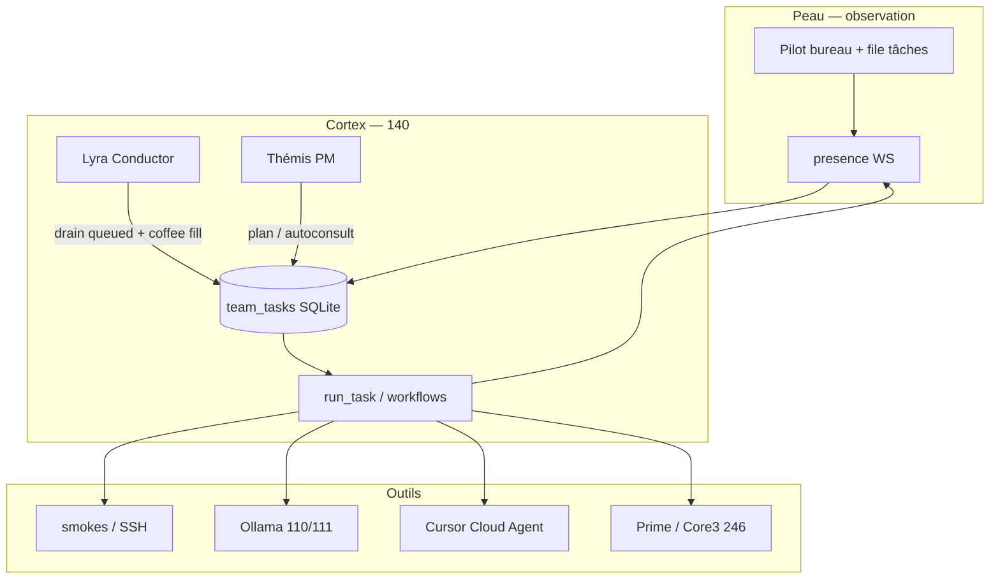

# LBG Agentic OS — carte CrewAI / Manus / Dify / OpenClaw / OpenHands → Studio LAN

**Date** : 2026-07-31 · **MAJ** : 2026-08-03 (§ 6.1 greffe vs substitution)  
**Public** : Team + ops  
**Complète** : `plan_campus_conductor.md`, `plan_team_petri_peau.md`, `architecture_tri_backend_hybride.md`, ADR 0015 / 0019

## 1. Idée

Un **OS agentique** (Manus, CrewAI, Dify…) = couche qui *planifie*, *appelle des outils*, *observe*, *corrige*, sans humain en boucle.

LBG n’importe pas ces frameworks tels quels : on a déjà un **studio multi-agents ancré LAN** (Cortex 140 + Peau Pilot + workers 110/111/245/246).  
Ce doc mappe les concepts « agentic OS » sur **nos** rôles et briques.

## 2. Tableau de correspondance

| Concept | Manus / CrewAI / Dify | Chez LBG |
|---------|----------------------|----------|
| Orchestrateur / chef | Manager agent, Crew, workflow Dify | **Lyra** (Campus Conductor) + **Thémis** (PM / autoconsult) + Cortex `orchestrator` |
| Planification | Planner LLM | `POST /v1/team/plan`, briefs PM, missions Pilot |
| Agents spécialisés | Researcher / Coder / Writer | Argus (qa), Héphaïstos (ops), Atlas (admin), Dédale/Vulcan (dev_game), Iris/Hermès (Godot), Pygmalion (assets), Chœur (player_ia) |
| Outils | Browser, shell, files, APIs | Workflows Team, SSH/scripts, smoke LAN, sidecar Core3, **Cursor Cloud Agent** (PR), Ollama 110/111 |
| Mémoire / état | Memory store, vector DB | SQLite Team tasks, presence hub, state.json jobs, RAG / docs optionnels |
| Observation | Sensors, webhooks | Présence campus WS, healthz, timers systemd, failure follow-up |
| Action proactive | Auto-mail, auto-code | Conductor (drain + coffee fill), jobs QA/Atlas/M9, follow-ups échec |
| Garde-fous | Human-in-the-loop | L1 auto / L2 token, allowlists repos & rôles, dry-run |
| UI « bureau » | Chat / canvas | Pilot `#/team/office` (Peau) |

## 3. Architecture LBG (vue OS)



**Principe** : Cortex décide et exécute ; Peau montre ; pas de second cerveau opaque type SaaS Manus sur le chemin critique LAN.

## 4. Boucle autonome cible (alignée Manus)

```text
Mission NL
  → plan (Thémis / /v1/team/plan)
  → file de tâches spécialisées
  → Lyra : cap busy + démarrage L1 + coffee fill
  → exécution outils
  → échec → failure_followup (triage PM ± retry)
  → smoke / présence → boucle
```

| Niveau | Comportement | État LBG |
|--------|--------------|----------|
| L0 | Lecture / dry-run | OK |
| L1 | Run sans humain (smoke, brief, drain) | OK + Conductor V0/V1 |
| L2 | Approbation (build Core3, Cursor PR, think player) | OK (token) |
| L3 | Mission multi-jours auto-corrigée | Partiel — objectif produit |

## 5. Multi-agents : qui fait quoi (CrewAI-style)

| Persona | Rôle Crew | Sorties typiques |
|---------|-----------|------------------|
| Lyra | Orchestrator / dispatcher | Prefill, coffee fill, rapport idle |
| Thémis | Manager / synthesizer | Plan, autoconsult, brief réunif |
| Argus | QA / critic | Smoke LAN, healthz |
| Héphaïstos | Ops / infra probe | Sondes, selfcheck |
| Atlas | Admin LLM / dual host | Audit Ollama, storage hints |
| Dédale | Gameplay coder | Correctifs, forge propositions |
| Vulcan | Systems / Core3 | Build plan, ZB |
| Iris | Client UI | M9, minimap, HUD |
| Hermès | Network / SOE | Gateway, launchpad |
| Pygmalion | Artist | LoRA, sprites, GLB |
| Chœur | NPC / player sims | Probe / think L2 |

## 6. Ce qu’on ne copie pas (volontairement)

- Remplacer Cortex par CrewAI/Dify en prod LAN (dette + latence + moins de contrôle L2).
- Un seul mega-agent Manus qui SSH partout sans allowlist.
- Chat LLM comme seul bus de coordination (la file SQLite + presence restent la source de vérité).

Réutiliser plutôt les **patterns** : rôles clairs, outils bornés, boucle observe→act→correct, HITL sur L2.

### 6.1 Greffer en périphérie — pas substituer (décision 2026-08-03)

**Principe** : Cortex / Team reste le cerveau du studio LAN tant qu’il est plus performant sur le chemin critique. Les produits type **OpenClaw**, **Manus**, **OpenHands** apportent surtout des *capacités périphériques* — on les greffe éventuellement, on ne remplace pas l’existant.

| Capacité externe | Décision produit | Chez LBG |
|------------------|------------------|----------|
| Canaux messagerie grand public (WhatsApp, Telegram, Discord…) | **Pas utile pour l’instant** | **Element / Matrix** déjà en place ; **Slack** éventuel plus tard, hors chemin critique |
| Computer-use générique (souris / clavier / écran A→Z) | **Utile plus tard, pas urgent** | Desktop hybride = kinds structurés + approval (pas vision UI libre) |
| Édition de repo libre (shell / workspace type OpenHands) | **Utile plus tard, pas urgent** | Iris L3 allowlist + Cursor Cloud Agent (L2 token) ; pas de shell libre sur 140 |
| Skills / playbooks OpenClaw | Greffe OK (déjà amorcée) | `openclaw_adapter.py` + `infra/openclaw/skills/` — EXEC borné, pas runtime OpenClaw comme OS |

**Garde-fou** : toute greffe future (computer-use, OpenHands, Slack) reste en **L2 / allowlist**, jamais en substitution du Conductor, du bus Team ni de la file SQLite.

## 7. Roadmap produit (courte)

1. **Fait** — Conductor V0–V2 (drain, coffee fill, act selon état, mission NL, UI Pilot) ; Cursor PR ; présence Petri.
2. **Vague 0–4 + L3 Iris** — ADR 0019 : plan LLM, bus, mémoire, hooks, clôture mission, prune ; Iris L3 allowlist (`LBG_IRIS_FORGE_L3`).
3. **Ensuite** — scoring playbooks (A3) ; élargissement allowlist Iris avec smoke ; voir [`docs/PLAN_MMO_O2.md`](../../../docs/PLAN_MMO_O2.md).
4. **A1+A2 livrés 2026-08-03** — playbook `spawn_team_mmo_jalon_job` + owner smokes + anti-clôture si rouge.
4. **Plus tard (périphérie)** — Slack optionnel ; computer-use borné ; OpenHands / co-design repo en lab L2 — **sans** remplacer Team/Cortex.
5. **Lab only** — Adapter CrewAI hors chemin critique.

## 8. Commandes utiles

```bash
curl -s http://192.168.0.140:8010/v1/team/campus/status
curl -s -X POST http://192.168.0.140:8010/v1/team/campus/conduct \
  -H 'Content-Type: application/json' -d '{"dry_run":true}'
# Bureau
# http://192.168.0.140:8080/#/team/office
```
