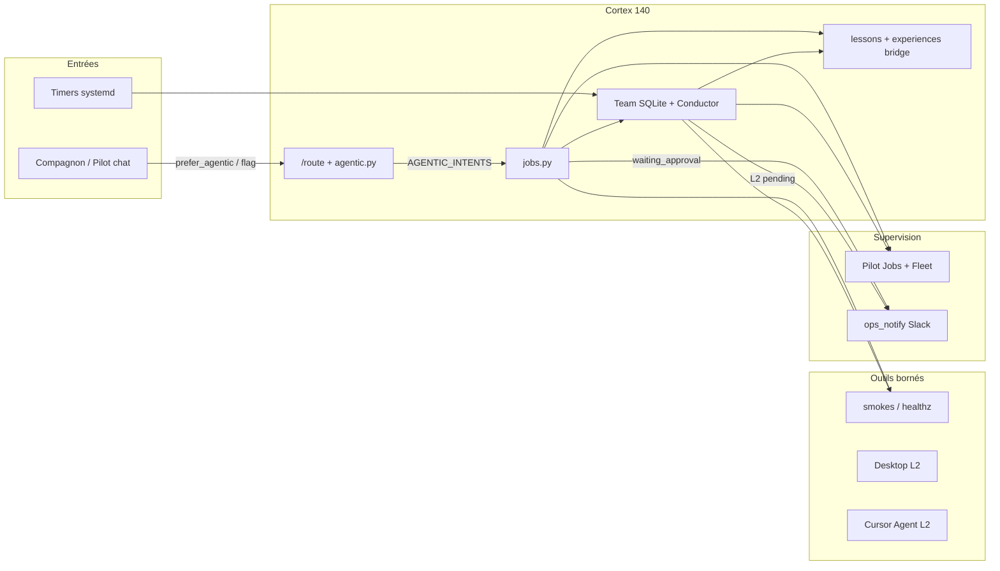

# Plan — Combler les gaps agentiques & réaliser le plan d’action

**Date** : 2026-10-02 · **MAJ** 2026-10-07  
**Statut** : pilote ops health **livré** (A–F2 + tick L3) — revue 7j / F3 O2 hors scope immédiat  
**Priorité** : O1 Studio (`packages/cortex`) — LAN 140  
**Complète** : [`lbg_agentic_os.md`](lbg_agentic_os.md) · [`plan_meta_autonomie_l3.md`](plan_meta_autonomie_l3.md) · [`ops_notify_slack.md`](ops_notify_slack.md) · [`agents/README.md`](../agents/README.md) · [`runbook_ops_health_pilot.md`](runbook_ops_health_pilot.md)

## 0. Objectif

Passer d’un OS agentique **en morceaux** (Team / Jobs / Compagnon) à une **délégation mesurable** :

```text
Intention NL → plan → outils bornés → action → mémoire → supervision Pilot/Slack
```

**Non-objectifs** : remplacer Cortex par CrewAI/Manus ; computer-use libre ; shell libre L1 ; cas d’usage B2B finance/RH génériques.

## 1. Gaps ciblés (source de vérité)

| # | Gap | Impact | Critère « comblé » |
|---|-----|--------|--------------------|
| G1 | Chat agentique off + 3 boucles parallèles | Pas de délégation NL unifiée | Intent `devops_probe` → job fond → Pilot Jobs, opt-in contrôlé |
| G2 | Pas de processus pilote bout-en-bout mesuré | Autonomie non prouvée | Flux ops health→smoke→notify→L2 avec métriques 7j |
| G3 | Supervision fragmentée (anti-sprawl) | Risque agents orphelins | Vue Pilot unique : agents actifs, outils, L2 pending, audits |
| G4 | Mémoire fragmentée (experiences ≠ lessons ≠ LBG_SA) | Pas d’apprentissage cross-boucle | Échec job/Team → lesson injectée au prochain plan du même intent |
| G5 | HITL incomplet (tokens OK, UX faible) | Approbations lentes | Carte Pilot + alerte Slack `#lbg-ops` (boutons si déjà câblés) |
| G6 | L3 multi-jours partiel | Pas de mission auto-corrigée | 1 mission bornée (budget/deadline/cap outils) + escalade L2 |
| G7 | Orch non runnable hors LAN (monorepo Cloud) | Dev Cloud dégradé | Doc + garde-fous clairs ; **pas** de réintro HPA — travail sur 140 |

**Contrainte G7** : toute implémentation runtime se valide sur **140**. Le monorepo sert de sources + tests unitaires isolés.

## 2. Processus pilote (décision produit)

**Choix** : **Ops health → smoke → notify → (remediation L2)**

Pourquoi : intents/outils déjà là (`devops_probe`, Argus, Héphaïstos, `ops_notify`, jobs `waiting_approval`), risque métier faible, ROI immédiat studio.

| Étape | Qui | Action | Niveau |
|-------|-----|--------|--------|
| 1. Perception | Héphaïstos / timer | Collecte healthz 110/140/245/246 (+ surfaces Pilot) | L0/L1 |
| 2. Diagnostic | Argus | Smoke LAN ciblé (`smoke_lan_surfaces` ou subset) | L1 |
| 3. Décision | Lyra / jobs planner | Vert → log + digest ; Rouge → créer job remediation | L1 |
| 4. Notification | `ops_notify` | Slack (+ Element backup) résumé + lien Pilot | L1 |
| 5. Remédiation | Héphaïstos | Proposition d’actions allowlist (restart service, re-smoke) | **L2** |
| 6. Clôture | System | Écrire lesson (cause, fix, outcome) + métrique | L1 |

**Hors pilote pour l’instant** : PM plan_de_route, assets Pygmalion, jeu quests/combat (phases ultérieures).

## 3. Architecture cible (greffe, pas second cerveau)



**Règle** : Team SQLite + jobs restent la source de vérité. Chat n’élève que si `LBG_CHAT_AGENTIC` **ou** `context.prefer_agentic`, et uniquement pour `AGENTIC_INTENTS`.

## 4. Phases d’exécution

### Phase A — Socle mesure + supervision (semaine 1)

**But** : voir et mesurer avant d’élargir l’autonomie.

| ID | Livrable | Fichiers / zones | Done when |
|----|----------|------------------|-----------|
| A1 | Cahier des charges pilote ops (5–7 étapes) versionné | Ce doc §2 (figé) + checklist smoke | Review humaine OK |
| A2 | Endpoint / agrégat **fleet agents** | Orch : statut Team personas + jobs actifs + desktop healthz proxies + L2 pending | `GET` JSON unique consommé par Pilot |
| A3 | Vue Pilot **Fleet / Supervision** | `pilot_web` (page ou panneau `#/team/…`) | Liste agents, intents, last audit, pending L2 |
| A4 | Métriques minimales | Compteurs : jobs créés / done / failed / waiting_approval ; taux escalade L2 ; latence perception→notify | Visible `#/team/metrics` ou panneau Fleet |
| A5 | Doc ops runbook pilote | Court runbook LAN (flags, timers, rollback) | Fichier doc + lien depuis ce plan |

**Flags** : aucun changement d’autonomie encore (`LBG_CHAT_AGENTIC` reste `0` en prod).

### Phase B — Pilote ops bout-en-bout (semaine 2)

**But** : un flux réel, timer + manuel, sans chat agentique global.

| ID | Livrable | Fichiers / zones | Done when |
|----|----------|------------------|-----------|
| B1 | Playbook / workflow **ops_health_pilot** | `team/` workflows ou job template dédié | Dry-run OK sur 140 |
| B2 | Chaîne healthz → smoke → `ops_notify` | Brancher sur `ops_notify.send_text` + lien Pilot job/task | Alerte Slack reçue sur KO simulé |
| B3 | Étape remediation en `waiting_approval` | Policy jobs / task `approval_required` | Rien de destructif sans L2 |
| B4 | Carte HITL Pilot pour ce job | Pilot Jobs / Team approve existant | Approve → re-smoke → clôture |
| B5 | Écriture lesson à la clôture | `team/lessons_learned` (+ optionnel `experience_memory`) | Lesson lisible après 1 run KO→fix |
| B6 | Timer ou entrée Conductor coffee-fill | systemd timer **ou** spawn L1 périodique (intervalle prudent, ex. 1–3 h) | 1 run auto vert documenté |

**Rollback** : désactiver timer / flag playbook ; dry-run only.

### Phase C — Chat agentique opt-in (semaine 3)

**But** : intention NL → même pilote, sans activer tous les intents.

| ID | Livrable | Fichiers / zones | Done when |
|----|----------|------------------|-----------|
| C1 | Allowlist d’élévation **étroite** | `agentic.py` : flag `LBG_CHAT_AGENTIC_INTENTS=devops_probe` (ou equivalent) | Seul `devops_probe` s’élève en prod |
| C2 | Runner jobs vérifié sur 140 | `jobs.runner_enabled()` + auto_start | Job ne reste pas `queued` |
| C3 | Compagnon / Pilot : `prefer_agentic` sur console Ops | UI toggle « Déléguer en job » | Message NL « vérifie la santé LAN » → job_id |
| C4 | Réponse chat avec lien suivi | `elevate_to_job` reply + deep-link Pilot | UX claire |
| C5 | Tests | `orchestrator/tests/test_agentic.py` (+ smoke LAN) | Vert local + 1 smoke 140 |

**Prod** : `LBG_CHAT_AGENTIC=0` global ; opt-in UI `prefer_agentic` **ou** intents allowlistés seulement.

### Phase D — Mémoire unifiée (semaine 3–4)

**But** : combler G4 sans fusionner tous les stores d’un coup.

| ID | Livrable | Fichiers / zones | Done when |
|----|----------|------------------|-----------|
| D1 | Pont **jobs → lessons** | À `done`/`failed` job : append lesson normalisée (intent, outcome, tags) | Fichier lessons enrichi |
| D2 | Pont **failure_followup → lessons** | Déjà partiel : garantir inject au plan suivant même intent | Trace `lessons_injected > 0` |
| D3 | Recall au plan (`/v1/team/plan` + job planner) | Slice lessons filtrée par intent/tags | Plan cite / évite échec connu |
| D4 | **Pas** de vector DB obligatoire | JSONL / JSON existants | Doc explicite « phase 0 mémoire » |
| D5 | LBG_SA | Laisser namespacé ; documenter dégradé hors HPA | Pas de réintro legacy |

### Phase E — HITL + L3 borné (semaine 4–5)

**But** : G5 + G6 sans ouvrir l’autonomie libre.

| ID | Livrable | Fichiers / zones | Done when |
|----|----------|------------------|-----------|
| E1 | Push Slack L2 pending pour jobs pilote | Réutiliser `slack_notify` / HITL poll ADR 0021 | Message Approve/Reject ou texte `approve <id>` |
| E2 | Mission L3 **bornée** « stabiliser smoke LAN N jours » | Objet mission : deadline, budget retries, cap outils, owner Argus/Héphaïstos | 1 mission créée via Pilot |
| E3 | Boucle observe→retry→escalade | Si rouge > seuil → L2 + stop auto | Pas de boucle infinie |
| E4 | Dashboard mission | Pilot : progression, derniers smokes, lessons | Visible non-ops |

### Phase F — Extension (après pilote vert 7 jours)

Ordre strict, **un** à la fois :

1. ~~**PM** : intent `project_pm` agentique → job fond (même pattern C)~~ — **F1**
2. ~~**Assets** : brief Pygmalion → desktop/Comfy L2~~ — **F2** (`pygmalion_assets_pilot` + allowlist `desktop_control`)
3. **O2 jeu** : workers quests/combat réels + mémoire `player/*` (hors scope immédiat O1)

## 5. Ordre de travail quotidien (plan d’action)

### Cette semaine (Phase A + démarrage B)

1. Figer §2 (processus pilote) — **fait dans ce doc**
2. Implémenter A2–A4 (fleet + métriques)
3. Spécifier B1 playbook (dry-run)
4. Vérifier secrets Slack / `ops_notify` sur 140 (`ops_notify_slack.md`)

### Semaine suivante (Phase B)

1. Brancher B2–B5
2. 1 KO simulé (service test ou dry-run forcé) → Slack → approve → lesson
3. Activer B6 timer prudent

### Semaine 3 (Phases C–D)

1. Allowlist `devops_probe` seulement
2. Toggle Compagnon/Pilot
3. Pont mémoire jobs→lessons + recall plan

### Semaines 4–5 (Phase E)

1. HITL Slack jobs pilote
2. Première mission L3 bornée smoke LAN
3. Revue métriques 7j → go/no-go Phase F

## 6. Definition of Done (global)

Le plan est **réalisé** quand, sur LAN 140 pendant **7 jours** :

- [ ] Au moins 1 run pilote auto/jour (vert ou KO géré)
- [ ] 100 % des remédiations passent par L2
- [ ] Toute clôture KO écrit une lesson
- [ ] Chat NL ops peut créer un job (opt-in) sans activer les autres intents
- [ ] Vue Fleet Pilot montre agents + pending L2
- [ ] Aucun nouvel outil hors allowlist ; aucun shell libre L1
- [ ] Métriques : taux succès smoke, % escalade L2, temps median perception→notify

## 7. Risques & garde-fous

| Risque | Mitigation |
|--------|------------|
| Agent sprawl (nouveaux timers/agents) | Tout nouveau spawn = entrée registry + Fleet |
| Fausse autonomie (jobs queued sans runner) | C2 bloque élévation si runner off |
| Bruit Slack | Digests / seuils ; pas d’alerte sur chaque vert |
| Régression desktop / Cursor | Hors pilote jusqu’à Phase F |
| Tentation HPA legacy | Interdit — G7 |

## 8. Mapping articles → livrables LBG

| Idée externe | Livrable ici |
|--------------|--------------|
| Intention → plan → action | Phases B–C (`agentic` + jobs + Team) |
| Monitoring permanent | Phase A Fleet |
| Anti-sprawl / gouvernance | A2–A3 + registry |
| HITL / responsabilité | B3–B4 + E1 |
| Apprentissage | Phase D |
| Mission multi-jours | Phase E L3 bornée |
| Ne pas tout automatiser | Un seul pilote jusqu’à DoD 7j |

## 9. Prochaine action immédiate

1. ~~Valider ce plan (surtout §2 processus pilote).~~
2. ~~Démarrer **A2** (agrégat fleet) + **A3** (UI Pilot).~~
3. ~~Dry-run **B1**~~ · ~~**B2–B5** notify/HITL/lesson~~ · ~~**B6** timer dry-run~~
4. ~~**C1–C5** chat agentique opt-in `devops_probe`~~ · ~~**D1** pont jobs→lessons~~
5. ~~**E1** jobs `waiting_approval` → Slack HITL~~ · ~~**E2–E4** mission L3 `smoke_lan_mission`~~
6. ~~**F1** `project_pm` agentique~~ · ~~**F2** Pygmalion assets L2~~
7. ~~**Suite** : tick mission L3 sur timer ops_health~~ (245 optionnel · sonde 246 `:8787/healthz` · `days_ok` 1×/jour UTC).
8. **Maintenant** : revue métriques 7j (Pilot Jobs / Slack `#lbg-ops`) · consolider Fleet/presence soft-links (Vulcan↔Vex, Hermès↔Tess) · **F3** O2 jeu = hors ce plan (voir [`PRIORITES_ACTUELLES.md`](../../../docs/PRIORITES_ACTUELLES.md) P3–P5).

Voir [`runbook_ops_health_pilot.md`](runbook_ops_health_pilot.md).
