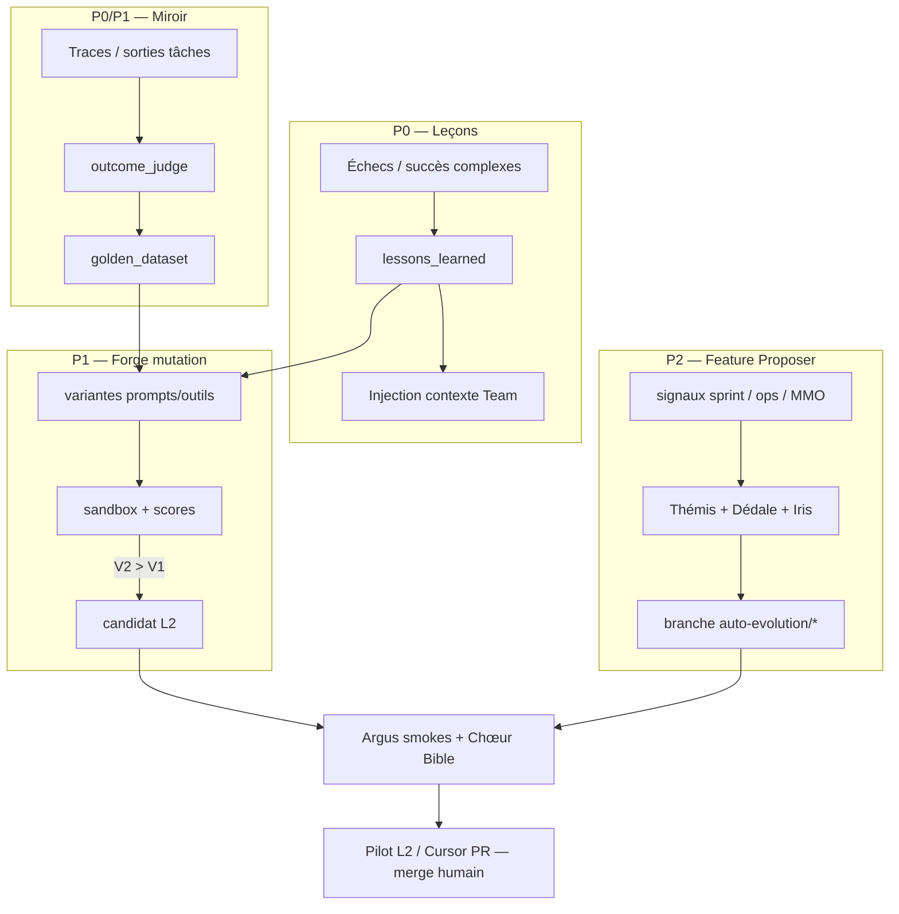

# Plan — Auto-amélioration & extension L3 (méta-apprentissage)

**Date** : 2026-08-21  
**Statut** : cible produit — **greffe** sur Team (pas un second OS)  
**Priorité** : O1 Studio (`packages/cortex`) ; idéation jeu = sandbox / L2 uniquement  
**Complète** : [lbg_agentic_os.md](lbg_agentic_os.md), [vision_equipe_fable_autoconsultation.md](vision_equipe_fable_autoconsultation.md), [team_evolution_sprint.md](team_evolution_sprint.md), [`docs/PLAN_MMO_O2.md`](../../../docs/PLAN_MMO_O2.md) (rails A1–A4)

## 1. Vision (cadrage)

Permettre à l’équipe virtuelle (Thémis, Héphaïstos, Dédale, Iris, Pygmalion, Argus, Chœur…) de **capitaliser et proposer**, au-delà de l’exécution L1/L2 déjà en place :

1. **S’auto-évaluer** (juge + golden set) puis **proposer** une V2 candidate (prompts / outils) — merge = L2.
2. **Proposer des évolutions** Studio / jeu (briefs, branches isolées, proto OpenGame).
3. **Mémoriser** échecs et réussites (leçons injectées dans le contexte Team).

**Nommage** : on parle d’**extension L3 + méta-apprentissage**, pas de « Rang 3 / Méta-autonomie » isolé.

| Terme à éviter ici | Canon projet |
|--------------------|--------------|
| Rang 3 (auto-évolution agents) | Collision avec *Rang 3* = évolution monde IA dans `plan_de_route.md` |
| Second orchestrateur / CrewAI-like | Interdit sur chemin critique — §6 `lbg_agentic_os.md` |
| Remplacer L1/L2 | L1/L2 + Conductor + Cursor PR + A1–A4 sont **déjà** le socle |

## 2. Diagnostic recalibré

| Brique actuelle | État | Manque réel pour ce plan |
|-----------------|------|---------------------------|
| Playbooks / workflows | OK | Hypothèses d’amélioration **mesurées** (pas seulement exécution) |
| Smokes vert/rouge (A2) | OK | Rubriques fines (qualité, tokens, lore) **après** smokes |
| `playbook_scores` (A3) | OK | Registre **leçons** réutilisable cross-agents |
| Iris L3 allowlist + forge staging | Partiel | Contrat forge générique + mutation **déclarations/prompts** en candidat L2 |
| Cursor PR + file Pilot L2 | OK | Brancher sorties Judge / Feature Proposer — **ne pas reconstruire** |
| Sprint 7j (gaps / opportunités) | OK | Chaîne idéation → brief → proto → smoke → L2 |
| Déclarations `agents/declarations/*.json` | Statiques sur `main` | Versioning candidats (`*_v2_candidate`) hors `main` |

## 3. Les 4 piliers (ordre d’exécution)



| Pilier | Contenu | Dépend de |
|--------|---------|-----------|
| **1. Miroir** | Golden dataset + LLM-as-a-Judge + metrics Pilot | Smokes A2 (juge **après**, jamais à la place) |
| **2. Leçons** | Registre épisodique + injection contexte | Traces / clôtures tâches |
| **3. Forge mutation** | 3 variantes → sandbox golden → candidat | Miroir + leçons ; pattern Iris |
| **4. Feature Proposer** | Opportunités → RFC → branche → L2 | Sprint 7j + OpenGame + Cursor |

Le **contrat L2 Pilot** n’est pas un 5ᵉ pilier à construire : c’est la **porte** déjà livrée (A4).

## 4. Contrats techniques

### 4.1 Judge (`orchestrator/team/outcome_judge.py`)

Entrée / sortie cible :

```text
{ task_id, artifacts[], rubric_id }
  → { score: 0..1, pass: bool, reasons[], suggested_followups[], tokens_used?, latency_ms? }
```

Rubriques initiales (P0) : exactitude, concision, respect règles / Bible, coût (tokens ou latence).  
Capability déclarative (ex. Argus / Thémis) : `task_outcome_judge` — profil LLM `forge` ou light (matrice `.110` / `.111`), audit JSONL.

### 4.2 Golden dataset

- Fichier versionné : `packages/cortex/orchestrator/team/data/golden_dataset.json` (ou équivalent sous `agents/`).
- Cas : Godot (Iris), infra (Héphaïstos), lore (Chœur), brief PM (Thémis) — **petits**, reproductibles, sans secrets.
- Exécution : isolée (staging / dry-run) ; promotion V2 **uniquement** si score + smokes + L2.

### 4.3 Forge mutation (généralisation Iris)

- Manifeste staging (inchangé dans l’esprit) → smoke → apply **L2 token** ou **L3 allowlist** si déjà couvert.
- Candidats : copies de prompts / strategies sous préfixe clair (`*_v2_candidate`), **jamais** mute silencieuse de `declarations/` sur `main`.
- Seuil : V2 > V1 sur golden **et** smokes verts ; sinon rejet tracé (leçon).

### 4.4 Lessons learned

- Registre : `packages/cortex/knowledge/lessons_learned.json` (ou store Team SQLite + export).
- Schéma minimal : `{ id, date, agent_role, context, failure_or_success, pattern, do_not_repeat, refs[] }`.
- Injection : slice des leçons pertinentes dans le prompt / brief de run_task (cap tokens).

### 4.5 Feature Proposer

- Entrée : opportunités sprint, boîte à idées, signaux ops / MMO.
- Sortie : brief Thémis → tâches Dédale/Iris/Pygmalion → branche `auto-evolution/<slug>` → smoke Argus → conformité [`docs/world/BIBLE_MMO.md`](../../../docs/world/BIBLE_MMO.md) (Chœur) → file L2 / Cursor PR.
- Proto jeu : **OpenGame** (ADR 0003) ; pas d’écriture aveugle Core3 / `prime-client` prod.

## 5. Garde-fous (anti-dérive)

1. **Sandbox** : aucune auto-mutation sur `main` sans `tools/check_local.sh` + smokes owner / LAN pertinents.
2. **Bible MMO** : contenu jeu → Chœur + Bible avant L2.
3. **A4 inchangé** : write hors allowlist, build Core3, think Chœur, merge PR = L2.
4. **Charge LLM** : Judge + forge ne chargent pas deux modèles ~18 Go sur `.110` (matrice locale).
5. **O1 d’abord** : Feature Proposer jeu profond reste secondaire tant que Miroir + leçons ne tournent pas sur Studio.

## 6. P0 exécutable (prochaine livraison)

**Statut P0** : **livré 2026-08-21** (code + tests `orchestrator/tests/test_outcome_judge.py`).

Découpage minimal, testable sur LAN / CI locale :

| # | Livrable | Fichiers / surface | Done quand |
|---|----------|--------------------|------------|
| P0.1 | Schéma + 5–10 cas golden (mock OK) | `team/data/golden_dataset.json` | ✅ 8 cas |
| P0.2 | `outcome_judge` (LLM mockable) | `team/outcome_judge.py` + cap Argus `task_outcome_judge` | ✅ pytest |
| P0.3 | `lessons_learned` lecture/écriture + injection stub | `knowledge/lessons_learned.json` + hook `run_task` → `context.lessons_slice` | ✅ |
| P0.4 | Trace Pilot légère | `GET /v1/team/meta` → `features.traces` + ligne `#/team` | ✅ |
| P0.5 | Doc + liens | ce fichier + roadmap Agentic OS | ✅ |

**Hors P0** (vague suivante) : Mutator 3 variantes, Feature Proposer branches `auto-evolution/*`, dashboard metrics riche, TRELLIS/ComfyUI dans la boucle.

## 6bis. P1 — Forge mutation (livré 2026-08-21)

| # | Livrable | Fichiers | État |
|---|----------|----------|------|
| P1.1 | `agent_mutator` — 3 variantes + golden + staging | `team/agent_mutator.py`, `team/staging/agent_mutator/` | ✅ |
| P1.2 | Candidat L2 (`agent_mutation_review`, pas re-run) | `create_task(approval_required=True)` | ✅ |
| P1.3 | Hook QA/PM + meta `last_mutation` | `roles.py`, `team/meta` | ✅ |
| P1.4 | Tests | `orchestrator/tests/test_agent_mutator.py` | ✅ |

```bash
python -m pytest orchestrator/tests/test_agent_mutator.py orchestrator/tests/test_outcome_judge.py -q
```

Cibles mutables P1 : prompts `outcome_judge` / `plan_llm` (staging only). **Jamais** `agents/declarations/*.json` auto.

## 6ter. P2 — Feature Proposer (livré 2026-08-21)

| # | Livrable | Fichiers | État |
|---|----------|----------|------|
| P2.1 | `feature_proposer` — signaux + RFC + Bible stub | `team/feature_proposer.py` | ✅ |
| P2.2 | Staging + branche `auto-evolution/<slug>` (dry-run safe, no push) | `team/staging/feature_proposer/` | ✅ |
| P2.3 | L2 `feature_proposal_review` (pas de re-run) | `create_task` + hook PM | ✅ |
| P2.4 | Tests | `orchestrator/tests/test_feature_proposer.py` | ✅ |

```bash
python -m pytest orchestrator/tests/test_feature_proposer.py \
  orchestrator/tests/test_agent_mutator.py \
  orchestrator/tests/test_outcome_judge.py -q
```

Contexte tâche : `{"feature_proposal": true, "idea_id": "seed_hub_quest_short", "spawn_l2": true}`.

**Hors P2** : spawn Dédale/Iris auto, Cursor PR auto, TRELLIS/ComfyUI.

## 6quater. P3 — Metrics Pilot + smoke Argus (livré 2026-08-21)

| # | Livrable | Fichiers | État |
|---|----------|----------|------|
| P3.1 | Page `#/team/metrics` (judge / leçons / mutation / proposal) | `pilot_web/index.html`, `pilot_team.js`, router | ✅ |
| P3.2 | Chaîne smoke Argus post-mutation / post-proposal | `team/verify_chain.py` | ✅ |
| P3.3 | Tests | `orchestrator/tests/test_verify_chain.py` | ✅ |

Env : `LBG_TEAM_VERIFY_SMOKE_CHAIN=1` (défaut), `LBG_TEAM_VERIFY_SMOKE_AUTO_RUN=0` (défaut — spawn L1 sans run auto).

```bash
python -m pytest orchestrator/tests/test_verify_chain.py \
  orchestrator/tests/test_feature_proposer.py \
  orchestrator/tests/test_agent_mutator.py \
  orchestrator/tests/test_outcome_judge.py -q
```

**Hors P3** : Cursor PR auto, TRELLIS/ComfyUI, spawn Dédale/Iris auto.

## 6quinquies. Boucle fermée A–C (livré 2026-08-21)

| # | Livrable | Détail | État |
|---|----------|--------|------|
| **A** | Sprint 7j → méta | Spawn L1 mutator + feature proposer (`LBG_TEAM_EVOLUTION_META=1`) ; opportunités persistées | ✅ |
| **B** | Post-judge | `post_judge.maybe_judge_task_outcome` après `run_task` (échantillon) ; leçons dans `plan_llm` | ✅ |
| **C** | Apply L2 candidat | Revue mutator → `prompt_overrides/<target>.txt` ; chargé par `outcome_judge` / `plan_llm` | ✅ |

```bash
python -m pytest orchestrator/tests/test_loop_close_abc.py -q
```

Env clés : `LBG_TEAM_EVOLUTION_META`, `LBG_TEAM_POST_JUDGE`, `LBG_TEAM_POST_JUDGE_SAMPLE`, `LBG_AGENT_MUTATOR_APPLY_ON_REVIEW`, `LBG_TEAM_PROMPT_OVERRIDES_DIR`.

### Tests P0

```bash
cd packages/cortex && source .venv/bin/activate
python -m pytest orchestrator/tests/test_outcome_judge.py -q   # à créer
# non-régression
python -m pytest backend/tests -q
bash tools/check_local.sh   # depuis racine LBG_Studios si applicable
```

## 7. Résultat attendu

Cycle hebdo (compatible sprint 7j) :

```text
Audit / traces → Judge + leçons → (option) candidats V2 / RFC feature
  → Argus + Chœur → Pilot L2 (1 clic) → mémoire enrichie
```

Les agents gagnent en pertinence **sans** réingénierie manuelle systématique des prompts, et **sans** contourner A4.

## 8. Références code / doc

| Rôle | Chemin |
|------|--------|
| OS agentique L0–L3 | `docs/lbg_agentic_os.md` |
| A1–A4 | `docs/PLAN_MMO_O2.md` |
| Scores playbooks | `orchestrator/team/playbook_scores.py` |
| Outcome judge / golden | `orchestrator/team/outcome_judge.py`, `orchestrator/team/data/golden_dataset.json` |
| Lessons learned | `orchestrator/team/lessons_learned.py`, `knowledge/lessons_learned.json` |
| Agent mutator V1→V2 | `orchestrator/team/agent_mutator.py`, `orchestrator/team/staging/agent_mutator/` |
| Feature Proposer | `orchestrator/team/feature_proposer.py`, `orchestrator/team/staging/feature_proposer/` |
| Verify chain (Argus smoke) | `orchestrator/team/verify_chain.py` |
| Iris L3 | `orchestrator/team/iris_l3.py`, `iris_gdscript_forge.py` |
| Sprint 7j | `orchestrator/team/evolution_sprint_workflow.py` |
| Cursor PR | `orchestrator/integrations/cursor_agent.py` |
| Bible | `docs/world/BIBLE_MMO.md` |
| OpenGame | `docs/adr/0003-opengame-forge-prototypes.md` |
| Matrice LLM | `docs/local_llm_route_matrix.md` |
