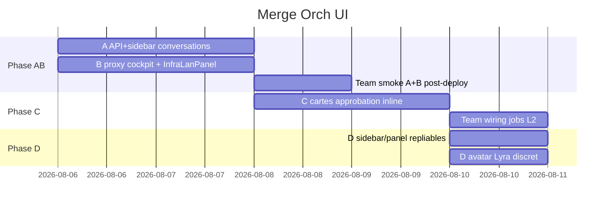

# Plan merge Orch UI — `:5174` shell unique

**Objectif** : une interface proche Cursor (historique gauche, chat centre, contexte droite), sans presets Pilot, en absorbant Assistant `.140` + Cockpit `.8093`.

## Parallélisation



| Phase | Agent Cursor | Team Campus `.140` |
|-------|--------------|------------------|
| **A** | `GET /chat/conversations`, sidebar historique | Smoke `/chat/conversations` + switch `conversation_id` |
| **B** | `GET /monitor/cockpit`, `InfraLanPanel.vue` | Smoke proxy vs snapshot P03 direct |
| **C** | Cartes approbation dans `ChatFlow` | Jobs L2 + pattern `#/team/office` |
| **D** | Panels repliables + polish | Veille smoke LAN surfaces |

## Phase C — livré

- Proxy Orch : `GET /team/pending`, `POST /team/tasks/{id}/approve|run`
- Cartes L2 + chips followup dans `ChatFlow` ; `PendingApprovalsPanel` à droite

## Phase D — livré

- Sidebar gauche repliable (icônes / historique) — `useLayout` + localStorage
- Panneau droit monitoring repliable (rail 40px) — toggles dans `ChatHeader`
- Avatar Lyra discret (coin bas-droit, jauges au clic) — remplace le widget flottant lourd
- ChatInput suit la largeur sidebar (`sm:left-16` / `sm:left-64`)

## Missions Campus (2026-08-06)

| Phase | mission_id | task_ids |
|-------|------------|----------|
| A | `e9e27566-f083-4080-8f46-e3ce50ca95e4` | `cd7a4cfc-…` |
| B | `0e95d548-19ec-4fc2-b792-0875a5faeecc` | `f1ed1111-…`, `3be0c0fa-…` |
| C | `99d8b080-35fa-4c59-b103-6b989e2eb806` | `cc563c2d-…`, `ede6df65-…` (+ demo L2 `69fb84b1-…`) |
| D | `a638d21a-6221-4f1a-8db6-f1d2b990931f` | `ae00064f-…`, `d3633a8d-…` |

## Phase E — layout 5 colonnes (2026-08-06)

```
[ rail icônes ] [ historique ] [ chat ] [ INFRA LAN ] [ monitoring/Lyra ]
```

- Archiver / restaurer / supprimer discussions (`POST …/archive|unarchive`, `DELETE …/{id}`)
- Horodatage relatif (`17m`, `2h`, `3j`) + tooltip date absolue
- Section **Archivées** repliable
- Colonnes INFRA et Monitoring séparées (comme mock image 1)

## Gaps vs mock

| Item | Statut |
|------|--------|
| Logs sous INFRA (dernière tâche Campus) | ✅ `activity` dans `/monitor/cockpit` + UI |
| Barres RAM/Disk | ✅ progress bars dans `InfraLanPanel` |
| Sélecteur Agent / Mode dans l’input | ✅ auto\|team\|cursor\|tools + fast\|balanced\|smart |
| Roster Équipe (cartes + @mention) | ✅ Monitoring — `team_roster` Cockpit |
| @mention → Team Campus | ✅ handles connus → `team:` (UI + backend) |
| Sous-projets + MMO | ✅ colonne INFRA (`InfraLanPanel`) |
| Breadcrumbs Utilisateur / AI / Timeline | ✅ filtres chat + labels AI |
| New Agent / Customize | ✅ stub → mission Thémis / Lyra (pas de factory) |
| Desktop open_app (vghd…) depuis chat | ✅ P1 `desktop` → Cockpit `tasks/run` / worker `.10` |

Smoke parcours :
```bash
bash /home/sdesh/projects/_archive/LBG_IA/orchestrateur/scripts/smoke_orch_pilot.sh
# ou :
curl -sS -X POST http://192.168.0.100:5174/api/ask \
  -H 'Content-Type: application/json' \
  -d '{"prompt":"ouvre vghd sur mon poste","agent":"auto"}'
```

Hors scope :
- `#/team/office` (Phaser) — overlay / nouvel onglet
- `#/chat` lab PNJ — legacy jeu
- Réécriture Cockpit P03 — consommation API uniquement

## Déploiement

```bash
bash /home/sdesh/projects/_archive/LBG_IA/orchestrateur/scripts/deploy_ct100_prod.sh --smoke
```
