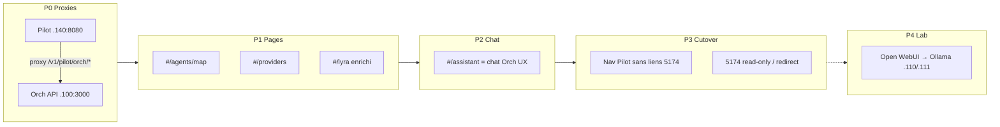

# Plan — Pilot hub + Orch absorbé + Open WebUI lab

**Décision (2026-08-25)** : hub unique = **Pilot** (`http://192.168.0.140:8080/pilot/`).  
Orch UI (`.100:5174`) est **absorbé** puis gelé. Open WebUI = **lab optionnel**, pas le shell Studio.

**Inverse de** [`plan_orch_ui_merge.md`](plan_orch_ui_merge.md) (qui faisait d’Orch le shell unique). Ce document **remplace** cette direction pour O1.

**Contexte inventaire** : Pilot a déjà `#/assistant`, `#/lyra` (contrat Cortex), `#/team*`, jobs, desktop. Orch apporte chat `/ask` + historique serveur, LyraEngineV2, `/agents/map`, `/providers/catalog`, InfraLan / monitor.

---

## Canon / non-objectifs

| Canon | Hors scope |
|-------|------------|
| Shell = Pilot hash routes | Remplacer Pilot par Open WebUI |
| API métier Studio = `/v1/pilot/*` (Cortex) | Fusion Cockpit `.8093` dans Pilot (reste lien Ops) |
| Team L2 / Jobs / Desktop / office_map = Pilot | Porter le layout 5 colonnes Orch *tel quel* |
| Lyra jauges : unifier vers **un** backend (décision P1) | Réintroduire `/mmo/` web legacy |

---

## Pages à porter

| Orch (5174) | Cible Pilot | Priorité | Notes |
|-------------|-------------|----------|--------|
| `/agents/map` | `#/agents/map` | **P1** | Nouvelle page ; nav Campus |
| `/providers/catalog` | `#/providers` | **P1** | Élargit `GET /v1/pilot/ollama/tags` |
| `/lyra` | `#/lyra` **enrichi** | **P1** | Remplacer bac Cortex-only ou dual-mode clair |
| `/` chat + historique | `#/assistant` | **P2** | UX type Open WebUI / Orch (historique, modes) sans quitter Pilot |
| InfraLanPanel / monitor | `#/ops` (panneau) **ou** lien Cockpit | **P2** | Préférer enrichir `#/ops` ; pas d’iframe 5174 |
| FaceRig prioritaire | déjà `#/assistant` | polish P2 | Aligner assets / priorité visuelle |

**Ne pas porter** (déjà mieux dans Pilot) : Team office Phaser, Jobs, Hunt, Desktop détaillé, PM, gameplay debug.

---

## Endpoints

### P0 — proxies same-origin (backend Cortex → `.100:3000`)

Préfixe proposé : `/v1/pilot/orch/*`  
Env : `LBG_ORCH_UI_API_URL=http://192.168.0.100:3000` (défaut).

| Proxy Pilot | Upstream Orch | Usage UI |
|-------------|----------------|----------|
| `POST /v1/pilot/orch/ask` | `POST /ask` | Chat produit (P2) |
| `GET /v1/pilot/orch/chat/conversations` (+ archive/DELETE) | `/chat/conversations*` | Historique (P2) |
| `GET /v1/pilot/orch/lyra/state` | `GET /lyra/state` | `#/lyra` |
| `POST /v1/pilot/orch/lyra/update` | `POST /lyra/update` | `#/lyra` |
| `GET /v1/pilot/orch/agents/map` | `GET /agents/map` | `#/agents/map` |
| `GET /v1/pilot/orch/providers/catalog` | `GET /providers/catalog` | `#/providers` |
| `GET /v1/pilot/orch/monitor/cockpit` | `GET /monitor/cockpit` | `#/ops` (optionnel) |
| `GET /v1/pilot/orch/monitor/agents` | `GET /monitor/agents` | `#/ops` / map |

**Déjà canon Pilot (pas de proxy Orch)** : `/v1/pilot/team/*`, `/jobs*`, `/route`, `/status`, desktop, hunt.

### Décision Lyra (bloquante P1)

Deux moteurs aujourd’hui :

1. **Cortex** — `context.lyra` / `output.lyra` via `/v1/pilot/route`
2. **LyraEngineV2** — `.3000` `/lyra/state|update`

**Choix retenu pour ce plan** : UI `#/lyra` lit/écrit **LyraEngine** via proxy P0 ; le panneau Assistant garde un **miroir lecture** (état Orch) et n’écrit plus de jauges « locales fantômes » sans sync. Un ADR court si on fusionne plus tard les deux stores.

### Décision chat (bloquante P2)

| Mode | Stack | Rôle |
|------|-------|------|
| **Produit** | `#/assistant` → `orch/ask` (+ conversations) | Remplace Home Orch |
| **Lab intention** | `#/chat` → `/v1/pilot/route` | Presets, WS, commits, debug |

Pas de fusion des deux stacks en P2 — seulement UX unifiée côté Assistant.

---

## Ordre de cutover `.5174`

### P0 — Proxies (1–2 j) — **FAIT 2026-08-25**

1. Module `backend/api/v1/routes/pilot/orch_proxy.py` + `LBG_ORCH_UI_API_URL` (défaut `.100:3000`).
2. Routes : `/v1/pilot/orch/{health,ask,lyra/state,lyra/update,agents/map,providers/catalog,monitor/*,chat/conversations*}`.
3. Tests : `backend/tests/test_pilot_orch_proxy.py` (8 pass).
4. Smoke local → amont `.100:3000` OK (lyra/state, agents/map×38, providers, monitor, conversations).
5. **Deploy 140** : redémarrer backend Cortex pour exposer les routes sur `:8080` (pas encore UI).
6. **5174 reste actif** (aucun changement nav).

### P1 — Pages lecture (2–3 j) — **FAIT 2026-08-25**

1. Hash routes `#/agents/map`, `#/providers` via `src/modules/orch_surfaces.js` (patch router, comme hunt).
2. Pages Pilot + nav Campus / Studio / Projet ; Accueil pointe vers hash locaux (lien `5174` = legacy).
3. `#/lyra` : panneau **LyraEngine** (`/v1/pilot/orch/lyra/state|update`) au-dessus du bac route.
4. Smoke : déployer pilot_web (+ backend P0) sur 140, ouvrir `#/agents/map` / `#/providers` / `#/lyra`.

### P2 — Chat produit (3–5 j) — **FAIT (fragile) 2026-08-25**

1. Sidebar conversations + `POST orch/ask` dans `#/assistant` — **FAIT** (`assistant_orch_chat.js`, proxy `GET /chat/context/{id}`).
2. Modes auto|team|cursor|tools — **partiel** ; `/ask` Orch timeout → **repli legacy** `/v1/pilot/route`.
3. Cartes approbation L2 — **reporté**.
4. Panneau infra `#/ops` — **reporté**.
5. Archive/pin/streaming — **reporté**.

### P3 — Cutover 5174 — **ASSOUPLI / RETOUR 2026-08-25**

Le redirect forcé vers Pilot était une **régression** pour le chat unique.  
**Rétabli** : `http://192.168.0.100:5174/` = chat produit Orch (HTTP 200, plus de 302).  
Banner soft → lien Pilot (Studio/ops). API `.3000` inchangée.

| Surface | Rôle |
|---------|------|
| `.100:5174` | **Chat produit** (objectif canal unique) |
| `.140:8080/pilot/` | Hub Studio / équipe / desktop |
| `.100:3080` | Lab Open WebUI |

### P3 — Cutover 5174 (tentative initiale, archivée)

| Étape | Action | État |
|-------|--------|------|
| T0 | Banner Orch UI si `?stay=1` + lien Pilot | fait puis assoupli |
| Redirects nginx | `5174/` → Pilot | **RETIRÉ** |
| API `.3000` | Conservée | **OK** |

### P3 — Cutover 5174 (plan initial, archivé)

| Étape | Action |
|-------|--------|
| T0 | Banner Orch UI : « Migré vers Pilot — lien » |
| T+2j | Nav Pilot : **plus aucun** lien primaire vers `5174` (lien « legacy » dans Projet OK) |
| T+7j | Reverse-proxy / Vite : redirect `5174/*` → `http://192.168.0.140:8080/pilot/#/…` (map des paths) |
| T+14j | Stop process Vite 5174 si redirect OK ; **garder** API `.3000` tant que proxies P0 en dépendent |
| Plus tard | Port logique `/ask` + LyraEngine **dans** Cortex → drop dépendance `.3000` (hors mini-plan) |

Redirects suggérés :

| Ancien | Nouveau |
|--------|---------|
| `5174/` | `8080/pilot/#/assistant` |
| `5174/lyra` | `8080/pilot/#/lyra` |
| `5174/agents/map` | `8080/pilot/#/agents/map` |
| `5174/providers/catalog` | `8080/pilot/#/providers` |

Mettre à jour : `docs/SMOKE_LAN.md`, `docs/REGISTRE.md`, nav Accueil, `tools/smoke_lan_surfaces.sh`.

### Canal unique `#/assistant` — **FAIT 2026-08-25 (v3 auto)**

**Un seul chat** + **routage automatique** (heuristique sur le message, comme Cursor).  
Indicateur `auto · réflexion` / `auto · ops` ; surcharge optionnelle « Forcer » (défaut Auto).

| Intention détectée | Effet |
|--------------------|--------|
| réflexion (défaut) | Envoyer → `/ask` ; chrome proposer/exéc. masqué |
| ops (verbes action, @agent, diagnostic…) | Même saisie ; chrome ops visible |

Plus de switch manuel Discuter/Piloter obligatoire.

### Canal unique `#/assistant` — **FAIT 2026-08-25 (v2)**

**Un seul chat** (stream + saisie). Le switch Discuter | Piloter ne change **que** le routage / chrome ops — pas une 2ᵉ UI.

| Mode | Utilisateur voit | Derrière |
|------|------------------|----------|
| **Discuter** | Même fil, Envoyer, historique | `/ask` (+ repli) ; proposer/exéc. masqués |
| **Piloter** | Même fil + boutons ops | Idem + proposer / dry-run / réel |

Open WebUI `.100:3080` = lab optionnel hors canal (lien Accueil).  
Historique unifié Orch côté Pilot ; pas d’iframe.

### P4 — Open WebUI lab = **Simple Chat** — **FAIT 2026-08-25**

**Intention** : UI chat seule (style panneau Cursor) pour discuter avec les LLM locaux **sans** utiliser le chat Cursor comme cockpit projet.

| Élément | Valeur |
|---------|--------|
| URL | http://192.168.0.100:3080/ |
| Hôte | `.100` (front) — Pilot reste `.140` |
| Compose | `packages/cortex/infra/open_webui/` |
| Deploy | `bash packages/cortex/infra/open_webui/deploy_100.sh` |
| Ollama | `.110:11434` (défaut) ; `.111` à ajouter dans l’UI |
| Lien Pilot | Accueil → carte « Simple Chat » |

1. Docker port **3080** — **FAIT** (compose + deploy script).
2. Providers Ollama matrice locale — **au démarrage**.
3. Lien Pilot Accueil — **FAIT**.
4. **Interdit** : Team / Desktop / approvals via Open WebUI.

### P4 — Open WebUI lab (optionnel, plan initial)

1. Docker sur hôte libre (ex. `.100` ou WSL) : port **3080** (éviter conflit 8080).
2. Providers : Ollama `http://192.168.0.110:11434` + light `.111` (matrice locale).
3. Lien Pilot Accueil / Projet : « Lab LLM (Open WebUI) ».
4. **Interdit** : brancher Team/Desktop/approvals via Open WebUI en P4.

### Suite (après P0–P3, décision séparée) — Docling / AnythingLLM

À évaluer **une fois** le hub Pilot + cutover `.5174` traités. Pas dans le chemin critique O1 UI.

| Outil | Lien | Rôle probable LBG | Verdict provisoire |
|-------|------|-------------------|--------------------|
| **Docling** | [github.com/docling-project/docling](https://github.com/docling-project/docling) | Parse PDF/DOCX/… → Markdown/JSON pour RAG, knowledge Pilot, ingestion docs Studio | **Fort candidat** : brique pipeline (CLI / `docling-serve` / MCP), pas une UI concurrente. S’intègre bien avec Open WebUI (extracteur) ou un store Cortex. |
| **AnythingLLM** | [anythingllm.com](https://anythingllm.com/) | Workspace docs + chat local / desktop | **À trancher** : chevauche Open WebUI (P4) + Assistant Pilot. Utile si besoin fort « knowledge workspaces » / desktop app ; sinon risque 3ᵉ front LLM. Préférer POC court vs Open WebUI avant adoption. |

**Règle** : au plus **un** lab chat générique (Open WebUI *ou* AnythingLLM). Docling = dépendance d’ingestion, compatible avec l’un ou l’autre (et avec RAG Cortex plus tard).

---

## Fichiers touchés (indicatif)

| Zone | Chemins |
|------|---------|
| Proxies | `packages/cortex/backend/api/v1/routes/pilot/orch_proxy.py`, `__init__.py`, settings |
| Router / nav | `pilot_web/index.html`, `pilot_router.js` / chunks, `pilot_assistant.js` (`pilotParseRoute`) |
| Pages | nouveaux `pilot_agents_map.js`, `pilot_providers.js` ; enrichir `pilot_lyra.js`, `pilot_assistant.js` |
| Docs ops | `docs/SMOKE_LAN.md`, `docs/REGISTRE.md`, ce plan |
| Legacy note | Bannière / redirect scripts sous `_archive/LBG_IA/orchestrateur/` (lecture ; changements runtime sur `.100`) |

---

## Critères done

- [x] P0 proxies `/v1/pilot/orch/*` + tests (2026-08-25)
- [x] P1 pages `#/agents/map`, `#/providers`, LyraEngine sur `#/lyra` + deploy 140 (2026-08-25)
- [ ] Plus de dépendance **utilisateur** à `.100:5174` pour Lyra / map / providers / chat Studio
- [ ] Smoke LAN vert avec nouvelles routes + proxies
- [ ] `#/chat` lab et `#/assistant` produit clairement séparés
- [ ] Open WebUI (si déployé) = lien lab uniquement
- [x] `plan_orch_ui_merge.md` marqué **supersédé** en tête de fichier

---

## Première PR concrète (GO immédiat)

**Scope P0 only** :

1. `orch_proxy.py` : ask, lyra state/update, agents/map, providers/catalog (4–6 routes).
2. Tests backend.
3. Doc : ce plan + note supersede sur `plan_orch_ui_merge.md`.
4. Pas d’UI encore (sauf lien debug optionnel).

Ensuite enchaîner P1 pages map + providers (valeur visible rapide, faible risque vs chat).
