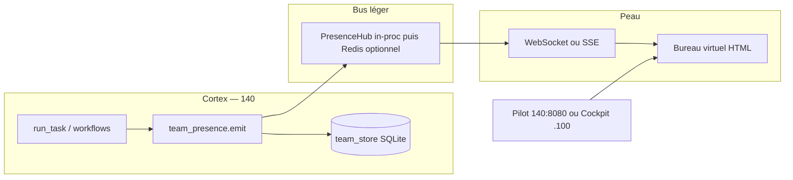

# Plan — Bureau virtuel Team (« boîte de Petri » / Peau)

**Date** : 2026-07-29  
**Statut** : proposition — infra LAN down OK, implémentation par phases  
**Public** : équipe virtuelle (pm, qa, admin_infra, dev_*) + ops  
**Complète** : `plan_lbg_studios_agents_partitions.md` (Peau), Pilot `#/team`, Cockpit P03 `.100:8093`

---

## 1. Objectif

Offrir une **vue vivante** des agents Team : où ils « travaillent », sur quoi, et depuis quand — **sans** bloquer ni ralentir l’exécution réelle (SSH, workflows, LLM sur 110/111/140).

Inspirations : Generative Agents (carte + déplacement), mais **adapté LAN LBG** : bureaux = **zones métier** (Core, Front web, Ollama, PreCU, Prime), pas une simulation sociale complète.

**Principe LBG_SA** : la logique reste **Cortex** (`orchestrator/team`); le rendu est **Peau** (nouvelle route Pilot ou onglet Cockpit).

---

## 2. Architecture cible (découplée)



| Couche | Choix recommandé LAN | Pourquoi |
|--------|----------------------|----------|
| Émission | Hook Python dans `team/roles.py` + workflows | Un seul point après `update_task(status=…)` |
| Bus v1 | **In-memory** `asyncio.Queue` + fan-out WS (process orchestrateur **8010**) | Pas de dépendance Redis tant que 1 instance uvicorn |
| Bus v2 | Redis Pub/Sub (`team:presence`) | Si plusieurs workers / process |
| Transport | **WebSocket** `/v1/team/presence/ws` (FastAPI) | Déjà `websockets` ailleurs dans le monorepo ; push instantané |
| Fallback | `GET /v1/team/presence/snapshot` | Reconnexion client, tests curl |
| UI v1 | **Option B** — grille CSS + cartes (Pilot existant) | Rapide, accessible, même stack que `pilot_web` |
| UI v2 | **Option A** — Phaser tilemap (zone « open space ») | Immersion si la Team valide la métaphore |

**Ne pas** mélanger avec `mmmorpg` WS (245) ni gateway Core3 : protocole et domaine différents.

---

## 3. Modèle de données (normalisé)

Événement **`team.presence.v1`** — publié à chaque transition utile (pas à chaque log ligne).

```json
{
  "schema": "team.presence.v1",
  "agent_id": "admin_infra",
  "display_name": "Atlas",
  "status": "busy",
  "current_action": "Audit dual Ollama 110/111",
  "location": "zone_core",
  "target_destination": null,
  "task_id": "6835b3e1-…",
  "role": "admin_infra",
  "host_hint": "192.168.0.140",
  "trace_id": "…",
  "timestamp": 1782662514
}
```

### Énumérations

| Champ | Valeurs | Règle |
|-------|---------|--------|
| `status` | `idle`, `busy`, `review`, `failed`, `offline` | Map depuis `TeamTask.status` + rôle sans tâche |
| `location` | `zone_core`, `zone_front`, `zone_llm`, `zone_mmo_lab`, `zone_prime`, `zone_coffee` | Dérivé du **workflow** / `LBG_LAN_HOST_*` touché |
| `target_destination` | même enum ou `null` | Animation UI : déplacement entre zones |

### Mapping rôle → zone par défaut

| Rôle Team | Zone initiale | Zone si workflow MMO/Prime |
|-----------|---------------|----------------------------|
| `admin_infra`, `pm`, `qa` | `zone_core` | `zone_mmo_lab` si tâche 245/246 |
| `dev_godot`, `dev_game` | `zone_prime` | — |
| `ops` (jobs système) | selon `actor` | ex. storage → `zone_core` |

Fichier cible : `orchestrator/team/presence.py` (pure functions + emit).

---

## 4. Points d’accroche code (Cortex)

Ordre d’implémentation minimal :

1. **`team_store.update_task`** — après commit DB, appeler `presence.emit_from_task(task, event="status_changed")`.
2. **`run_task`** dans `team/roles.py` — `running` / `done` / `failed` / `review`.
3. **Workflows longs** (`admin_infra_workflow`, `godot_dev_workflow`, …) — `emit` intermédiaire avec `current_action` texte court (≤ 120 car.).
4. **Jobs système** (`system:team_qa_smoke`, Atlas timer) — `agent_id=system:…`, zone fixe.

**Contrainte** : emit **non bloquant** (try/except, jamais de raise vers le runner).

### API REST (140, proxy Pilot)

| Méthode | Route | Rôle |
|---------|-------|------|
| GET | `/v1/team/presence/snapshot` | `{ "agents": [...], "zones": [...], "generated_at": … }` — `zones[]` enrichi (`host`, `host_status`, `host_badge`) |
| GET | `/v1/team/presence/history?limit=50` | Derniers événements (JSONL ring buffer optionnel) |
| WS | `/v1/team/presence/ws` | Push `{ "type": "presence", "payload": … }` |

Enregistrement router : même app que `/v1/pilot/team/*` (backend **8000** ou orchestrateur **8010** — choisir **8010** si Team y est déjà centralisé).

### Annotation hôte zone (Lab SWG / PreCU)

La zone **`zone_mmo_lab`** est **thématique** (personas `dev_game` Dédale/Vulcan) — pas un heartbeat « agents tournent sur `.245` ».

Quand PreCU **`.245`** est injoignable, le snapshot annote la zone :

| Champ zone | Exemple offline |
|------------|-----------------|
| `host_status` | `offline` |
| `host_badge` | `Éteinte` |
| `label` | `Lab SWG (245) · Éteinte` |

- Sonde TCP légère (ports `8050` / `3306` / `8792` / `22`), cache TTL `LBG_ZONE_HOST_PROBE_TTL_SEC` (défaut 30 s).
- Forcer sans sonde : `LBG_ZONE_MMO_LAB_HOST_STATE=off|on`.
- UI : badge ambre vue classic + label carte Phaser (`office_map.setZoneHostStates`).
- Aligné Atlas : PreCU **hors critique** par défaut (`LBG_ATLAS_REQUIRE_PRECU=0`).

---

## 5. Frontend (Peau)

### Phase UI-0 — « Mur de cartes » (Option B, ~2–3 jours dev)

- Nouvelle route Pilot : **`#/team/office`** (ou onglet à côté `#/team`).
- Grille 2×3 zones (libellés FR) :
  - **Open Space Core (140)**
  - **Front web (.100)**
  - **Forge LLM (.110 / .111)**
  - **Lab SWG (245)** — badge **Éteinte** si hôte PreCU down (voir § annotation hôte)
  - **Monde Prime (246)**
  - **Pause café**
- Chaque agent = carte : avatar (initiales / icône rôle), barre statut, `current_action`, lien `task_id` → fil Team existant.
- Connexion WS ; si down → polling snapshot 5 s + bannière « infra down ».
- **Pas de build Vite séparé** si possible : étendre `pilot_web` (même déploiement **140:8080**).

### Phase UI-1 — Mouvement (Option B+)

- Transition CSS `transform` quand `location` → `target_destination` change.
- File d’attente visuelle : tâches `review` clignotent en `zone_core`.

### Phase UI-2 — Carte pixel (Option A) — cible visuelle

**Référence** : Generative Agents / Stanford (carte top-down, sprites, bulles, callouts)  
→ `docs/assets/team_petri_reference_stanford.png`

On vise **le même langage visuel**, adapté LAN LBG — pas le papier de recherche complet.

| Élément Stanford | Version LBG (recommandée) | Plus tard (nice-to-have) |
|------------------|---------------------------|---------------------------|
| Carte tuiles + bâtiments | 1 tilemap « campus LBG » : Core, Front, Forge LLM, Lab SWG, Prime, Café | Intérieurs décorés pièce par pièce |
| Sprites qui marchent | 5–8 sprites rôles + pathfinding grille | Animations assis / clavier / café |
| Bulles initiales | Initiale rôle + couleur statut (`busy`/`idle`…) | Bulle = extrait `current_action` |
| Callouts dialogue | **Panneau latéral** : zoom zone + derniers logs / `task_id` (pas de chat social LLM) | Transcript agent↔agent si Fable5 collab |
| Vie sociale autonome | **Non** — agents = jobs Team réels | Scénarios démo hors prod |

**Stack** : Phaser 3 (lazy-load) dans Pilot `#/team/office?view=map` ; positions = cases dérivées de `location` / `target_destination` (`team.presence.v1`).  
**Fallback** : Option B `?view=classic` (teaser 111 déjà en place).

Carte LBG proposée (simplifiée vs image) :

```
        [ Café ]
           |
[ Front .100 ]--[ Core 140 ]--[ Forge LLM 110/111 ]
           |         |
     [ Lab 245 ]  [ Prime 246 ]
```

Pas de parc / école / appartements : zones = **hôtes métier** uniquement.

### Cockpit P03 (`.100:8093`)

- **V2** : iframe ou lien « Ouvrir mur Team » → `http://192.168.0.140:8080/#/team/office` (same-origin API via proxy `/v1/` déjà en place sur 140).
- Ne pas dupliquer la logique WS dans P03 au début.

---

## 6. Phases projet (feuille de route)

| Phase | Livrable | Critère done |
|-------|----------|--------------|
| **P0 — Spec** | Ce doc + JSON Schema `team.presence.v1` dans `docs/schemas/team/` | Revue Team (pm) |
| **P0.5 — Teaser 111** | Mock Option B sur **111:8096** (`services/team_petri_teaser`) pendant infra 140 down | URL bookmark Team ; WS + snapshot contractuels |
| **P1 — Emit** | `presence.py` + hooks `update_task` / `run_task` | curl snapshot montre Atlas busy pendant un run admin_infra |
| **P2 — WS** | Hub + route WS + tests pytest (client mock) | 1 client reçoit 3 events sur kickoff Team |
| **P3 — UI cartes** | `#/team/office` dans pilot_web | LAN : 5 agents visibles, clic → tâche |
| **P4 — Ops** | Doc runbook + Atlas sonde optionnelle `GET …/snapshot` | Atlas gap si WS KO |
| **P5 — Polish** | Tilemap Phaser `#/team/office?view=map` + fallback classic | Acceptation PO |

**Hors scope v1** : Redis, 3D Three.js, synchronisation avec entités MMO in-game.

---

## 7. Infra / déploiement (LAN)

### Teaser immédiat (infra 140 down) — **111**

| Composant | Hôte | Note |
|-----------|------|------|
| UI + WS mock | **111:8096** | `lbg-team-petri-teaser` — simulateur `team.presence.v1` |
| Install | `infra/scripts/install_team_petri_teaser_111.sh` | Même contrat API que la prod (snapshot + WS) |
| Enrich web (optionnel) | **111:8095** | Sidecar séparé ; pas couplé au bureau |

Bookmark Team : **http://192.168.0.111:8096/**

### Cible prod

| Composant | Hôte | Note |
|-----------|------|------|
| API + WS Team | **140** | `lbg-orchestrator` / `lbg-backend` — vérifier port unique |
| UI | **140:8080** | Nginx proxy `/v1/` → pas de CORS ; route `#/team/office` |
| Données | SQLite team existant | Pas de nouveau SGBD |
| Redis | — | Phase v2 seulement si multi-worker |

Variables env proposées :

```bash
LBG_TEAM_PRESENCE_ENABLED=1
LBG_TEAM_PRESENCE_WS=1
LBG_TEAM_PRESENCE_HISTORY=100   # ring buffer events
# Annotation Lab SWG (.245) — badge Éteinte si PreCU down
# LBG_ZONE_MMO_LAB_HOST_STATE=off   # forcer offline|online (sinon sonde TCP)
# LBG_ZONE_HOST_PROBE_TTL_SEC=30
# LBG_ZONE_HOST_PROBE_TIMEOUT_SEC=0.6
```

---

## 8. Risques et garde-fous

| Risque | Mitigation |
|--------|------------|
| Flood WS (logs verbeux) | Émettre max 1 event / 2 s / agent sauf changement `status` |
| Fuite secrets dans `current_action` | Sanitizer : pas de clés API, tronquer paths home |
| Infra down | UI mode dégradé + dernier snapshot persisté (fichier `/var/lib/…/presence_last.json` optionnel) |
| Confusion avec joueurs IA (Corps) | Namespace strict `team.*` ; pas de mix `player/lia` |

---

## 9. Prochaine action quand le LAN remonte

1. ~~Valider **P0** avec la Team~~ → **P0.5 teaser 111** + **P1–P3 déployés sur 140** (2026-07-30).
2. Bookmark prod : **http://192.168.0.140:8080/#/team/office**
3. Teaser mock 111:8096 peut rester en démo hors Cortex ; le live est sur Pilot.
4. Ensuite : Option A Phaser (`?view=map`) si la Team valide la métaphore pixel.

---

## 10. Références internes

- `orchestrator/team/models.py` — `TeamTask`
- `orchestrator/team/roles.py` — `run_task`
- `docs/plan_lbg_studios_agents_partitions.md` — Peau vs Cortex
- Pilot Team actuel : `/v1/pilot/team/tasks`, `#/team`
- Cockpit infra : `/v1/pilot/cockpit/snapshot` (P03, `.100`)
